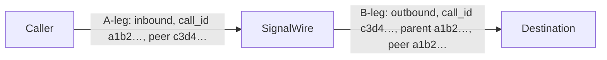

[glossary-call]: /docs/platform/glossary#call
[glossary-call-leg]: /docs/platform/glossary#call-leg
[glossary-segment-id]: /docs/platform/glossary#segment-id
[segment-ids]: /docs/platform/what-is-a-sid
[forward-calls]: /docs/platform/voice/forward-calls
[sip-refer]: /docs/platform/voice/sip-refer
[sip-refer-how]: /docs/platform/voice/sip-refer#how-sip-refer-works
[make-and-receive]: /docs/platform/voice/make-and-receive-calls
[call-queues]: /docs/platform/voice/call-queues
[record-calls]: /docs/platform/voice/record-calls
[swml-connect]: /docs/swml/reference/calling/connect
[swml-transfer]: /docs/swml/reference/calling/transfer
[swml-ai-sidecar]: /docs/swml/reference/calling/ai-sidecar
[server-sdks]: /docs/server-sdks
[call-commands]: /docs/apis/rest/calls/call-commands
[voice-logs]: /docs/apis/rest/voice-logs/list-voice-logs
[recordings]: /docs/apis/rest/recordings/list-call-recordings
[inbound-webhook]: /docs/apis/rest/webhooks/inbound-call-webhook
[cxml-dial]: /docs/compatibility-api/cxml/reference/voice/dial
[compat-list-calls]: /docs/compatibility-api/rest/calls/list-all-calls
[cfb-forward]: /docs/call-flow-builder/reference/forward-to-phone
[subscribers]: /docs/platform/subscribers
[video]: /docs/platform/video
[browser-sdk-aux]: /docs/browser-sdk/v4/reference/errors/auxiliary-leg-cancelled-error
[webhooks]: /docs/platform/webhooks

A forwarded call is one conversation to the people on it. To SignalWire it is two legs: the caller's
connection to your number, and the connection SignalWire dials to the destination. Each leg has its own
Call ID, its own log record, its own status callbacks, and its own charge. Once you can see the legs
in a call, the second log entry, the extra callback, and the unfamiliar ID in a webhook all make sense.

This page explains what a leg is, how legs come into being, how to tell which leg you're looking at,
and what you can do to one leg without touching the other.

## What a call leg is

A [call leg][glossary-call-leg] is the connection between two user agents. A user agent is anything
that can hold up its end of a call: a phone on the public network, a SIP device or PBX, a browser
running the Browser SDK, or SignalWire itself. A [call][glossary-call] is everything the person on the
other end experiences, from the moment it is placed to the moment it ends, and it is made of one or more
legs.

The leg that started the call is the A-leg. A leg SignalWire dials on its behalf is a B-leg. Forward an
inbound call to one SIP endpoint and the call has two legs. Ring four endpoints at once and it has five,
because every destination SignalWire rings is a leg, including the ones that never answer.

<llms-ignore>


</llms-ignore>

<llms-only>



Each leg is its own log record, with its own Segment ID and its own charge. Once bridged, each leg's
peer is the other, and the B-leg also names the A-leg as its parent.

</llms-only>

The Browser SDK also uses the word leg for the connections inside one browser call: the main leg, the
screen-share leg, and the additional-device leg. Each of those [auxiliary legs][browser-sdk-aux] opens
its own connection to SignalWire with its own call ID.

## How legs are created

Every leg starts the same way: someone, or something, dials. The table lists what adds legs to a call
and how many.

| What happens | Legs | What to expect |
|---|---|---|
| A caller dials your number | 1 | The A-leg. Your SWML document, Relay handler, cXML, or call flow runs on it. |
| Your code dials out over the REST Calling API or Relay | 1 | SignalWire places the leg and gives you its ID. It becomes the A-leg of whatever you connect it to next. |
| You connect the call to one destination with SWML [`connect`][swml-connect], Relay `connect` from the [Server SDKs][server-sdks], cXML [`<Dial>`][cxml-dial], or the Call Flow Builder [Forward to Phone][cfb-forward] node | +1 | A B-leg to the destination. When it answers, SignalWire bridges the two legs so the parties hear each other. |
| You dial several destinations in parallel | +1 per destination | Each destination is its own leg. The first to answer is bridged, and the others end. |
| You dial a [Subscriber][subscribers] | +1 per registered device or endpoint | Every phone, browser, and SIP endpoint registered to the Subscriber rings as its own leg. The leg that answers wins. |
| You connect a queued caller to an agent | 0 | The waiting caller is one leg and the agent's call is another, placed when the agent dialed in or your code dialed out. A `connect` to the [queue][call-queues] bridges those two existing legs. |
| Participants join a conference or [video room][video] | 0 | Each participant joins the room on the leg they already have, whether they arrived by phone, SIP, or browser. |
| You transfer a SIP call with [SIP REFER][sip-refer] | 0 | The SIP device places the new call itself, and your app hangs up SignalWire's leg once the transfer succeeds. See [how SIP REFER works][sip-refer-how]. |
| You move a leg to a new SWML document with [`transfer`][swml-transfer] | 0 | The same leg continues under new instructions. Its Call ID and variables carry over. |

[Forward calls][forward-calls] walks through the two-leg case with code, and
[Make and receive calls][make-and-receive] covers the single-leg start.

## What each leg keeps

Each leg carries its own state: a direction, a `from` and `to`, a call state with its own start, answer,
and end times, and its own log record. On a B-leg, `from` is the caller ID you chose and `to` is the
destination, so the same call looks different depending on which leg reports it.

In SWML, each leg has its own `call` object and its own variables.

<Markdown src="/snippets/swml/_vars-per-leg.mdx" />

The AI agent's `global_data` follows the same rule. It persists across AI sessions on one leg through
the `ai_agents_global_data` variable, as the [AI sidecar reference][swml-ai-sidecar] describes, and it
does not cross to another leg.

## Tell legs apart

Every surface identifies legs with the same handful of fields under slightly different names. The
[glossary][glossary-segment-id] lists all of them side by side. The ones below relate legs to each
other.

A Call ID names one leg for its whole life, and every leg in a call has a different one. A Segment ID
names the leg's log record, and it is the value to quote to Support. A leg's first segment reuses its
Call ID, so the two match for most calls. When SignalWire re-routes a leg to a new handler, a new
segment starts on the same leg: the Segment ID changes and the Call ID does not. That happens when a
SIP device sends SignalWire a REFER, and when cXML transfers the call. The Compatibility API calls the
Segment ID `CallSid`, and the [Segment IDs page][segment-ids] shows where to find it in the Dashboard.

The parent is the leg that created this one. SWML webhooks and status callbacks send it as `parent`,
the REST voice logs and Calling API as `parent_id`, and the Compatibility API as `ParentCallSid`. The
peer is the leg this one is connected to. It arrives as `peer` in `connect` status callbacks and in Relay
connect events. A dialed leg has its peer from the moment it's created, so a `confirm` script can read
it. SignalWire clears it when the bridge ends, so a SWML document that resumes after `connect` has no
`call.peer`.

Two more fields say which leg won and which legs belong together. The `dial_winner` flag marks the leg
that answered a Relay or Calling API `dial`, including the winning device of a parallel dial. Legs that
a `connect` dials don't carry it. A tag is a label you set on a Relay `dial` or `connect` request. Every
leg that request creates shares it, and SignalWire echoes it on those legs' own events and as `peer.tag`
in the `connected` event of the leg that issued the `connect`.

Here is the `call` object a `confirm` script receives on the B-leg of a `connect`, abridged to the fields
above. The leg is outbound, its `segment_id` still matches its `call_id`, and both its `parent` and its
`peer` are the A-leg:

```json
{
  "call_id": "c3d4e5f6-2222-3333-4444-555566667777",
  "segment_id": "c3d4e5f6-2222-3333-4444-555566667777",
  "call_state": "answered",
  "direction": "outbound",
  "type": "phone",
  "from": "+15551230002",
  "to": "+15551230003",
  "parent": {
    "call_id": "a1b2c3d4-1111-2222-3333-444455556666"
  },
  "peer": {
    "call_id": "a1b2c3d4-1111-2222-3333-444455556666"
  }
}
```

The full field list is in the [inbound call webhook reference][inbound-webhook].

## Where legs show up

| Surface | How legs appear |
|---|---|
| Dashboard logs | Each leg is its own entry under **Logs**, and the detail view shows its Segment ID. |
| REST voice logs | The [voice logs][voice-logs] return one entry per leg. A B-leg's `parent_id` points at the leg that created it, which is how you reassemble a call from its legs. |
| Compatibility API | [List all Calls][compat-list-calls] accepts a `ParentCallSid` filter that returns the legs a given leg created, and a `<Dial>` sends the new leg's `DialCallSid` to its `action` URL. |
| Status callbacks | Each leg reports its own state changes to its own callback URL. `connect` callbacks include the `peer` from the moment the legs are bridged, including the `disconnected` callback. [Webhooks][webhooks] explains the delivery rules. |
| Recordings | A recording belongs to a leg. The [Recordings API][recordings] names the leg in a field for its type, such as `relay_pstn_leg_id`, and that value is not the leg's Call ID or Segment ID. A stereo recording puts the two sides of a bridged call on separate channels, as the [record calls guide][record-calls] describes. |

## Act on one leg or both

Because the legs are separate, what happens when one ends depends on which one it is. When the dialed
leg hangs up, the leg that connected it carries on: a SWML document continues past its `connect`, and
by default a Relay handler receives the disconnected event. When the leg that issued `connect` hangs up,
SignalWire hangs up the dialed leg too, because nothing else controls it. A `connect` to a queue is the
exception. Once the agent and the caller are bridged, the agent's document doesn't resume, and
`execute_after_queue` decides what the agent's leg does next.

To break the bridge and keep this leg, send the REST Calling API's `calling.disconnect`
[command][call-commands] or the Relay disconnect method to the leg that issued `connect`. Your code can
then play a message or connect the caller somewhere else. The other leg doesn't hang up: it stays up and
parked, and no event fires for it, so hang it up or connect it yourself.

Two operations change a call without adding a leg. [SIP REFER][sip-refer] asks the SIP device to place
the next call itself. When it succeeds, your app hangs up SignalWire's leg and the call continues
without SignalWire. SWML [`transfer`][swml-transfer] moves the same leg to a new document, and nothing
about the leg changes except what runs on it.

## Legs and billing

Each leg is billed on its own, and each voice log entry carries its own `charge` and `charge_details`.
A forwarded call therefore produces two entries: the caller's inbound leg to your number, and the
outbound leg SignalWire dialed to the destination. A parallel dial produces an entry for every
destination SignalWire dialed, including the ones that never answered.

## Next steps

<CardGroup cols={2}>
  <Card title="Forward calls" icon="regular phone-arrow-right" href="/docs/platform/voice/forward-calls">
    Build the two-leg call with SWML or Relay, and decide what the caller hears when nobody answers.
  </Card>
  <Card title="Transfer calls with SIP REFER" icon="regular arrow-right-arrow-left" href="/docs/platform/voice/sip-refer">
    Hand a SIP call to a new target without keeping a SignalWire leg.
  </Card>
  <Card title="Make and receive calls" icon="regular phone" href="/docs/platform/voice/make-and-receive-calls">
    Place and answer the single-leg call every other guide builds on.
  </Card>
  <Card title="Segment IDs" icon="regular fingerprint" href="/docs/platform/what-is-a-sid">
    Find a leg's Segment ID in the Dashboard and include it in a support ticket.
  </Card>
</CardGroup>
