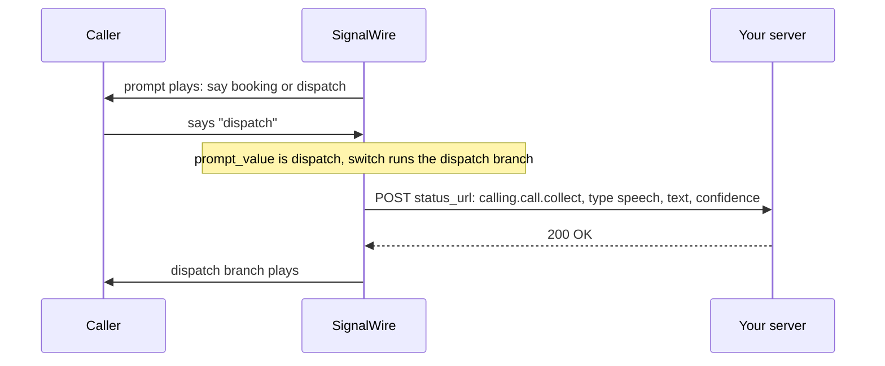
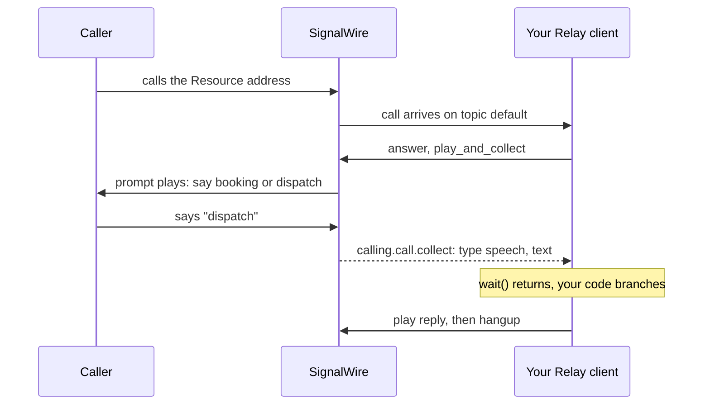

[answer-relay]: /docs/platform/voice/make-and-receive-calls#answer-a-call-via-websocket-relay
[api-credentials]: /docs/platform/your-signalwire-api-space
[cfb]: /docs/call-flow-builder
[cfb-answer]: /docs/call-flow-builder/reference/answer-call
[cfb-forward]: /docs/call-flow-builder/reference/forward-to-phone
[cfb-gather]: /docs/call-flow-builder/reference/gather-input
[cfb-hangup]: /docs/call-flow-builder/reference/hangup-call
[cfb-play]: /docs/call-flow-builder/reference/play-audio-or-tts
[cfb-version]: /docs/call-flow-builder/guides/version
[control-flow]: /docs/swml/guides/goto-execute-transfer-disambiguation
[create-swml-script]: /docs/platform/voice/make-and-receive-calls#create-the-swml-script
[forward-relay]: /docs/platform/voice/forward-calls#forward-an-incoming-call-via-websocket-relay
[forward-swml]: /docs/platform/voice/forward-calls#forward-an-incoming-call-via-swml
[how-incoming]: /docs/platform/voice/make-and-receive-calls#how-an-incoming-call-reaches-your-code
[make-receive]: /docs/platform/voice/make-and-receive-calls
[relay-client]: /docs/server-sdks/guides/relay-client
[rest-calling]: /docs/apis/rest/calls/call-commands
[server-sdks]: /docs/server-sdks
[speak-rest]: /docs/platform/voice/speak-text#speak-text-on-a-call-in-progress-via-rest
[speak-text]: /docs/platform/voice/speak-text
[swml]: /docs/swml
[swml-goto]: /docs/swml/reference/calling/goto
[swml-prompt]: /docs/swml/reference/calling/prompt
[swml-switch]: /docs/swml/reference/calling/switch
[swml-transfer]: /docs/swml/reference/calling/transfer

Ask the caller a question, collect what they say or press, and send the call down a branch based
on the answer. That one pattern is a department menu, a yes-or-no confirmation, or a request for
an account number, and it works the same whether the call reached your flow from a phone number, a
SIP address, or a browser. Start by asking one question and branching on the reply, then handle
silence and unmatched replies, track what the flow heard, and extend the prompt to keypad digits
and a retry.

## Pick the right product for collecting caller input

| Function | SWML | WebSocket (Relay) | REST | Call Flow Builder |
|---|---|---|---|---|
| Ask a question and branch on the answer without running a server | <Icon icon="regular circle-check" color="var(--status-success)" /> | <Icon icon="regular circle-xmark" color="var(--status-error)" /> | <Icon icon="regular circle-xmark" color="var(--status-error)" /> | <Icon icon="regular circle-check" color="var(--status-success)" /> |
| Collect speech, keypad digits, or both on one prompt | <Icon icon="regular circle-check" color="var(--status-success)" /> | <Icon icon="regular circle-check" color="var(--status-success)" /> | <Icon icon="regular circle-check" color="var(--status-success)" /> | <Icon icon="regular circle-check" color="var(--status-success)" /> |
| Play the question and collect the reply in one command | <Icon icon="regular circle-check" color="var(--status-success)" /> | <Icon icon="regular circle-check" color="var(--status-success)" /> | <Icon icon="regular circle-xmark" color="var(--status-error)" /> | <Icon icon="regular circle-check" color="var(--status-success)" /> |
| Tell silence apart from a reply that matched nothing | <Icon icon="regular circle-check" color="var(--status-success)" /> | <Icon icon="regular circle-check" color="var(--status-success)" /> | <Icon icon="regular circle-check" color="var(--status-success)" /> | <Icon icon="regular circle-check" color="var(--status-success)" /> |
| Compare the reply in your own code while the call is live | <Icon icon="regular circle-xmark" color="var(--status-error)" /> | <Icon icon="regular circle-check" color="var(--status-success)" /> | <Icon icon="regular circle-check" color="var(--status-success)" /> | <Icon icon="regular circle-xmark" color="var(--status-error)" /> |
| Collect input on a call another process answered, by its call ID | <Icon icon="regular circle-xmark" color="var(--status-error)" /> | <Icon icon="regular circle-xmark" color="var(--status-error)" /> | <Icon icon="regular circle-check" color="var(--status-success)" /> | <Icon icon="regular circle-xmark" color="var(--status-error)" /> |
| Build the menu visually, with no code | <Icon icon="regular circle-xmark" color="var(--status-error)" /> | <Icon icon="regular circle-xmark" color="var(--status-error)" /> | <Icon icon="regular circle-xmark" color="var(--status-error)" /> | <Icon icon="regular circle-check" color="var(--status-success)" /> |

- [SWML][swml] is a JSON or YAML document that SignalWire runs step by step. Generate it with the
  [Server SDKs][server-sdks] or write it by hand, then host it in your Space or serve it from your
  own server. Its `prompt` method asks and collects in one step.
- [Relay][relay-client] is the WebSocket client in the Server SDKs. Your process receives the call,
  plays the question, and gets the reply back as a value it can compare.
- The [REST Calling API][rest-calling] sends the same collect command over HTTP to a call you
  already hold the ID for. The reply arrives as a webhook.
- [Call Flow Builder][cfb] is a visual editor in the Dashboard. Its Gather Input node asks,
  collects, and branches without code.

The Browser SDK places and receives calls from a web page. It is the caller or the callee, never
the flow, so it has no column here.

## Prepare to collect caller input

Start from working inbound call setup in [Make and receive calls][make-receive]: a SWML Script,
Relay Application, or Call Flow that a call can reach. This guide picks up once a call reaches your
flow. [How an incoming call reaches your code][how-incoming] explains why the same flow answers a
phone number, a SIP address, a browser call, or the Dashboard's **Click-to-Test** button. To pick a
voice for the questions, see [Speak text on a call][speak-text].

Have these values ready:

- Your Space URL, such as `<YOUR_SPACE>.signalwire.com`.
- For the Relay and REST paths, your Project ID and an API token from the Dashboard's
  [API credentials][api-credentials] page, with the **Voice** permission enabled. A hosted SWML
  script or a Call Flow needs no credentials.
- For SWML served from your own server, Python 3 or Node.js and a tunnel such as
  [ngrok](https://ngrok.com/download).

Replace these placeholders in the samples. The hosted SWML and Call Flow Builder paths use none of
them.

| Value | Replace with |
|---|---|
| `<YOUR_SPACE>` | Your Space's subdomain in `<YOUR_SPACE>.signalwire.com` |
| `<YOUR_PROJECT_ID>` | Your Project ID |
| `<YOUR_API_TOKEN>` | Your API token, used only in server code |
| `<YOUR_BASIC_AUTH_PASSWORD>` | A password you choose; SignalWire presents it when it fetches a served SWML document |
| `<YOUR_CALL_ID>` | The ID of a call in progress, for the REST samples |
| `<YOUR_STATUS_WEBHOOK_URL>` | A public HTTPS URL on your server that accepts POST requests |

## Ask a question and branch on the answer

In every surface the pattern is the same: play a question, wait for input, compare the result, and
continue down one path. Bayview Taxi asks callers to say "booking" or "dispatch". Speech hints tell
the recognizer which words to expect, which makes short single-word replies reliable.

### Ask a question and branch via SWML

Three methods do the work. [`prompt`][swml-prompt] plays the question and waits. Setting any
speech parameter, such as `speech_hints`, switches it from keypad digits to speech; the recognized
text lands in the `prompt_value` variable and the outcome in `prompt_result`.
[`switch`][swml-switch] compares a variable against case keys and runs the matching list, or
`default` when nothing matches. [`transfer`][swml-transfer] jumps to another section and does not
return.

The `booking` and `dispatch` sections each speak a different line, and `no_match` catches
everything else. The [Server SDKs][server-sdks] build the document with the SWML builder and serve
it over HTTP; the YAML and JSON forms are what you paste into a hosted script. The builder's
methods append to `main`; the named sections go through the service.

<CodeBlocks>
<CodeBlock title="Python — SWML builder">
```python
# Install: python -m pip install signalwire-sdk==3.4.1
# Save as collect_input.py and run: python collect_input.py
from signalwire import SWMLBuilder, SWMLService

service = SWMLService(
    name="collect-input",
    route="/swml",
    port=3000,
    basic_auth=("signalwire", "<YOUR_BASIC_AUTH_PASSWORD>"),
)
(
    SWMLBuilder(service)
    .answer()
    .prompt(
        play=["say:Thanks for calling Bayview Taxi. Say booking or dispatch."],
        speech_hints=["booking", "dispatch"],
    )
    .switch(
        variable="prompt_value",
        case={
            "booking": [{"transfer": {"dest": "booking"}}],
            "dispatch": [{"transfer": {"dest": "dispatch"}}],
        },
        default=[{"transfer": {"dest": "no_match"}}],
    )
)

# The builder appends to the main section. Named sections go through the service.
service.add_verb_to_section("booking", "play", {"url": "say:You said booking."})
service.add_verb_to_section("booking", "hangup", {})

service.add_verb_to_section("dispatch", "play", {"url": "say:You said dispatch."})
service.add_verb_to_section("dispatch", "hangup", {})

service.add_verb_to_section("no_match", "play", {"url": "say:Sorry, I didn't catch that. Goodbye."})
service.add_verb_to_section("no_match", "hangup", {})

service.serve()
```
</CodeBlock>
<CodeBlock title="TypeScript — SWML builder">
```typescript
// Install: npm install @signalwire/sdk@2.0.5
// This sample also runs as JavaScript: save as collect-input.mjs,
// then run: node collect-input.mjs
import { SWMLService } from "@signalwire/sdk";

const service = new SWMLService({
  name: "collect-input",
  route: "/swml",
  port: 3000,
  basicAuth: ["signalwire", "<YOUR_BASIC_AUTH_PASSWORD>"],
});
const swml = service.getBuilder();

swml
  .answer()
  .prompt({
    play: ["say:Thanks for calling Bayview Taxi. Say booking or dispatch."],
    speech_hints: ["booking", "dispatch"],
  })
  .switch({
    variable: "prompt_value",
    case: {
      booking: [{ transfer: { dest: "booking" } }],
      dispatch: [{ transfer: { dest: "dispatch" } }],
    },
    default: [{ transfer: { dest: "no_match" } }],
  });

// The builder's verb methods append to the main section. Named sections use addVerbToSection.
swml.addVerbToSection("booking", "play", { url: "say:You said booking." });
swml.addVerbToSection("booking", "hangup", {});

swml.addVerbToSection("dispatch", "play", { url: "say:You said dispatch." });
swml.addVerbToSection("dispatch", "hangup", {});

swml.addVerbToSection("no_match", "play", { url: "say:Sorry, I didn't catch that. Goodbye." });
swml.addVerbToSection("no_match", "hangup", {});

await service.serve();
```
</CodeBlock>
<CodeBlock title="YAML">
```yaml
version: 1.0.0
sections:
  main:
    - answer: {}
    - prompt:
        play:
          - "say:Thanks for calling Bayview Taxi. Say booking or dispatch."
        speech_hints:
          - booking
          - dispatch
    - switch:
        variable: prompt_value
        case:
          booking:
            - transfer:
                dest: booking
          dispatch:
            - transfer:
                dest: dispatch
        default:
          - transfer:
              dest: no_match
  booking:
    - play:
        url: "say:You said booking."
    - hangup: {}
  dispatch:
    - play:
        url: "say:You said dispatch."
    - hangup: {}
  no_match:
    - play:
        url: "say:Sorry, I didn't catch that. Goodbye."
    - hangup: {}
```
</CodeBlock>
<CodeBlock title="JSON">
```json
{
  "version": "1.0.0",
  "sections": {
    "main": [
      { "answer": {} },
      {
        "prompt": {
          "play": ["say:Thanks for calling Bayview Taxi. Say booking or dispatch."],
          "speech_hints": ["booking", "dispatch"]
        }
      },
      {
        "switch": {
          "variable": "prompt_value",
          "case": {
            "booking": [{ "transfer": { "dest": "booking" } }],
            "dispatch": [{ "transfer": { "dest": "dispatch" } }]
          },
          "default": [{ "transfer": { "dest": "no_match" } }]
        }
      }
    ],
    "booking": [
      { "play": { "url": "say:You said booking." } },
      { "hangup": {} }
    ],
    "dispatch": [
      { "play": { "url": "say:You said dispatch." } },
      { "hangup": {} }
    ],
    "no_match": [
      { "play": { "url": "say:Sorry, I didn't catch that. Goodbye." } },
      { "hangup": {} }
    ]
  }
}
```
</CodeBlock>
</CodeBlocks>

`add_verb_to_section` and `addVerbToSection` create a section on first use and append to it after
that. `switch` compares the whole value exactly. SignalWire lowercases recognized speech and strips
its punctuation before storing it in `prompt_value`, so "Booking." still matches the `booking`
case, but "booking please" does not. SWML also has a `cond` method that branches on a JavaScript
expression; the Python SDK cannot emit it, because `add_verb` takes only object-valued methods and
`cond` takes a list, so the SWML samples in this guide branch with `switch`.

Run the program and point an External URL SWML Script at it through your tunnel, or paste the YAML
or JSON into a Hosted Script, as in [Create the SWML Script][create-swml-script]. To put dispatch
callers through to a person instead of playing a line, the `dispatch` section can
[connect the call to a phone][forward-swml].

Then open the Resource under **My Resources** and select **Click-to-Test**, under the Resource's
name. A new tab opens, shows "Connecting", and places a browser call to the Resource. Allow
microphone access if the browser asks. Call three times: say "booking", say "dispatch", and say
nothing. You hear a different line each time.

If you don't, match the symptom:

- **The call connects but stays silent.** The flow never ran. For a served document, request it
  through the tunnel with `curl` to confirm it still answers, then check that the Resource's
  **Primary Script URL** carries the same hostname and password. For a hosted script, reopen it and
  confirm the document saved with a `main` section.
- **`curl` returns 401.** The password in the request differs from the one in the sample's
  `basic_auth`.
- **Every call ends in the `no_match` line.** The recognized text did not equal a case key.
  [Track what the flow heard](#track-what-the-flow-heard) shows the text SignalWire stored.
- **Click-to-Test is disabled.** It appears only on Resources that handle calls and have an
  address. Open the Resource's **Addresses & Phone Numbers** tab and add an alias.

### Ask a question and branch via WebSocket (Relay)

The [Server SDKs][server-sdks] expose the prompt as `play_and_collect` on the call. It plays the
question and resolves when input arrives, times out, or fails. The result carries a `type` of
`speech`, `digit`, `no_input`, or `no_match`, and for speech the recognized `text` with a
`confidence` score. Your code compares the text and continues.

<CodeBlocks>
<CodeBlock title="Python — Relay client">
```python
# Install: python -m pip install signalwire-sdk==3.4.1
# Save as collect_input_relay.py and run: python collect_input_relay.py
from signalwire.relay import RelayClient

client = RelayClient(
    project="<YOUR_PROJECT_ID>",
    token="<YOUR_API_TOKEN>",
    host="<YOUR_SPACE>.signalwire.com",
    contexts=["default"],
)


@client.on_call
async def handle_call(call):
    await call.answer()

    action = await call.play_and_collect(
        media=[{"type": "tts", "params": {"text": "Thanks for calling Bayview Taxi. Say booking or dispatch."}}],
        collect={"speech": {"hints": ["booking", "dispatch"], "language": "en-US"}},
    )
    event = await action.wait()
    result = event.params.get("result", {})

    heard = ""
    if result.get("type") == "speech":
        heard = result.get("params", {}).get("text", "").lower()

    if "booking" in heard:
        reply = "You said booking."
    elif "dispatch" in heard:
        reply = "You said dispatch."
    else:
        reply = "Sorry, I didn't catch that. Goodbye."

    async def hang_up_after_playback(_event):
        if call.state != "ended":
            await call.hangup()

    await call.play(
        [{"type": "tts", "params": {"text": reply}}],
        on_completed=hang_up_after_playback,
    )
    await call.wait_for_ended()


client.run()
```
</CodeBlock>
<CodeBlock title="TypeScript — Relay client">
```typescript
// Install: npm install @signalwire/sdk@2.0.5
// Save as collect-input-relay.mts and run: npx tsx collect-input-relay.mts
import { RelayClient } from "@signalwire/sdk";

const client = new RelayClient({
  project: "<YOUR_PROJECT_ID>",
  token: "<YOUR_API_TOKEN>",
  host: "<YOUR_SPACE>.signalwire.com",
  contexts: ["default"],
});

client.onCall(async (call) => {
  await call.answer();

  const action = await call.playAndCollect(
    [{ type: "tts", text: "Thanks for calling Bayview Taxi. Say booking or dispatch." }],
    { speech: { hints: ["booking", "dispatch"], language: "en-US" } },
  );
  const event = await action.wait();
  const result = (event.params.result ?? {}) as {
    type?: string;
    params?: { text?: string };
  };

  const heard = result.type === "speech" ? (result.params?.text ?? "").toLowerCase() : "";

  let reply = "Sorry, I didn't catch that. Goodbye.";
  if (heard.includes("booking")) reply = "You said booking.";
  else if (heard.includes("dispatch")) reply = "You said dispatch.";

  await call.play([{ type: "tts", text: reply }], {
    onCompleted: async () => {
      if (call.state !== "ended") await call.hangup();
    },
  });
  await call.waitForEnded();
});

await client.run();
```
</CodeBlock>
</CodeBlocks>

Because the comparison runs in your code, you can match loosely: `"booking" in heard` accepts
"booking please" as well as "booking". To put dispatch callers through to a person,
[connect the call to a phone][forward-relay] instead of playing the reply.

Run the client and create a Relay Application Resource whose **Topic** is `default`, the value in
the client's `contexts`, as in [Answer a call via WebSocket (Relay)][answer-relay]. Then open the
Resource under **My Resources**, select **Click-to-Test**, and call three times to hear the three
outcomes. If the client logs an authentication error at startup, the project, token, and Space do
not belong together. If the call connects but stays silent, check that the client process is still
running and that the Resource's **Topic** matches its `contexts`.

Over REST, the same collect runs as the `calling.collect` command on a call you already hold the
ID for, such as one a hosted script answered. REST can't play the question and collect in one
command, so [speak the question with `calling.play`][speak-rest] first. The reply arrives at
`status_url` as a `calling.call.collect` event instead of a return value, and `control_id` names
the collect so you can match the event to it.

<CodeBlocks>
<CodeBlock title="Python — REST client">
```python
# Install: python -m pip install signalwire-sdk==3.4.1
# Save as collect_rest.py and run: python collect_rest.py
from signalwire.rest import RestClient

client = RestClient(
    project="<YOUR_PROJECT_ID>",
    token="<YOUR_API_TOKEN>",
    host="<YOUR_SPACE>.signalwire.com",
)

# signalwire-sdk 3.4.1 has no status_url argument; extras merges it into the command's params.
client.calling.collect(
    "<YOUR_CALL_ID>",
    control_id="collect-1",
    speech={"hints": ["booking", "dispatch"], "language": "en-US"},
    extras={"status_url": "<YOUR_STATUS_WEBHOOK_URL>"},
)
```
</CodeBlock>
<CodeBlock title="TypeScript — REST client">
```typescript
// Install: npm install @signalwire/sdk@2.0.5
// This sample also runs as JavaScript: save as collect-rest.mjs,
// then run: node collect-rest.mjs
import { RestClient } from "@signalwire/sdk";

const client = new RestClient({
  project: "<YOUR_PROJECT_ID>",
  token: "<YOUR_API_TOKEN>",
  host: "<YOUR_SPACE>.signalwire.com",
});

await client.calling.collect("<YOUR_CALL_ID>", {
  control_id: "collect-1",
  speech: { hints: ["booking", "dispatch"], language: "en-US" },
  status_url: "<YOUR_STATUS_WEBHOOK_URL>",
});
```
</CodeBlock>
<CodeBlock title="cURL — Calling API">
```bash
# Runs against a call that is already answered; play the question first with calling.play.
curl --request POST "https://<YOUR_SPACE>.signalwire.com/api/calling/calls" \
  --user "<YOUR_PROJECT_ID>:<YOUR_API_TOKEN>" \
  --header "Content-Type: application/json" \
  --data '{
    "id": "<YOUR_CALL_ID>",
    "command": "calling.collect",
    "params": {
      "control_id": "collect-1",
      "speech": { "hints": ["booking", "dispatch"], "language": "en-US" },
      "status_url": "<YOUR_STATUS_WEBHOOK_URL>"
    }
  }'
```
</CodeBlock>
</CodeBlocks>

The [Calling API reference][rest-calling] documents every `calling.collect` field.

### Ask a question and branch via Call Flow Builder

Open **Tools** > **Call Flow Builder** in the Dashboard, select **Add New**, name the flow, and
select **Save**. Open the flow's **More Options** menu and select **Edit** to reach the canvas.
Every flow starts from the **Handle Call** node. Connect these nodes in order:

1. [**Answer Call**][cfb-answer].
2. [**Gather Input**][cfb-gather], with "Thanks for calling Bayview Taxi. Say booking or dispatch."
   as its Text to Speech. Every input option pairs a key with a word: add one option with
   **Caller presses** `1` and **Or says** `booking`, and a second with `2` and `dispatch`. The node
   grows one output connector per option, plus **Unknown** and **No Input**.
3. A [**Play Audio or TTS**][cfb-play] node on each option's connector, with the matching line,
   and a [**Hangup Call**][cfb-hangup] node after each. To put dispatch callers through to a
   person, use a [**Forward to Phone**][cfb-forward] node instead.

Leave **Unknown** and **No Input** for the next task. Select **Deploy** to make this version the
live one; the [versioning guide][cfb-version] explains how deployed and draft versions relate. A
deployed Call Flow is a Resource under **My Resources**, so **Click-to-Test** works here too: call
three times and hear the three outcomes.

## Handle silence and unmatched speech

A caller who says nothing, or says something the flow did not plan for, must still get an answer.
Each surface reports the two cases separately, so the flow can say something different for each.

### Handle silence and unmatched speech via SWML

After `prompt`, `prompt_result` is `match_speech`, `no_input`, `no_match`, or `failed`, and
`match_digits` once keypad input is enabled. The `default` case already routes everything but a
match to `no_match`; this change makes that section say which one happened, using a JavaScript
expression inside the spoken text. Only the `no_match` section changes.

<CodeBlocks>
<CodeBlock title="Python — SWML builder">
```python {1-6}
service.add_verb_to_section(
    "no_match",
    "play",
    {"url": "say:${prompt_result == 'no_input' ? \"I didn't hear anything.\" : \"I didn't understand that.\"} Goodbye."},
)
service.add_verb_to_section("no_match", "hangup", {})
```
</CodeBlock>
<CodeBlock title="TypeScript — SWML builder">
```typescript {1-4}
swml.addVerbToSection("no_match", "play", {
  url: "say:${prompt_result == 'no_input' ? \"I didn't hear anything.\" : \"I didn't understand that.\"} Goodbye.",
});
swml.addVerbToSection("no_match", "hangup", {});
```
</CodeBlock>
<CodeBlock title="YAML">
```yaml {3}
  no_match:
    - play:
        url: "say:${prompt_result == 'no_input' ? \"I didn't hear anything.\" : \"I didn't understand that.\"} Goodbye."
    - hangup: {}
```
</CodeBlock>
<CodeBlock title="JSON">
```json {2}
    "no_match": [
      { "play": { "url": "say:${prompt_result == 'no_input' ? \"I didn't hear anything.\" : \"I didn't understand that.\"} Goodbye." } },
      { "hangup": {} }
    ]
```
</CodeBlock>
</CodeBlocks>

The wait for input before `no_input` is five seconds by default; `prompt.initial_timeout` changes
it.

### Handle silence and unmatched speech via WebSocket (Relay)

The collect result's `type` is `no_input` when the caller stayed silent and `no_match` when speech
arrived but matched nothing. Replace the reply selection in the Relay sample:

<CodeBlocks>
<CodeBlock title="Python — Relay client">
```python {1-8}
    if "booking" in heard:
        reply = "You said booking."
    elif "dispatch" in heard:
        reply = "You said dispatch."
    elif result.get("type") == "no_input":
        reply = "I didn't hear anything. Goodbye."
    else:
        reply = "I didn't understand that. Goodbye."
```
</CodeBlock>
<CodeBlock title="TypeScript — Relay client">
```typescript {1-4}
  let reply = "I didn't understand that. Goodbye.";
  if (heard.includes("booking")) reply = "You said booking.";
  else if (heard.includes("dispatch")) reply = "You said dispatch.";
  else if (result.type === "no_input") reply = "I didn't hear anything. Goodbye.";
```
</CodeBlock>
</CodeBlocks>

### Handle silence and unmatched speech via Call Flow Builder

Connect the **Gather Input** node's **No Input** connector to a **Play Audio or TTS** node that
says "I didn't hear anything. Goodbye.", and its **Unknown** connector to one that says "I didn't
understand that. Goodbye." Connect both to a **Hangup Call** node and select **Deploy**.

## Track what the flow heard

Three places show what happened on the call: the Dashboard's call log, a webhook you host, and the
Relay client's own event stream.

### See the flow's steps in the Dashboard

Open **Logs** > **Voice** in the Dashboard and select the most recent call. The call's timeline
lists each step the flow ran in order: the call state changes, a **Play** entry for each spoken
line, and a **Collect** entry for the prompt. Select an entry to see its details. A document that
fails to load or contains an invalid method shows a **Script Warning** or **Error** entry with the
reason, so a broken flow is visible here without a support ticket.

The timeline records that input was collected, not what the caller said. For the recognized text
itself, use one of the two paths below.

### Receive the result via SWML

Add a `status_url` to the `prompt` method. SignalWire sends a `calling.call.collect` event to that
URL when input arrives. The same event reaches the `status_url` on a REST `calling.collect`
command.

<CodeBlocks>
<CodeBlock title="Python — SWML builder">
```python {4}
    .prompt(
        play=["say:Thanks for calling Bayview Taxi. Say booking or dispatch."],
        speech_hints=["booking", "dispatch"],
        status_url="<YOUR_STATUS_WEBHOOK_URL>",
    )
```
</CodeBlock>
<CodeBlock title="TypeScript — SWML builder">
```typescript {4}
  .prompt({
    play: ["say:Thanks for calling Bayview Taxi. Say booking or dispatch."],
    speech_hints: ["booking", "dispatch"],
    status_url: "<YOUR_STATUS_WEBHOOK_URL>",
  })
```
</CodeBlock>
<CodeBlock title="YAML">
```yaml {5}
    - prompt:
        play:
          - "say:Thanks for calling Bayview Taxi. Say booking or dispatch."
        speech_hints: [booking, dispatch]
        status_url: "<YOUR_STATUS_WEBHOOK_URL>"
```
</CodeBlock>
<CodeBlock title="JSON">
```json {5}
      {
        "prompt": {
          "play": ["say:Thanks for calling Bayview Taxi. Say booking or dispatch."],
          "speech_hints": ["booking", "dispatch"],
          "status_url": "<YOUR_STATUS_WEBHOOK_URL>"
        }
      }
```
</CodeBlock>
</CodeBlocks>

The POST body for a recognized reply looks like this. `params.result.type` is `no_input` or
`no_match` for the failure cases, with no `params.result.params`.

```json
{
  "event_type": "calling.call.collect",
  "event_channel": "swml:...",
  "timestamp": 1757971200.123,
  "project_id": "<YOUR_PROJECT_ID>",
  "space_id": "...",
  "params": {
    "call_id": "<YOUR_CALL_ID>",
    "node_id": "...",
    "control_id": "...",
    "result": {
      "type": "speech",
      "params": {
        "text": "dispatch",
        "confidence": 0.94
      }
    }
  }
}
```

The [`prompt` reference][swml-prompt] documents every field.

<llms-ignore>


</llms-ignore>

<llms-only>



</llms-only>

### Receive the result via WebSocket (Relay)

The Relay client already holds the result: it is the event that `action.wait()` returned. To log
every collect event as it happens, including partial ones, register a handler on the call before
starting the prompt. The [Server SDKs][server-sdks] document the fields of every call event.

<CodeBlocks>
<CodeBlock title="Python — Relay client">
```python {1-4}
    def log_collect(event):
        print("collect:", event.params.get("result"))

    call.on("calling.call.collect", log_collect)
```
</CodeBlock>
<CodeBlock title="TypeScript — Relay client">
```typescript {1-3}
  call.on("calling.call.collect", (event) => {
    console.log("collect:", event.params.result);
  });
```
</CodeBlock>
</CodeBlocks>

<llms-ignore>


</llms-ignore>

<llms-only>



</llms-only>

### Compare the surfaces

| Surface | Where the recognized text shows up | How silence and no match are reported |
|---|---|---|
| SWML | `prompt_value` inside the document; the `status_url` webhook | `prompt_result` is `no_input` or `no_match` |
| WebSocket (Relay) | The `result` on the event `action.wait()` returns; `call.on` handlers | `result.type` is `no_input` or `no_match` |
| REST | The `status_url` webhook only | `params.result.type` is `no_input` or `no_match` |
| Call Flow Builder | Not exposed; the flow branches on the matched option | The **No Input** and **Unknown** connectors |

The Dashboard's call log shows the Collect step and its outcome for every surface, but never the
text.

## Examples

### Accept a keypad digit as well as speech

Some callers are in a noisy place or on a handset that makes speaking awkward. Offer keys and
words at once, and treat "press 1" and "say booking" as the same answer.

#### Accept a keypad digit as well as speech via SWML

Setting one digit parameter alongside the speech parameters enables both inputs. `max_digits`
joins the prompt, and the digit keys join the switch.

<CodeBlocks>
<CodeBlock title="Python — SWML builder">
```python
# Install: python -m pip install signalwire-sdk==3.4.1
# Save as collect_input.py and run: python collect_input.py
from signalwire import SWMLBuilder, SWMLService

service = SWMLService(
    name="collect-input",
    route="/swml",
    port=3000,
    basic_auth=("signalwire", "<YOUR_BASIC_AUTH_PASSWORD>"),
)
(
    SWMLBuilder(service)
    .answer()
    .prompt(
        play=["say:Thanks for calling Bayview Taxi. Say booking or press 1. Say dispatch or press 2."],
        max_digits=1,
        speech_hints=["booking", "dispatch"],
    )
    .switch(
        variable="prompt_value",
        case={
            "booking": [{"transfer": {"dest": "booking"}}],
            "1": [{"transfer": {"dest": "booking"}}],
            "dispatch": [{"transfer": {"dest": "dispatch"}}],
            "2": [{"transfer": {"dest": "dispatch"}}],
        },
        default=[{"transfer": {"dest": "no_match"}}],
    )
)

# The builder appends to the main section. Named sections go through the service.
service.add_verb_to_section("booking", "play", {"url": "say:You said booking."})
service.add_verb_to_section("booking", "hangup", {})

service.add_verb_to_section("dispatch", "play", {"url": "say:You said dispatch."})
service.add_verb_to_section("dispatch", "hangup", {})

service.add_verb_to_section("no_match", "play", {"url": "say:Sorry, I didn't catch that. Goodbye."})
service.add_verb_to_section("no_match", "hangup", {})

service.serve()
```
</CodeBlock>
<CodeBlock title="TypeScript — SWML builder">
```typescript
// Install: npm install @signalwire/sdk@2.0.5
// This sample also runs as JavaScript: save as collect-input.mjs,
// then run: node collect-input.mjs
import { SWMLService } from "@signalwire/sdk";

const service = new SWMLService({
  name: "collect-input",
  route: "/swml",
  port: 3000,
  basicAuth: ["signalwire", "<YOUR_BASIC_AUTH_PASSWORD>"],
});
const swml = service.getBuilder();

swml
  .answer()
  .prompt({
    play: ["say:Thanks for calling Bayview Taxi. Say booking or press 1. Say dispatch or press 2."],
    max_digits: 1,
    speech_hints: ["booking", "dispatch"],
  })
  .switch({
    variable: "prompt_value",
    case: {
      booking: [{ transfer: { dest: "booking" } }],
      "1": [{ transfer: { dest: "booking" } }],
      dispatch: [{ transfer: { dest: "dispatch" } }],
      "2": [{ transfer: { dest: "dispatch" } }],
    },
    default: [{ transfer: { dest: "no_match" } }],
  });

// The builder's verb methods append to the main section. Named sections use addVerbToSection.
swml.addVerbToSection("booking", "play", { url: "say:You said booking." });
swml.addVerbToSection("booking", "hangup", {});

swml.addVerbToSection("dispatch", "play", { url: "say:You said dispatch." });
swml.addVerbToSection("dispatch", "hangup", {});

swml.addVerbToSection("no_match", "play", { url: "say:Sorry, I didn't catch that. Goodbye." });
swml.addVerbToSection("no_match", "hangup", {});

await service.serve();
```
</CodeBlock>
<CodeBlock title="YAML">
```yaml
version: 1.0.0
sections:
  main:
    - answer: {}
    - prompt:
        play:
          - "say:Thanks for calling Bayview Taxi. Say booking or press 1. Say dispatch or press 2."
        max_digits: 1
        speech_hints:
          - booking
          - dispatch
    - switch:
        variable: prompt_value
        case:
          booking:
            - transfer:
                dest: booking
          "1":
            - transfer:
                dest: booking
          dispatch:
            - transfer:
                dest: dispatch
          "2":
            - transfer:
                dest: dispatch
        default:
          - transfer:
              dest: no_match
  booking:
    - play:
        url: "say:You said booking."
    - hangup: {}
  dispatch:
    - play:
        url: "say:You said dispatch."
    - hangup: {}
  no_match:
    - play:
        url: "say:Sorry, I didn't catch that. Goodbye."
    - hangup: {}
```
</CodeBlock>
<CodeBlock title="JSON">
```json
{
  "version": "1.0.0",
  "sections": {
    "main": [
      { "answer": {} },
      {
        "prompt": {
          "play": ["say:Thanks for calling Bayview Taxi. Say booking or press 1. Say dispatch or press 2."],
          "max_digits": 1,
          "speech_hints": ["booking", "dispatch"]
        }
      },
      {
        "switch": {
          "variable": "prompt_value",
          "case": {
            "booking": [{ "transfer": { "dest": "booking" } }],
            "1": [{ "transfer": { "dest": "booking" } }],
            "dispatch": [{ "transfer": { "dest": "dispatch" } }],
            "2": [{ "transfer": { "dest": "dispatch" } }]
          },
          "default": [{ "transfer": { "dest": "no_match" } }]
        }
      }
    ],
    "booking": [
      { "play": { "url": "say:You said booking." } },
      { "hangup": {} }
    ],
    "dispatch": [
      { "play": { "url": "say:You said dispatch." } },
      { "hangup": {} }
    ],
    "no_match": [
      { "play": { "url": "say:Sorry, I didn't catch that. Goodbye." } },
      { "hangup": {} }
    ]
  }
}
```
</CodeBlock>
</CodeBlocks>

#### Accept a keypad digit as well as speech via WebSocket (Relay)

Pass both `digits` and `speech` in the collect config. A keypad reply comes back with type
`digit` and the pressed key in `params.digits`, so the code maps keys to the same words.

<CodeBlocks>
<CodeBlock title="Python — Relay client">
```python
# Install: python -m pip install signalwire-sdk==3.4.1
# Save as collect_input_relay.py and run: python collect_input_relay.py
from signalwire.relay import RelayClient

client = RelayClient(
    project="<YOUR_PROJECT_ID>",
    token="<YOUR_API_TOKEN>",
    host="<YOUR_SPACE>.signalwire.com",
    contexts=["default"],
)

BY_KEY = {"1": "booking", "2": "dispatch"}


@client.on_call
async def handle_call(call):
    await call.answer()

    action = await call.play_and_collect(
        media=[{"type": "tts", "params": {"text": "Thanks for calling Bayview Taxi. Say booking or press 1. Say dispatch or press 2."}}],
        collect={"digits": {"max": 1}, "speech": {"hints": ["booking", "dispatch"], "language": "en-US"}},
    )
    event = await action.wait()
    result = event.params.get("result", {})

    heard = ""
    if result.get("type") == "digit":
        heard = BY_KEY.get(result.get("params", {}).get("digits", ""), "")
    elif result.get("type") == "speech":
        heard = result.get("params", {}).get("text", "").lower()

    if "booking" in heard:
        reply = "You said booking."
    elif "dispatch" in heard:
        reply = "You said dispatch."
    else:
        reply = "Sorry, I didn't catch that. Goodbye."

    async def hang_up_after_playback(_event):
        if call.state != "ended":
            await call.hangup()

    await call.play(
        [{"type": "tts", "params": {"text": reply}}],
        on_completed=hang_up_after_playback,
    )
    await call.wait_for_ended()


client.run()
```
</CodeBlock>
<CodeBlock title="TypeScript — Relay client">
```typescript
// Install: npm install @signalwire/sdk@2.0.5
// Save as collect-input-relay.mts and run: npx tsx collect-input-relay.mts
import { RelayClient } from "@signalwire/sdk";

const client = new RelayClient({
  project: "<YOUR_PROJECT_ID>",
  token: "<YOUR_API_TOKEN>",
  host: "<YOUR_SPACE>.signalwire.com",
  contexts: ["default"],
});

const byKey: Record<string, string> = { "1": "booking", "2": "dispatch" };

client.onCall(async (call) => {
  await call.answer();

  const action = await call.playAndCollect(
    [{ type: "tts", text: "Thanks for calling Bayview Taxi. Say booking or press 1. Say dispatch or press 2." }],
    { digits: { max: 1 }, speech: { hints: ["booking", "dispatch"], language: "en-US" } },
  );
  const event = await action.wait();
  const result = (event.params.result ?? {}) as {
    type?: string;
    params?: { text?: string; digits?: string };
  };

  let heard = "";
  if (result.type === "digit") heard = byKey[result.params?.digits ?? ""] ?? "";
  else if (result.type === "speech") heard = (result.params?.text ?? "").toLowerCase();

  let reply = "Sorry, I didn't catch that. Goodbye.";
  if (heard.includes("booking")) reply = "You said booking.";
  else if (heard.includes("dispatch")) reply = "You said dispatch.";

  await call.play([{ type: "tts", text: reply }], {
    onCompleted: async () => {
      if (call.state !== "ended") await call.hangup();
    },
  });
  await call.waitForEnded();
});

await client.run();
```
</CodeBlock>
</CodeBlocks>

#### Accept a keypad digit as well as speech via Call Flow Builder

The flow you built already accepts both, because every **Gather Input** option carries a
**Caller presses** key as well as an **Or says** word. Change the prompt text to mention the keys
and select **Deploy**.

### Ask again when the caller says nothing

One retry turns a dead end into a second chance. Ask the question again after silence, then give
up.

#### Ask again when the caller says nothing via SWML

[`goto`][swml-goto] jumps to a label within the same section, and its `when` condition and `max`
count keep the loop bounded. A `label` before the prompt and a conditional `goto` after it repeat
the question once. The TypeScript builder has a `label` method; the Python SDK cannot emit
`label`, whose value is a bare string rather than an object, so from Python paste the YAML or JSON
form into a hosted script. The [control flow guide][control-flow] compares `goto` with `execute`
and `transfer`.

<CodeBlocks>
<CodeBlock title="TypeScript — SWML builder">
```typescript
// Install: npm install @signalwire/sdk@2.0.5
// This sample also runs as JavaScript: save as collect-input.mjs,
// then run: node collect-input.mjs
import { SWMLService } from "@signalwire/sdk";

const service = new SWMLService({
  name: "collect-input",
  route: "/swml",
  port: 3000,
  basicAuth: ["signalwire", "<YOUR_BASIC_AUTH_PASSWORD>"],
});
const swml = service.getBuilder();

swml
  .answer()
  .label("ask")
  .prompt({
    play: ["say:Thanks for calling Bayview Taxi. Say booking or dispatch."],
    speech_hints: ["booking", "dispatch"],
  })
  .goto({ label: "ask", when: "prompt_result == 'no_input'", max: 1 })
  .switch({
    variable: "prompt_value",
    case: {
      booking: [{ transfer: { dest: "booking" } }],
      dispatch: [{ transfer: { dest: "dispatch" } }],
    },
    default: [{ transfer: { dest: "no_match" } }],
  });

// The builder's verb methods append to the main section. Named sections use addVerbToSection.
swml.addVerbToSection("booking", "play", { url: "say:You said booking." });
swml.addVerbToSection("booking", "hangup", {});

swml.addVerbToSection("dispatch", "play", { url: "say:You said dispatch." });
swml.addVerbToSection("dispatch", "hangup", {});

swml.addVerbToSection("no_match", "play", { url: "say:Sorry, I didn't catch that. Goodbye." });
swml.addVerbToSection("no_match", "hangup", {});

await service.serve();
```
</CodeBlock>
<CodeBlock title="YAML">
```yaml
version: 1.0.0
sections:
  main:
    - answer: {}
    - label: ask
    - prompt:
        play:
          - "say:Thanks for calling Bayview Taxi. Say booking or dispatch."
        speech_hints:
          - booking
          - dispatch
    - goto:
        label: ask
        when: "prompt_result == 'no_input'"
        max: 1
    - switch:
        variable: prompt_value
        case:
          booking:
            - transfer:
                dest: booking
          dispatch:
            - transfer:
                dest: dispatch
        default:
          - transfer:
              dest: no_match
  booking:
    - play:
        url: "say:You said booking."
    - hangup: {}
  dispatch:
    - play:
        url: "say:You said dispatch."
    - hangup: {}
  no_match:
    - play:
        url: "say:Sorry, I didn't catch that. Goodbye."
    - hangup: {}
```
</CodeBlock>
<CodeBlock title="JSON">
```json
{
  "version": "1.0.0",
  "sections": {
    "main": [
      { "answer": {} },
      { "label": "ask" },
      {
        "prompt": {
          "play": ["say:Thanks for calling Bayview Taxi. Say booking or dispatch."],
          "speech_hints": ["booking", "dispatch"]
        }
      },
      {
        "goto": {
          "label": "ask",
          "when": "prompt_result == 'no_input'",
          "max": 1
        }
      },
      {
        "switch": {
          "variable": "prompt_value",
          "case": {
            "booking": [{ "transfer": { "dest": "booking" } }],
            "dispatch": [{ "transfer": { "dest": "dispatch" } }]
          },
          "default": [{ "transfer": { "dest": "no_match" } }]
        }
      }
    ],
    "booking": [
      { "play": { "url": "say:You said booking." } },
      { "hangup": {} }
    ],
    "dispatch": [
      { "play": { "url": "say:You said dispatch." } },
      { "hangup": {} }
    ],
    "no_match": [
      { "play": { "url": "say:Sorry, I didn't catch that. Goodbye." } },
      { "hangup": {} }
    ]
  }
}
```
</CodeBlock>
</CodeBlocks>

#### Ask again when the caller says nothing via WebSocket (Relay)

A loop around the prompt exits on the first reply of any kind and gives up after two silent
attempts.

<CodeBlocks>
<CodeBlock title="Python — Relay client">
```python
# Install: python -m pip install signalwire-sdk==3.4.1
# Save as collect_input_relay.py and run: python collect_input_relay.py
from signalwire.relay import RelayClient

client = RelayClient(
    project="<YOUR_PROJECT_ID>",
    token="<YOUR_API_TOKEN>",
    host="<YOUR_SPACE>.signalwire.com",
    contexts=["default"],
)


@client.on_call
async def handle_call(call):
    await call.answer()

    result = {}
    for _attempt in range(2):
        action = await call.play_and_collect(
            media=[{"type": "tts", "params": {"text": "Thanks for calling Bayview Taxi. Say booking or dispatch."}}],
            collect={"speech": {"hints": ["booking", "dispatch"], "language": "en-US"}},
        )
        event = await action.wait()
        result = event.params.get("result", {})
        if result.get("type") != "no_input":
            break

    heard = ""
    if result.get("type") == "speech":
        heard = result.get("params", {}).get("text", "").lower()

    if "booking" in heard:
        reply = "You said booking."
    elif "dispatch" in heard:
        reply = "You said dispatch."
    elif result.get("type") == "no_input":
        reply = "I didn't hear anything. Goodbye."
    else:
        reply = "I didn't understand that. Goodbye."

    async def hang_up_after_playback(_event):
        if call.state != "ended":
            await call.hangup()

    await call.play(
        [{"type": "tts", "params": {"text": reply}}],
        on_completed=hang_up_after_playback,
    )
    await call.wait_for_ended()


client.run()
```
</CodeBlock>
<CodeBlock title="TypeScript — Relay client">
```typescript
// Install: npm install @signalwire/sdk@2.0.5
// Save as collect-input-relay.mts and run: npx tsx collect-input-relay.mts
import { RelayClient } from "@signalwire/sdk";

const client = new RelayClient({
  project: "<YOUR_PROJECT_ID>",
  token: "<YOUR_API_TOKEN>",
  host: "<YOUR_SPACE>.signalwire.com",
  contexts: ["default"],
});

type CollectResult = { type?: string; params?: { text?: string } };

client.onCall(async (call) => {
  await call.answer();

  let result: CollectResult = {};
  for (let attempt = 0; attempt < 2; attempt++) {
    const action = await call.playAndCollect(
      [{ type: "tts", text: "Thanks for calling Bayview Taxi. Say booking or dispatch." }],
      { speech: { hints: ["booking", "dispatch"], language: "en-US" } },
    );
    const event = await action.wait();
    result = (event.params.result ?? {}) as CollectResult;
    if (result.type !== "no_input") break;
  }

  const heard = result.type === "speech" ? (result.params?.text ?? "").toLowerCase() : "";

  let reply = "I didn't understand that. Goodbye.";
  if (heard.includes("booking")) reply = "You said booking.";
  else if (heard.includes("dispatch")) reply = "You said dispatch.";
  else if (result.type === "no_input") reply = "I didn't hear anything. Goodbye.";

  await call.play([{ type: "tts", text: reply }], {
    onCompleted: async () => {
      if (call.state !== "ended") await call.hangup();
    },
  });
  await call.waitForEnded();
});

await client.run();
```
</CodeBlock>
</CodeBlocks>

## Next steps

<CardGroup cols={2}>

<Card title="Speak text on a call" href="/docs/platform/voice/speak-text" icon="regular comment-dots">
  Pick a voice for the questions, and speak on a call in progress over REST.
</Card>

<Card title="Forward calls" href="/docs/platform/voice/forward-calls" icon="regular phone-arrow-right">
  Connect the branch the caller chose to a phone, and play a message when nobody answers.
</Card>

<Card title="Make and receive calls" href="/docs/platform/voice/make-and-receive-calls" icon="regular phone">
  Point a phone number at this flow, or place the call yourself and run the flow once the
  destination answers.
</Card>

<Card title="Call Flow Builder" href="/docs/call-flow-builder" icon="regular diagram-project">
  Every node the visual editor offers, including request, recording, and AI agent nodes.
</Card>

</CardGroup>
