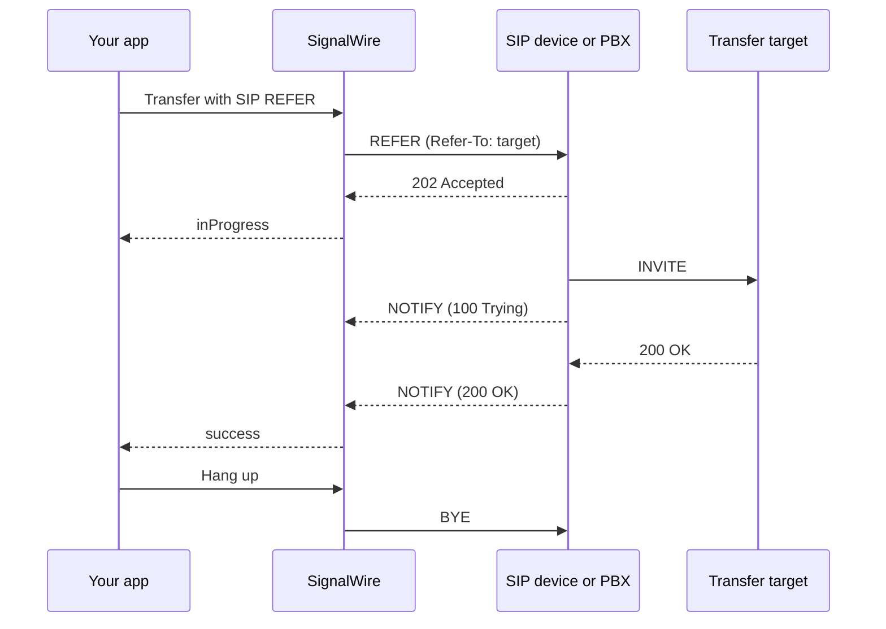

[make-and-receive-calls]: /docs/platform/voice/make-and-receive-calls
[place-swml]: /docs/platform/voice/make-and-receive-calls#place-a-call-via-swml
[place-relay]: /docs/platform/voice/make-and-receive-calls#place-a-call-via-websocket-relay
[sip]: /docs/platform/voice/sip
[sip-trunking]: /docs/platform/voice/sip/trunking
[sip-addresses]: /docs/platform/addresses#sip-addresses
[webhooks]: /docs/platform/webhooks
[server-sdks]: /docs/server-sdks
[relay-guide]: /docs/server-sdks/guides/relay-client
[relay-refer]: /docs/server-sdks/reference/python/relay/call/refer
[swml-sip-refer]: /docs/swml/reference/calling/sip-refer
[swml-connect]: /docs/swml/reference/calling/connect
[swml-switch]: /docs/swml/reference/calling/switch
[call-commands]: /docs/apis/rest/calls/call-commands

SIP REFER lets your app ask a SIP device or PBX to transfer a call to another destination.
Start by transferring a call to another SIP address and handling the result, with a bridged
transfer as the fallback, then track the transfer as it progresses.

## Choose an approach

Each approach sends the REFER and receives its result in its own way, so pick the one that matches
how your app controls the call and follow only its section. The sections don't build on each
other, and code from one doesn't carry over to another.

- [SWML][swml-sip-refer]: add `sip_refer` to your call document and branch on the result. The
  document waits for the transfer to finish. Optionally send events to a webhook.
- [WebSocket (Relay)][relay-guide]: send the REFER on an answered call from a Relay client and
  handle events in your code. No public URL is needed.
- [REST][call-commands]: send the REFER by call ID from any process and receive results at a
  webhook.

## Prepare for SIP REFER

Start with working call setup from [Make and receive calls][make-and-receive-calls]. You also
need a SIP device or PBX that SignalWire can call, and a second SIP address the device can
transfer the call to. Use a device and a target you can answer to test both stages of the
transfer. The device must:

- Accept a REFER during an established call and reply `202 Accepted`. A device that doesn't
  support REFER, or that refuses transfers, replies with an error such as `403`, `405`, or
  `501`.
- Place a call to the `Refer-To` URI. The device's network and dial plan must allow calls to
  the target.
- Report the new call's progress in NOTIFY requests. Without them, SignalWire can't tell whether
  the target answered: it waits about 32 seconds for the first NOTIFY, then reports success.
- Accept authentication credentials if it challenges the REFER. Supply `username` and
  `password` with the transfer request when required.

Check your device or PBX documentation for how it handles an incoming REFER, sometimes listed as
blind or unattended transfer. The [SIP overview][sip] covers registering a softphone with
SignalWire for testing, and [SIP trunking][sip-trunking] covers connecting a PBX.

<Warning title="SIP REFER only works on SIP calls">
REFER is a SIP request, so the call must be a SIP call, such as one SignalWire places to a SIP
URI. For phone and browser call legs, Relay and REST reject the command, and SWML sets
`sip_refer_result` to `error`. Use a bridged transfer, such as SWML [`connect`][swml-connect],
for those call legs.
</Warning>

Replace these values in the samples you run:

| Value | Replace with |
|---|---|
| `<YOUR_SPACE>` | Your Space's subdomain in `<YOUR_SPACE>.signalwire.com` |
| `<YOUR_PROJECT_ID>` | Your Project ID |
| `<YOUR_API_TOKEN>` | Your API token, used only in server code |
| `<YOUR_CALLER_ID>` | The caller ID SignalWire presents to your device, such as your SignalWire phone number in E.164 format |
| `<YOUR_SIP_DEVICE>` | The SIP URI of the device or PBX that answers the call and receives the REFER, such as `sip:1001@pbx.example.com` |
| `<YOUR_TRANSFER_TARGET>` | The SIP URI the device should call, starting with `sip:` or `sips:`, such as `sip:1002@pbx.example.com` |
| `<YOUR_STATUS_WEBHOOK_URL>` | A public URL that receives `calling.call.refer` events |
| `<YOUR_CALL_ID>` | The ID of an answered SIP call |

## How SIP REFER works

SignalWire sends a REFER request on an answered SIP call, with the transfer target in the
`Refer-To` header. The SIP device or PBX accepts with `202 Accepted`, places a new call to the
target, and reports its progress to SignalWire in NOTIFY requests. When the target answers,
your app ends SignalWire's leg. The device and target continue their call directly.

This is a blind, or unattended, transfer: the device calls the destination without your app
speaking to the recipient first.



SignalWire waits about 32 seconds for the device to accept the REFER, about 32 seconds for its
first NOTIFY, and up to two minutes for the target to answer. Only one REFER can run on a call
at a time. Your app must hang up SignalWire's leg after a successful transfer.

### When to use SIP REFER instead of a bridged transfer

Use SIP REFER when a SIP device or PBX can reach the destination directly and your app no
longer needs to control the call. The device places the new call from its own network, and your
app ends SignalWire's leg after the transfer succeeds.

For a bridged transfer, such as SWML [`connect`][swml-connect], SignalWire calls the target and
joins the two call legs. Both legs remain active and carry audio through SignalWire for the
rest of the conversation. This keeps your app in control of the call and requires the target
to be reachable from SignalWire.

| | SIP REFER | Bridged transfer |
|---|---|---|
| Who calls the target | The SIP device or PBX | SignalWire |
| SignalWire's leg after the transfer | Your app ends it; the device and target continue directly | Remains active for the rest of the call |
| Calls it works on | SIP calls to a device that supports REFER | Phone, SIP, and browser calls |
| The target must be reachable from | The device or PBX | SignalWire |
| Your app after the transfer | Can't play, record, or control the transferred call | Keeps controlling the call |

Common uses include:

- Return a call to your PBX. A PBX sends a call to a SignalWire [SIP address][sip-addresses] so
  an app can answer it, and the app then decides which extension, queue, or group should take
  the call. REFER lets the PBX connect the caller there directly.
- Reach a destination only the device can dial, such as an internal extension or a SIP URI on a
  private network.
- Remove SignalWire from the audio path after the transfer, so the rest of the conversation
  no longer uses two SignalWire call legs.

Use a bridged transfer instead when the call isn't a SIP call, when you need to keep recording or
controlling the call after the transfer, or when the device doesn't support REFER.

### SIP REFER results and response codes

Every approach reports the same final result: SWML sets it in `sip_refer_result`, and Relay and
webhooks carry it as the event's `state`.

| Result | Meaning | Typical action |
|---|---|---|
| `success` | The target answered. Also reported when the device accepted the REFER but sent no NOTIFY within about 32 seconds, when the call ended before the first NOTIFY, and when the target was still ringing after two minutes | Hang up SignalWire's leg |
| `busy` | The target was busy or declined the call (`486`, `600`, or `603`) | Tell the caller, or try another target |
| `noAnswer` | The target didn't answer or wasn't found (`404`, `487`, or `604`) | Tell the caller, or try another target |
| `cancel` | The call ended while the target was ringing, after the device reported progress in a NOTIFY | None; the call is over |
| `error` | The device rejected the REFER, didn't reply within about 32 seconds, or the call ended before it replied; or the target's call failed with another response code | Bridge the call through SignalWire |

A `success` result doesn't always mean the target answered. If your app needs to know, check the
target's response code before it hangs up: a `2xx` code means the target answered.

| Response code | Holds |
|---|---|
| The device's reply to the REFER | The reply, such as `202` or `403`. `0` when the device didn't reply. `-1` when the device replied `503` to three attempts in a row |
| The target's response | The target's final response from NOTIFY, such as `200` or `486`. The latest provisional response, such as `180`, when the target was still ringing after two minutes or the call ended while it rang. `0` when the device accepted the REFER but sent no NOTIFY. `-1` when the device didn't accept the REFER |

SWML reads the codes from variables, and Relay and webhooks from event fields:

| Code | SWML variable | Event field |
|---|---|---|
| The device's reply to the REFER | `sip_refer_response_code` | `sip_refer_response_code` |
| The target's response | `sip_refer_to_response_code` | `sip_notify_response_code` |

Event fields are strings, and an event omits a code that is `0` or `-1`. The target's response
appears only on the final event.

## Transfer calls via SWML

[`sip_refer`][swml-sip-refer] waits for the transfer to finish, then sets the result and response
code variables, plus `sip_refer_to` with the target URI. It answers the call first if it hasn't
been answered. Use [`switch`][swml-switch] on `sip_refer_result` to choose the next action. When
the call isn't a SIP call or a REFER is already in progress, `sip_refer_result` is `error` and
both response code variables are unset.

### Transfer a SIP call via SWML

Transfer the call to the target, then branch on the result. On `success`, the document hangs
up SignalWire's leg. On `error`, it uses `connect` to bridge the call to the same target. The
`default` branch plays a failure message and hangs up for other results.

The bridged fallback requires the target to be reachable from SignalWire.

The SDK programs place the call to your SIP device as in [Place a call via SWML][place-swml].
Each branch is built with the SDK's SWML builder. The YAML and JSON tabs contain the equivalent
complete document.

<CodeBlocks>
<CodeBlock title="Python — SWML builder">
```python
# Install: python -m pip install signalwire-sdk==3.4.1
# Save as sip_refer.py and run: python sip_refer.py
from signalwire import SWMLBuilder, SWMLService
from signalwire.rest import RestClient

client = RestClient(
    project="<YOUR_PROJECT_ID>",
    token="<YOUR_API_TOKEN>",
    host="<YOUR_SPACE>.signalwire.com",
)

transferred = (
    SWMLBuilder(SWMLService(name="transferred"))
    .hangup()
    .build()["sections"]["main"]
)
bridge = (
    SWMLBuilder(SWMLService(name="bridge"))
    .connect(to="<YOUR_TRANSFER_TARGET>")
    .build()["sections"]["main"]
)
failed = (
    SWMLBuilder(SWMLService(name="failed"))
    .say("The transfer couldn't be completed.")
    .build()["sections"]["main"]
)

swml = (
    SWMLBuilder(SWMLService(name="sip-refer"))
    .say("Transferring your call.")
    .sip_refer(to_uri="<YOUR_TRANSFER_TARGET>")
    .switch(
        variable="sip_refer_result",
        case={
            "success": transferred,
            "error": bridge,
        },
        default=failed,
    )
    .hangup()
    .build()
)

call = client.calling.dial(
    from_="<YOUR_CALLER_ID>",
    to="<YOUR_SIP_DEVICE>",
    swml=swml,
)
print(call["id"])
```
</CodeBlock>
<CodeBlock title="TypeScript — SWML builder">
```typescript
// Install: npm install @signalwire/sdk@2.0.5
// This sample also runs as JavaScript: save as sip-refer.mjs,
// then run: node sip-refer.mjs
import { RestClient, SwmlBuilder } from "@signalwire/sdk";

const client = new RestClient({
  project: "<YOUR_PROJECT_ID>",
  token: "<YOUR_API_TOKEN>",
  host: "<YOUR_SPACE>.signalwire.com",
});

const transferred = new SwmlBuilder()
  .hangup()
  .document.sections.main;
const bridge = new SwmlBuilder()
  .connect({ to: "<YOUR_TRANSFER_TARGET>" })
  .document.sections.main;
const failed = new SwmlBuilder()
  .say("The transfer couldn't be completed.")
  .document.sections.main;

const swml = new SwmlBuilder()
  .say("Transferring your call.")
  .sip_refer({ to_uri: "<YOUR_TRANSFER_TARGET>" })
  .switch({
    variable: "sip_refer_result",
    case: {
      success: transferred,
      error: bridge,
    },
    default: failed,
  })
  .hangup()
  .build();

const call = await client.calling.dial({
  from: "<YOUR_CALLER_ID>",
  to: "<YOUR_SIP_DEVICE>",
  swml,
});
console.log(call.id);
```
</CodeBlock>
<CodeBlock title="YAML">
```yaml
version: 1.0.0
sections:
  main:
    - play:
        url: say:Transferring your call.
    - sip_refer:
        to_uri: <YOUR_TRANSFER_TARGET>
    - switch:
        variable: sip_refer_result
        case:
          success:
            - hangup: {}
          error:
            - connect:
                to: <YOUR_TRANSFER_TARGET>
        default:
          - play:
              url: say:The transfer couldn't be completed.
    - hangup: {}
```
</CodeBlock>
<CodeBlock title="JSON">
```json
{
  "version": "1.0.0",
  "sections": {
    "main": [
      { "play": { "url": "say:Transferring your call." } },
      { "sip_refer": { "to_uri": "<YOUR_TRANSFER_TARGET>" } },
      {
        "switch": {
          "variable": "sip_refer_result",
          "case": {
            "success": [
              { "hangup": {} }
            ],
            "error": [
              { "connect": { "to": "<YOUR_TRANSFER_TARGET>" } }
            ]
          },
          "default": [
            { "play": { "url": "say:The transfer couldn't be completed." } }
          ]
        }
      },
      { "hangup": {} }
    ]
  }
}
```
</CodeBlock>
</CodeBlocks>

Run the example and answer on your SIP device. You hear "Transferring your call," then the
device calls the target. Answer at the target to complete the transfer and end SignalWire's
leg. Test again with the target busy or unanswered to hear the failure message.

If the device challenges the REFER, add `username` and `password` to `sip_refer`.

### Track REFER results via SWML

Add `status_url` to `sip_refer` to receive JSON webhooks as the transfer progresses. The document
still waits for the final result and branches on `sip_refer_result`.

| Webhook field | Value |
|---|---|
| `event_type` | `calling.call.refer` |
| `params.call_id` | The call ID |
| `params.state` | `inProgress`, then the final result |
| `params.sip_refer_to` | The SIP URI you transferred the call to |
| `params.sip_refer_response_code` | The device's reply to the REFER, such as `"202"` |
| `params.sip_notify_response_code` | The target's response reported in NOTIFY, such as `"200"`; only on the final event |

| Outcome | Callbacks, in order |
|---|---|
| The device accepts the REFER | `inProgress`, then the final result |
| The device rejects the REFER or doesn't reply | `error` |

Only the first REFER the device accepts on a call sends `inProgress`. If you try another target
on the same call, expect the final result only. See the [webhooks guide][webhooks] for endpoint
setup and testing.

## Transfer calls via WebSocket (Relay)

Send the REFER on an answered SIP call with `refer()` and a `sip` device whose `to` is the
target. The method returns as soon as SignalWire starts the REFER, so register a
`calling.call.refer` handler first and read the event's `state` for the result. If the call isn't
a SIP call or a REFER is already in progress, `refer()` raises an error instead of sending events.

### Transfer a SIP call via WebSocket (Relay)

Dial your SIP device, then refer the call to the target. The handler hangs up on `success`,
bridges the call to the target with `connect()` on `error`, and plays a message before hanging
up on `busy` or `noAnswer`. If the device challenges the REFER, add `username` and `password` to
the device's `params`.

Call setup follows [Place a call via WebSocket (Relay)][place-relay], with a `sip` device
instead of a `phone` device.

<CodeBlocks>
<CodeBlock title="Python — Relay client">
```python
# Install: python -m pip install signalwire-sdk==3.4.1
# Save as sip_refer_relay.py and run: python sip_refer_relay.py
import asyncio
from signalwire.relay import RelayClient
from signalwire.relay.event import ReferEvent

client = RelayClient(
    project="<YOUR_PROJECT_ID>",
    token="<YOUR_API_TOKEN>",
    contexts=["default"],
)

async def main():
    async with client:
        call = await client.dial(
            devices=[[{
                "type": "sip",
                "params": {
                    "from": "<YOUR_CALLER_ID>",
                    "to": "<YOUR_SIP_DEVICE>",
                    "timeout": 30,
                },
            }]],
        )

        async def hang_up_after_playback(_event):
            if call.state != "ended":
                await call.hangup()

        async def on_refer(event: ReferEvent):
            print(f"REFER {event.state}: {event.sip_refer_response_code} {event.sip_notify_response_code}")
            if call.state == "ended":
                return
            if event.state == "success":
                # The device has connected to the target.
                await call.hangup()
            elif event.state == "error":
                # The device couldn't complete the REFER: bridge through SignalWire instead.
                await call.connect([[{
                    "type": "sip",
                    "params": {
                        "from": "<YOUR_CALLER_ID>",
                        "to": "<YOUR_TRANSFER_TARGET>",
                        "timeout": 30,
                    },
                }]])
            elif event.state in ("busy", "noAnswer"):
                await call.play(
                    [{"type": "tts", "params": {"text": "The transfer couldn't be completed."}}],
                    on_completed=hang_up_after_playback,
                )

        call.on("calling.call.refer", on_refer)
        await call.refer({"type": "sip", "params": {"to": "<YOUR_TRANSFER_TARGET>"}})
        await call.wait_for_ended()

asyncio.run(main())
```
</CodeBlock>
<CodeBlock title="TypeScript — Relay client">
```typescript
// Install: npm install @signalwire/sdk@2.0.5
// Save as sip-refer-relay.mts and run: npx tsx sip-refer-relay.mts
import { RelayClient, ReferEvent } from "@signalwire/sdk";

const client = new RelayClient({
  project: "<YOUR_PROJECT_ID>",
  token: "<YOUR_API_TOKEN>",
  contexts: ["default"],
});

await client.connect();

try {
  const call = await client.dial([[{
    type: "sip",
    params: {
      from: "<YOUR_CALLER_ID>",
      to: "<YOUR_SIP_DEVICE>",
      timeout: 30,
    },
  }]]);

  call.on("calling.call.refer", async (event) => {
    const refer = event as ReferEvent;
    console.log(`REFER ${refer.state}: ${refer.sipReferResponseCode} ${refer.sipNotifyResponseCode}`);
    if (call.state === "ended") return;
    if (refer.state === "success") {
      // The device has connected to the target.
      await call.hangup();
    } else if (refer.state === "error") {
      // The device couldn't complete the REFER: bridge through SignalWire instead.
      await call.connect([[{
        type: "sip",
        params: {
          from: "<YOUR_CALLER_ID>",
          to: "<YOUR_TRANSFER_TARGET>",
          timeout: 30,
        },
      }]]);
    } else if (refer.state === "busy" || refer.state === "noAnswer") {
      await call.play([{ type: "tts", text: "The transfer couldn't be completed." }], {
        onCompleted: async () => {
          if (call.state !== "ended") await call.hangup();
        },
      });
    }
  });

  await call.refer({ type: "sip", params: { to: "<YOUR_TRANSFER_TARGET>" } });
  await call.waitForEnded();
} finally {
  await client.disconnect();
}
```
</CodeBlock>
</CodeBlocks>

Answer on your SIP device. The program prints `inProgress` with the device's `202`, then
`success` with the target's `200` once the target answers, and hangs up SignalWire's leg. To
transfer an incoming SIP call, answer it first, then send the REFER.

### Track REFER results via WebSocket (Relay)

The `calling.call.refer` handler is how Relay tracks the transfer. Each event carries `state`
(`inProgress`, then the final result), the target URI, the device's reply to the REFER, and the
target's response from NOTIFY, the same values as the [SWML webhook
fields](#track-refer-results-via-swml). As in SWML, only the first REFER the device accepts on a
call sends `inProgress`. To send the same events to a webhook as well, pass a status URL to
`refer()`.

## Transfer calls via REST

Send [`calling.refer`][call-commands] with an answered SIP call's ID from any process, such as one
that didn't place the call. The command returns immediately, and the result arrives at your
webhook.

### Transfer a SIP call via REST

Send the command with a `sip` device whose `to` is the target, and `status_url`. Add `username`
and `password` to the device's `params` if the device challenges the REFER. Use the
[Server SDKs][server-sdks] REST client's `calling.refer()` to send the command:

<CodeBlocks>
<CodeBlock title="Python — REST client">
```python
# Install: python -m pip install signalwire-sdk==3.4.1
# Save as refer_call.py and run: python refer_call.py
from signalwire.rest import RestClient

client = RestClient(
    project="<YOUR_PROJECT_ID>",
    token="<YOUR_API_TOKEN>",
    host="<YOUR_SPACE>.signalwire.com",
)

client.calling.refer(
    "<YOUR_CALL_ID>",
    device={"type": "sip", "params": {"to": "<YOUR_TRANSFER_TARGET>"}},
    status_url="<YOUR_STATUS_WEBHOOK_URL>",
)
```
</CodeBlock>
<CodeBlock title="TypeScript — REST client">
```typescript
// Install: npm install @signalwire/sdk@2.0.5
// This sample also runs as JavaScript: save as refer-call.mjs,
// then run: node refer-call.mjs
import { RestClient } from "@signalwire/sdk";

const client = new RestClient({
  project: "<YOUR_PROJECT_ID>",
  token: "<YOUR_API_TOKEN>",
  host: "<YOUR_SPACE>.signalwire.com",
});

await client.calling.refer("<YOUR_CALL_ID>", {
  device: { type: "sip", params: { to: "<YOUR_TRANSFER_TARGET>" } },
  status_url: "<YOUR_STATUS_WEBHOOK_URL>",
});
```
</CodeBlock>
<CodeBlock title="cURL — Calling API">
```bash
curl -X POST "https://<YOUR_SPACE>.signalwire.com/api/calling/calls" \
  -u "<YOUR_PROJECT_ID>:<YOUR_API_TOKEN>" \
  -H "Content-Type: application/json" \
  -d '{
    "command": "calling.refer",
    "id": "<YOUR_CALL_ID>",
    "params": {
      "device": { "type": "sip", "params": { "to": "<YOUR_TRANSFER_TARGET>" } },
      "status_url": "<YOUR_STATUS_WEBHOOK_URL>"
    }
  }'
```
</CodeBlock>
</CodeBlocks>

To call the REST API directly, see [Call commands][call-commands].

### Track REFER results via REST

Your webhook receives the `calling.call.refer` events described in
[Track REFER results via SWML](#track-refer-results-via-swml). Have the handler send the next
call command, such as `calling.end` on `success`, or `calling.transfer` to a document that uses
`connect` on `error`.

## Next steps

<CardGroup cols={2}>

<Card title="sip_refer reference" href="/docs/swml/reference/calling/sip-refer" icon="regular file-code">
  Every `sip_refer` parameter, the variables it sets, and its status callback payload.
</Card>

<Card title="call.refer in the Server SDKs" href="/docs/server-sdks/reference/python/relay/call/refer" icon="regular code">
  Send a REFER from a Relay call handler and read its events.
</Card>

<Card title="Call commands" href="/docs/apis/rest/calls/call-commands" icon="regular rectangle-api">
  The `calling.refer` command and the commands to send after a transfer.
</Card>

<Card title="connect reference" href="/docs/swml/reference/calling/connect" icon="regular phone">
  Bridge a call through SignalWire when a REFER isn't possible.
</Card>

</CardGroup>
