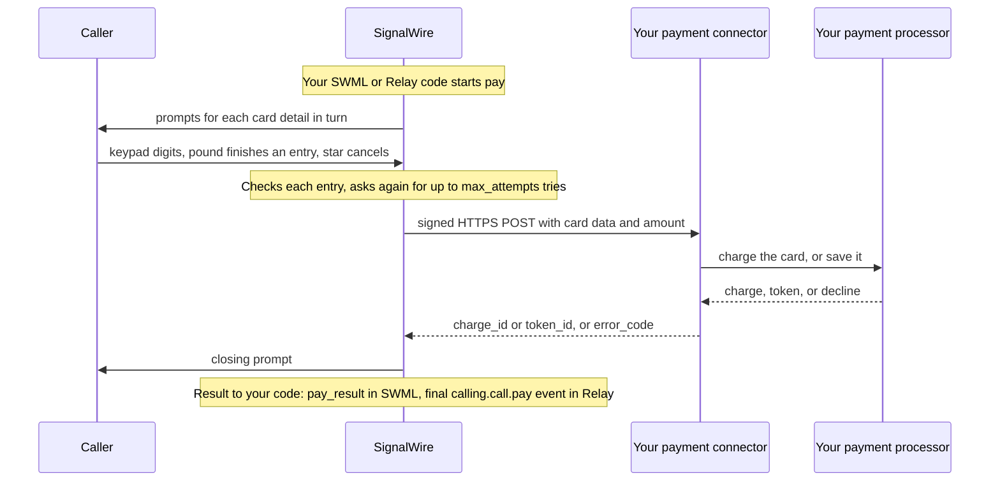

[swml-intro]: /docs/swml
[swml-pay]: /docs/swml/reference/calling/pay
[swml-switch]: /docs/swml/reference/calling/switch
[swml-cond]: /docs/swml/reference/calling/cond
[swml-variables]: /docs/swml/reference/variables
[server-sdks]: /docs/server-sdks
[relay-guide]: /docs/server-sdks/guides/relay-client
[call-commands]: /docs/apis/rest/calls/call-commands
[browser-sdk]: /docs/browser-sdk/v4/guides/build-voice-video
[cfb-intro]: /docs/call-flow-builder
[outbound-calling]: /docs/platform/voice/make-and-receive-calls
[api-credentials]: /docs/platform/your-signalwire-api-space
[phone-numbers]: /docs/platform/phone-numbers
[caller-id]: /docs/platform/voice/how-to-set-caller-id-or-cnam
[trial-mode]: /docs/platform/trial-mode
[signing-key]: /docs/platform/webhooks#verify-webhook-signature
[record-pause]: /docs/platform/voice/record-calls#pause-and-resume-a-recording
[compliance]: /docs/platform/compliance
[redaction]: /docs/platform/ai/content-redaction
[redaction-pay]: /docs/platform/ai/content-redaction#take-a-payment
[ai-overview]: /docs/platform/ai

Your app can take a card payment in the middle of a call. The caller types the card details on
the keypad, and SignalWire hands them to a payment connector you host, which charges the card
through your payment processor. Start by charging a test card on a call to your own phone, then
charge a card from [SWML][swml-intro] or [Relay][relay-guide], save a card for later payments, customize the prompts, handle the
result, stop collection from your code, and take a payment from an AI agent.

## Pick the right product for taking payments

Payments run inside a live call, from the code that controls that call.

| Function | SWML | WebSocket (Relay) | REST | Browser SDK | Call Flow Builder |
|---|---|---|---|---|---|
| Charge a card during a call | <Icon icon="regular circle-check" color="var(--status-success)" /> | <Icon icon="regular circle-check" color="var(--status-success)" /> | <Icon icon="regular circle-xmark" color="var(--status-error)" /> | <Icon icon="regular circle-xmark" color="var(--status-error)" /> | <Icon icon="regular circle-xmark" color="var(--status-error)" /> |
| Save a card as a token for later payments | <Icon icon="regular circle-check" color="var(--status-success)" /> | <Icon icon="regular circle-check" color="var(--status-success)" /> | <Icon icon="regular circle-xmark" color="var(--status-error)" /> | <Icon icon="regular circle-xmark" color="var(--status-error)" /> | <Icon icon="regular circle-xmark" color="var(--status-error)" /> |
| Customize the prompts the caller hears | <Icon icon="regular circle-check" color="var(--status-success)" /> | <Icon icon="regular circle-check" color="var(--status-success)" /> | <Icon icon="regular circle-xmark" color="var(--status-error)" /> | <Icon icon="regular circle-xmark" color="var(--status-error)" /> | <Icon icon="regular circle-xmark" color="var(--status-error)" /> |
| Stop collecting card details from your code | <Icon icon="regular circle-xmark" color="var(--status-error)" /> | <Icon icon="regular circle-check" color="var(--status-success)" /> | <Icon icon="regular circle-xmark" color="var(--status-error)" /> | <Icon icon="regular circle-xmark" color="var(--status-error)" /> | <Icon icon="regular circle-xmark" color="var(--status-error)" /> |
| Get the payment result in your own code, without a webhook | <Icon icon="regular circle-check" color="var(--status-success)" /> | <Icon icon="regular circle-check" color="var(--status-success)" /> | <Icon icon="regular circle-xmark" color="var(--status-error)" /> | <Icon icon="regular circle-xmark" color="var(--status-error)" /> | <Icon icon="regular circle-xmark" color="var(--status-error)" /> |
| Send payment progress to a status webhook | <Icon icon="regular circle-check" color="var(--status-success)" /> | <Icon icon="regular circle-check" color="var(--status-success)" /> | <Icon icon="regular circle-xmark" color="var(--status-error)" /> | <Icon icon="regular circle-xmark" color="var(--status-error)" /> | <Icon icon="regular circle-xmark" color="var(--status-error)" /> |

- [SWML][swml-intro] is the document that describes how the call should flow. Its [`pay`][swml-pay]
  method collects the card and sets variables the rest of the document can branch on. Write it with
  the SWML builders in the [Server SDKs][server-sdks], or by hand.
- [WebSocket (Relay)][relay-guide] is a Relay client in the Server SDKs. It holds a WebSocket
  connection to a call in progress, starts payment collection with `call.pay`, and receives the
  result as an event in your code.
- The [REST Calling API][call-commands] places calls and delivers SWML to them. A `dial` request
  that carries a SWML document with `pay` takes a payment, as the first run on this page shows; the
  payment itself runs in SWML.
- The [Browser SDK][browser-sdk] puts a person on a call from a web page. Payment collection runs in
  the SWML or Relay code that handles the call.
- [Call Flow Builder][cfb-intro] draws call flows on a canvas without code. Payment flows are built
  in SWML or Relay.

An [AI agent][ai-overview] built with the Server SDKs generates SWML, so it takes payments the same
way; [Take a payment from an AI agent](#take-a-payment-from-an-ai-agent) shows how.

## Prepare for taking payments

Have these values ready:

- Your Space URL, such as `<YOUR_SPACE>.signalwire.com`.
- Your Project ID and API token from the Dashboard's [API credentials][api-credentials] page.
  Enable the token's **Voice** permission for the Calling API.
- A voice-capable [phone number purchased in your Space][phone-numbers] or a
  [verified caller ID][caller-id].
- A phone you can answer, with a keypad.
- Your project's Signing Key. In the Dashboard, open **API Credentials**, find **Signing Key**, and
  select **Show**. [Verify webhook signature][signing-key] covers how SignalWire uses it.
- A machine that can run a small server, and a tunnel such as [ngrok](https://ngrok.com/) that
  gives it a public `https://` URL.

Your payment connector is an HTTPS endpoint you host. It receives the card details SignalWire
collects, charges the card through your payment processor, and replies with the outcome. You build
one in [Build a payment connector](#build-a-payment-connector).

<Warning title="Payment connector URLs must use https://">
SignalWire sends card details to your payment connector over HTTPS only, and rejects a
`payment_connector_url` that doesn't start with `https://` before it collects anything. During
development, put a TLS tunnel in front of your local server, as
[Give the connector a public URL](#give-the-connector-a-public-url) shows.
</Warning>

<Warning title="Your payment connector receives full card data">
SignalWire sends the full card number and security code to your connector, because your processor
needs them to charge the card. That puts the connector in scope for the Payment Card Industry Data
Security Standard (PCI DSS). Never log or store full card data, and read
[Payments and PCI compliance](#payments-and-pci-compliance) before you take a real payment.
</Warning>

<Warning title="Trial projects only call and receive calls from verified numbers">
A [trial project][trial-mode] only places calls to and receives calls from numbers you've
purchased or verified, and can't call internationally. Verify the phone you'll test with before
the first run.
</Warning>

Replace these values in the samples you run:

| Value | Replace with |
|---|---|
| `<YOUR_SPACE>` | Your Space's subdomain in `<YOUR_SPACE>.signalwire.com` |
| `<YOUR_PROJECT_ID>` | Your Project ID |
| `<YOUR_API_TOKEN>` | Your API token with the Voice permission, used only in server code |
| `<YOUR_CALLER_ID>` | Your SignalWire phone number, or a [verified caller ID][caller-id], in E.164 format |
| `<YOUR_DESTINATION>` | The phone you'll answer, in E.164 format |
| `<YOUR_PAYMENT_CONNECTOR_URL>` | The public `https://` URL of your payment connector, exactly as you pass it in `payment_connector_url`. SignalWire signs requests against this string. |
| `<YOUR_SIGNING_KEY>` | Your project's Signing Key, used only in your payment connector |
| `<YOUR_STATUS_WEBHOOK_URL>` | An HTTPS endpoint you control that receives payment progress |

## How taking a payment works

A payment starts when your SWML document or Relay code runs `pay` on a live call, and runs in four
parts:

1. SignalWire prompts the caller for each card detail in turn: the card number, the expiration
   date, the security code, and the postal code. The caller types each one on the keypad and
   presses `#` to finish an entry, or `*` to cancel the payment.
2. SignalWire checks each entry as it arrives, such as whether the card number is valid and its
   type is one you accept. When an entry fails the check or the caller enters nothing, SignalWire
   asks again, giving the caller `max_attempts` tries in all.
3. SignalWire sends the card details in a signed HTTPS request to your payment connector. Your
   connector charges the card, or saves it, through your payment processor and replies with the
   outcome.
4. SignalWire plays a closing prompt to the caller and hands the result to your code: as the
   `pay_result` variable in SWML, or as the final `calling.call.pay` event in Relay.

The diagram follows one payment from the first prompt to the result.

<llms-ignore>


</llms-ignore>

<llms-only>



</llms-only>

## Build a payment connector

SignalWire sends your connector one HTTPS `POST` per payment, with a JSON body. Your connector
checks the signature, charges the card or saves it through your payment processor, and replies.

This is the body for the Bayview Taxi fare. A test card's details arrive in full:

```json title="JSON"
{
  "transaction_id": "b6a2c3e1-4f0d-4c8e-9a51-2d7f3e8c1a90",
  "method": "credit-card",
  "cardnumber": "4111111111111111",
  "cvv": "123",
  "postal_code": "94107",
  "description": "Bayview Taxi fare",
  "chargeAmount": "24.50",
  "token_type": "reusable",
  "expiry_month": "12",
  "expiry_year": "30",
  "currency_code": "usd",
  "parameters": [
    { "ride_id": "R-1042" }
  ]
}
```

| Field | What it holds |
|---|---|
| `transaction_id` | A unique ID for this payment |
| `method` | The payment method, `credit-card` |
| `cardnumber` | The full card number |
| `cvv` | The security code |
| `postal_code` | The postal code |
| `expiry_month`, `expiry_year` | The expiration date, two digits each |
| `description` | The `description` you set on `pay`, left out when you set none |
| `chargeAmount` | The amount to charge. A zero amount means save the card instead of charging it. |
| `token_type` | The `token_type` you set on `pay`, `reusable` by default |
| `currency_code` | The currency, `usd` by default |
| `parameters` | The custom `parameters` you set on `pay`, each as a one-key object |

Reply with HTTP `200` and a JSON body. For a charge, return the processor's charge ID in
`charge_id`. For a zero amount, return the saved card's token in `token_id`. To decline, return
`error_code` and `error_message` with no ID.

<CodeBlocks>

```json title="Charge"
{
  "charge_id": "ch_3f9a1c2b7d4e8f60",
  "error_code": null,
  "error_message": null
}
```

```json title="Saved card"
{
  "token_id": "tok_8c41e07a92b5d3f1",
  "error_code": null,
  "error_message": null
}
```

```json title="Decline"
{
  "charge_id": null,
  "error_code": "card_declined",
  "error_message": "Card declined"
}
```

</CodeBlocks>

SignalWire counts the payment as a success only when the reply is HTTP `200` with a `charge_id`
for a charge, or a `token_id` for a zero amount, and no error. Any other reply is a decline,
including a non-200 status and a `token_id` for a nonzero amount.

SignalWire signs each request with your project's [Signing Key][signing-key]. The
`X-SignalWire-Signature` header holds the lowercase hex HMAC-SHA1 of the connector URL, exactly as
you passed it in `payment_connector_url`, followed by the raw request body. An
`X-SignalWire-SHA256-Signature` header carries the same value computed with HMAC-SHA256. Compute
the signature yourself and reject any request whose header doesn't match. The samples check it with
the Server SDKs' `validate_webhook_signature` helper and with the Node.js `crypto` module. Both
compare against the URL you passed, because a tunnel or proxy can change the URL your server sees.

These connectors check the signature, log the last four digits, and reply with a new ID in place of
a real processor call. Replace the ID with your processor's call where the comment says so.

<CodeBlocks>

```python title="Python — Flask" {19-22}
# Install: python -m pip install signalwire-sdk==3.4.1 flask
# Save as payment_connector.py and run: python payment_connector.py
import json
import uuid

from flask import Flask, jsonify, request
from signalwire.core.security import validate_webhook_signature

SIGNING_KEY = "<YOUR_SIGNING_KEY>"
# The exact URL you pass as payment_connector_url. SignalWire signs that URL,
# which can differ from the one your server sees behind a tunnel or proxy.
CONNECTOR_URL = "<YOUR_PAYMENT_CONNECTOR_URL>"

app = Flask(__name__)


@app.post("/")
def charge():
    raw_body = request.get_data(as_text=True)
    signature = request.headers.get("X-SignalWire-Signature", "")
    if not validate_webhook_signature(SIGNING_KEY, signature, CONNECTOR_URL, raw_body):
        return jsonify(error="invalid signature"), 403

    payment = json.loads(raw_body)
    amount = payment["chargeAmount"]
    # parameters arrives as a list of one-key objects: [{"ride_id": "R-1042"}]
    extra = {k: v for item in payment.get("parameters", []) for k, v in item.items()}

    # Log the last four digits only. Never log or store the full card number or the security code.
    print(
        f"{payment['transaction_id']}: card ending {payment['cardnumber'][-4:]}, "
        f"{amount} {payment['currency_code']}, {payment.get('description', '')} {extra}"
    )

    # Call your payment processor here with cardnumber, cvv, expiry_month,
    # expiry_year, and postal_code. If it declines, reply with its code and
    # message instead of an ID:
    #   {"charge_id": None, "error_code": "card_declined", "error_message": "Card declined"}

    if float(amount) == 0:
        # A zero amount saves the card: reply with a token instead of a charge.
        return jsonify(token_id=f"tok_{uuid.uuid4().hex[:16]}", error_code=None, error_message=None)
    return jsonify(charge_id=f"ch_{uuid.uuid4().hex[:16]}", error_code=None, error_message=None)


if __name__ == "__main__":
    app.run(port=8080)
```

```typescript title="TypeScript — Node.js http" {16-23}
// No install needed: this server uses only Node.js built-in modules.
// This sample also runs as JavaScript: save as payment-connector.mjs,
// then run: node payment-connector.mjs
import { createHmac, randomUUID, timingSafeEqual } from "node:crypto";
import { createServer } from "node:http";

const SIGNING_KEY = "<YOUR_SIGNING_KEY>";
// The exact URL you pass as payment_connector_url. SignalWire signs that URL,
// which can differ from the one your server sees behind a tunnel or proxy.
const CONNECTOR_URL = "<YOUR_PAYMENT_CONNECTOR_URL>";

const server = createServer(async (req, res) => {
  let rawBody = "";
  for await (const chunk of req) rawBody += chunk;

  // X-SignalWire-Signature is the hex HMAC-SHA1 of the URL followed by the raw body.
  const expected = createHmac("sha1", SIGNING_KEY).update(CONNECTOR_URL + rawBody).digest("hex");
  const signature = String(req.headers["x-signalwire-signature"] ?? "");
  if (signature.length !== expected.length
    || !timingSafeEqual(Buffer.from(signature), Buffer.from(expected))) {
    res.writeHead(403, { "Content-Type": "application/json" }).end('{"error":"invalid signature"}');
    return;
  }

  const payment = JSON.parse(rawBody);
  const amount = payment.chargeAmount;
  // parameters arrives as an array of one-key objects: [{"ride_id": "R-1042"}]
  const extra = Object.assign({}, ...(payment.parameters ?? []));

  // Log the last four digits only. Never log or store the full card number or the security code.
  console.log(
    `${payment.transaction_id}: card ending ${String(payment.cardnumber).slice(-4)}, `
    + `${amount} ${payment.currency_code}, ${payment.description ?? ""} ${JSON.stringify(extra)}`,
  );

  // Call your payment processor here with cardnumber, cvv, expiry_month,
  // expiry_year, and postal_code. If it declines, reply with its code and
  // message instead of an ID:
  //   { charge_id: null, error_code: "card_declined", error_message: "Card declined" }

  // A zero amount saves the card: reply with a token instead of a charge.
  const reply = Number(amount) === 0
    ? { token_id: `tok_${randomUUID().replaceAll("-", "").slice(0, 16)}`, error_code: null, error_message: null }
    : { charge_id: `ch_${randomUUID().replaceAll("-", "").slice(0, 16)}`, error_code: null, error_message: null };
  res.writeHead(200, { "Content-Type": "application/json" }).end(JSON.stringify(reply));
});

server.listen(8080, () => console.log("Payment connector listening on port 8080"));
```

</CodeBlocks>

## Take your first payment

Charge the Bayview Taxi fare to a test card on a call to your own phone. The connector from
[Build a payment connector](#build-a-payment-connector) stands in for your processor, so no real
card is charged.

<Steps>

<Step title="Give the connector a public URL" id="give-the-connector-a-public-url">

In a terminal, put a tunnel in front of port `8080`:

```bash
ngrok http 8080
```

ngrok prints an `https://` **Forwarding** URL. That URL is your `<YOUR_PAYMENT_CONNECTOR_URL>`.
Use the same string, character for character, in the connector and in the call, because the
signature covers it. Keep the tunnel running while you test; a new tunnel usually means a new
hostname.

</Step>

<Step title="Run the payment connector" id="run-the-payment-connector">

Fill in `<YOUR_SIGNING_KEY>` and `<YOUR_PAYMENT_CONNECTOR_URL>` in the connector you saved from
[Build a payment connector](#build-a-payment-connector), and start it in a second terminal with
the run command in its header comment. It listens on port `8080` and prints a line for each
payment.

</Step>

<Step title="Place the call" id="place-the-call-with-a-payment">

<Tabs groupId="outbound-api">
<Tab title="REST">

Send a REST `dial` request with a SWML document in `swml`. When you answer, the document reads the
fare, runs `pay`, and then reads the result back to you from the `pay_result` variable.

<CodeBlocks>

```python title="Python — REST client"
# Install: python -m pip install signalwire-sdk==3.4.1
# Save as first_payment.py and run: python first_payment.py
from signalwire import SWMLBuilder, SWMLService
from signalwire.rest import RestClient

client = RestClient(
    project="<YOUR_PROJECT_ID>",
    token="<YOUR_API_TOKEN>",
    host="<YOUR_SPACE>.signalwire.com",
)

swml = (
    SWMLBuilder(SWMLService(name="first-payment"))
    .say("Thanks for riding with Bayview Taxi. Your fare is 24 dollars and 50 cents.")
    .pay(
        payment_connector_url="<YOUR_PAYMENT_CONNECTOR_URL>",
        charge_amount="24.50",
        description="Bayview Taxi fare",
    )
    .say("The payment result is ${pay_result}.")
    .build()
)

call = client.calling.dial(
    from_="<YOUR_CALLER_ID>",
    to="<YOUR_DESTINATION>",
    swml=swml,
)
print(call["id"])
```

```typescript title="TypeScript — REST client"
// Install: npm install @signalwire/sdk@2.0.5
// This sample also runs as JavaScript: save as first-payment.mjs,
// then run: node first-payment.mjs
import { RestClient, SwmlBuilder } from "@signalwire/sdk";

const client = new RestClient({
  project: "<YOUR_PROJECT_ID>",
  token: "<YOUR_API_TOKEN>",
  host: "<YOUR_SPACE>.signalwire.com",
});

const swml = new SwmlBuilder()
  .say("Thanks for riding with Bayview Taxi. Your fare is 24 dollars and 50 cents.")
  .pay({
    payment_connector_url: "<YOUR_PAYMENT_CONNECTOR_URL>",
    charge_amount: "24.50",
    description: "Bayview Taxi fare",
  })
  .say("The payment result is ${pay_result}.")
  .build();

const call = await client.calling.dial({
  from: "<YOUR_CALLER_ID>",
  to: "<YOUR_DESTINATION>",
  swml,
});
console.log(call.id);
```

```bash title="cURL — Calling API"
curl -X POST "https://<YOUR_SPACE>.signalwire.com/api/calling/calls" \
  -u "<YOUR_PROJECT_ID>:<YOUR_API_TOKEN>" \
  -H "Content-Type: application/json" \
  -d '{
    "command": "dial",
    "params": {
      "from": "<YOUR_CALLER_ID>",
      "to": "<YOUR_DESTINATION>",
      "swml": {
        "version": "1.0.0",
        "sections": {
          "main": [
            { "play": { "url": "say:Thanks for riding with Bayview Taxi. Your fare is 24 dollars and 50 cents." } },
            {
              "pay": {
                "payment_connector_url": "<YOUR_PAYMENT_CONNECTOR_URL>",
                "charge_amount": "24.50",
                "description": "Bayview Taxi fare"
              }
            },
            { "play": { "url": "say:The payment result is ${pay_result}." } }
          ]
        }
      }
    }
  }'
```

</CodeBlocks>

The cURL example sends the `dial` command to [Call commands][call-commands].

The REST API returns a call `id` and status `queued`. This confirms that SignalWire accepted the
request; the call hasn't necessarily rung or been answered yet. Save the `id` to identify this call.

<EndpointResponseSnippet endpoint="POST /api/calling/calls" />

</Tab>
<Tab title="WebSocket (Relay)">

Dial your phone from a Relay client, then start `pay` on the answered call. The program prints the
result and reads it back to you before it hangs up.

`call.pay` returns as soon as SignalWire starts collecting. The final `calling.call.pay` event
carries `result`, so the program waits for the event that has one, and starts that wait before it
sends `pay` so the event can't arrive first.

<CodeBlocks>

```python title="Python — Relay client"
# Install: python -m pip install signalwire-sdk==3.4.1
# Save as first_payment_relay.py and run: python first_payment_relay.py
import asyncio
from signalwire.relay import RelayClient

client = RelayClient(
    project="<YOUR_PROJECT_ID>",
    token="<YOUR_API_TOKEN>",
    contexts=["default"],
)

async def main():
    async with client:
        call = await client.dial(
            devices=[[{
                "type": "phone",
                "params": {
                    "from_number": "<YOUR_CALLER_ID>",
                    "to_number": "<YOUR_DESTINATION>",
                    "timeout": 30,
                },
            }]],
        )

        intro = await call.play([{
            "type": "tts",
            "params": {"text": "Thanks for riding with Bayview Taxi. Your fare is 24 dollars and 50 cents."},
        }])
        await intro.wait()

        # The payment's last calling.call.pay event is the one that carries a result.
        finished = asyncio.create_task(
            call.wait_for("calling.call.pay", predicate=lambda event: "result" in event.params)
        )
        await call.pay(
            payment_connector_url="<YOUR_PAYMENT_CONNECTOR_URL>",
            charge_amount="24.50",
            description="Bayview Taxi fare",
        )
        event = await finished
        result = event.params["result"]
        print(f"Payment result: {result}")

        async def hang_up_after_playback(_event):
            if call.state != "ended":
                await call.hangup()

        await call.play(
            [{"type": "tts", "params": {"text": f"The payment result is {result}."}}],
            on_completed=hang_up_after_playback,
        )
        await call.wait_for_ended()

asyncio.run(main())
```

```typescript title="TypeScript — Relay client"
// Install: npm install @signalwire/sdk@2.0.5
// This sample also runs as JavaScript: save as first-payment-relay.mjs,
// then run: node first-payment-relay.mjs
import { RelayClient } from "@signalwire/sdk";

const client = new RelayClient({
  project: "<YOUR_PROJECT_ID>",
  token: "<YOUR_API_TOKEN>",
  contexts: ["default"],
});

await client.connect();

try {
  const call = await client.dial([[{
    type: "phone",
    params: {
      from_number: "<YOUR_CALLER_ID>",
      to_number: "<YOUR_DESTINATION>",
      timeout: 30,
    },
  }]]);

  const intro = await call.play([
    { type: "tts", text: "Thanks for riding with Bayview Taxi. Your fare is 24 dollars and 50 cents." },
  ]);
  await intro.wait();

  // The payment's last calling.call.pay event is the one that carries a result.
  const finished = call.waitFor("calling.call.pay", (event) => event.params.result !== undefined);
  await call.pay("<YOUR_PAYMENT_CONNECTOR_URL>", {
    chargeAmount: "24.50",
    description: "Bayview Taxi fare",
  });
  const event = await finished;
  const result = event.params.result;
  console.log(`Payment result: ${result}`);

  await call.play([{ type: "tts", text: `The payment result is ${result}.` }], {
    onCompleted: async () => {
      if (call.state !== "ended") await call.hangup();
    },
  });
  await call.waitForEnded();
} finally {
  await client.disconnect();
}
```

</CodeBlocks>

</Tab>
</Tabs>

</Step>

<Step title="Answer and pay on the keypad" id="answer-and-pay-on-the-keypad">

Answer your phone. After the fare, SignalWire asks for each card detail in turn. Enter these on
the keypad, pressing `#` after each one:

- Card number `4111111111111111`, a test number that passes SignalWire's card number check.
- An expiration date in the future, as four digits, month then year, such as `1230`.
- Any three-digit security code.
- Any postal code.

You hear "The payment result is success." The connector prints a line such as
`...: card ending 1111, 24.50 usd, Bayview Taxi fare {}`, and the Relay program also prints
`Payment result: success`.

If you hear a different result, find it here:

- `payment-connector-error`: SignalWire couldn't reach your connector. Check that the tunnel and
  the connector are both running and that `<YOUR_PAYMENT_CONNECTOR_URL>` is the tunnel's current
  `https://` URL.
- `internal-error`: your connector answered without a valid ID. If the connector printed nothing,
  it rejected the signature: check `<YOUR_SIGNING_KEY>`, and that the connector's
  `<YOUR_PAYMENT_CONNECTOR_URL>` matches the URL in the call exactly.
- `too-many-failed-attempts`: an entry failed SignalWire's check. Re-enter the test card number and
  a future expiration date.

If the call ends before anything plays, or `call.pay` returns an error in the Relay program, check
that `<YOUR_PAYMENT_CONNECTOR_URL>` starts with `https://`. SignalWire runs a SWML document or a
`call.pay` request only when its connector URL does.

</Step>

</Steps>

## Charge a card during a call

To charge a card, run `pay` with your connector's URL and the amount. `charge_amount` is a string
with the decimal amount, such as `"24.50"`, in the currency set by `currency` (`usd` unless you set
another). `description` reaches your connector unchanged, for your own records.

### Charge a card via SWML

This document reads the fare, charges it, and branches on `pay_result` with [`switch`][swml-switch]
to thank the rider or promise a callback. Deliver it the same way as in the first run, or any other
way your app [serves SWML][outbound-calling].

<CodeBlocks>

```python title="Python — SWML builder" {11-15}
# Install: python -m pip install signalwire-sdk==3.4.1
# Save as charge_fare_swml.py and run: python charge_fare_swml.py
import json

from signalwire import SWMLBuilder, SWMLService

swml = (
    SWMLBuilder(SWMLService(name="charge-fare"))
    .answer()
    .say("Thanks for riding with Bayview Taxi. Your fare is 24 dollars and 50 cents.")
    .pay(
        payment_connector_url="<YOUR_PAYMENT_CONNECTOR_URL>",
        charge_amount="24.50",
        description="Bayview Taxi fare",
    )
    .switch(
        variable="pay_result",
        case={
            "success": [{"play": {"url": "say:Your payment went through. Thanks for riding with Bayview Taxi."}}],
        },
        default=[{"play": {"url": "say:We couldn't take your payment. A dispatcher will call you back."}}],
    )
    .hangup()
    .build()
)

print(json.dumps(swml, indent=2))
```

```typescript title="TypeScript — SWML builder" {9-13}
// Install: npm install @signalwire/sdk@2.0.5
// This sample also runs as JavaScript: save as charge-fare-swml.mjs,
// then run: node charge-fare-swml.mjs
import { SwmlBuilder } from "@signalwire/sdk";

const swml = new SwmlBuilder()
  .answer()
  .say("Thanks for riding with Bayview Taxi. Your fare is 24 dollars and 50 cents.")
  .pay({
    payment_connector_url: "<YOUR_PAYMENT_CONNECTOR_URL>",
    charge_amount: "24.50",
    description: "Bayview Taxi fare",
  })
  .switch({
    variable: "pay_result",
    case: {
      success: [{ play: { url: "say:Your payment went through. Thanks for riding with Bayview Taxi." } }],
    },
    default: [{ play: { url: "say:We couldn't take your payment. A dispatcher will call you back." } }],
  })
  .hangup()
  .build();

console.log(JSON.stringify(swml, null, 2));
```

```yaml title="YAML" {7-10}
version: 1.0.0
sections:
  main:
    - answer: {}
    - play:
        url: 'say:Thanks for riding with Bayview Taxi. Your fare is 24 dollars and 50 cents.'
    - pay:
        payment_connector_url: '<YOUR_PAYMENT_CONNECTOR_URL>'
        charge_amount: '24.50'
        description: Bayview Taxi fare
    - switch:
        variable: pay_result
        case:
          success:
            - play:
                url: 'say:Your payment went through. Thanks for riding with Bayview Taxi.'
        default:
          - play:
              url: "say:We couldn't take your payment. A dispatcher will call you back."
    - hangup: {}
```

```json title="JSON" {13-19}
{
  "version": "1.0.0",
  "sections": {
    "main": [
      {
        "answer": {}
      },
      {
        "play": {
          "url": "say:Thanks for riding with Bayview Taxi. Your fare is 24 dollars and 50 cents."
        }
      },
      {
        "pay": {
          "payment_connector_url": "<YOUR_PAYMENT_CONNECTOR_URL>",
          "charge_amount": "24.50",
          "description": "Bayview Taxi fare"
        }
      },
      {
        "switch": {
          "variable": "pay_result",
          "case": {
            "success": [
              {
                "play": {
                  "url": "say:Your payment went through. Thanks for riding with Bayview Taxi."
                }
              }
            ]
          },
          "default": [
            {
              "play": {
                "url": "say:We couldn't take your payment. A dispatcher will call you back."
              }
            }
          ]
        }
      },
      {
        "hangup": {}
      }
    ]
  }
}
```

</CodeBlocks>

### Charge a card via WebSocket (Relay)

This call handler answers calls on the `default` context, charges the fare, and reads the final
`calling.call.pay` event. That event carries `result`, plus the masked card number and the
connector's `charge_id` as `payment_confirmation_code`, so the handler waits for it rather than for
`call.pay` to return.

<CodeBlocks>

```python title="Python — Relay client" {25-31}
# Install: python -m pip install signalwire-sdk==3.4.1
# Save as charge_fare_relay.py and run: python charge_fare_relay.py
import asyncio
from signalwire.relay import RelayClient

client = RelayClient(
    project="<YOUR_PROJECT_ID>",
    token="<YOUR_API_TOKEN>",
    contexts=["default"],
)

def is_pay_result(event):
    # Progress events name the step in "for"; the last event carries "result".
    return "result" in event.params

@client.on_call
async def handle_call(call):
    await call.answer()
    intro = await call.play([{
        "type": "tts",
        "params": {"text": "Thanks for riding with Bayview Taxi. Your fare is 24 dollars and 50 cents."},
    }])
    await intro.wait()

    finished = asyncio.create_task(call.wait_for("calling.call.pay", predicate=is_pay_result))
    await call.pay(
        payment_connector_url="<YOUR_PAYMENT_CONNECTOR_URL>",
        charge_amount="24.50",
        description="Bayview Taxi fare",
    )
    p = (await finished).params

    if p["result"] == "success":
        print(f"Charged {p['payment_card_type']} {p['payment_card_number']}: {p['payment_confirmation_code']}")
        text = "Your payment went through. Thanks for riding with Bayview Taxi."
    else:
        print(f"Payment failed: {p['result']} {p.get('payment_error', '')}")
        text = "We couldn't take your payment. A dispatcher will call you back."

    async def hang_up_after_playback(_event):
        if call.state != "ended":
            await call.hangup()

    await call.play([{"type": "tts", "params": {"text": text}}], on_completed=hang_up_after_playback)
    await call.wait_for_ended()

client.run()
```

```typescript title="TypeScript — Relay client" {20-25}
// Install: npm install @signalwire/sdk@2.0.5
// This sample also runs as JavaScript: save as charge-fare-relay.mjs,
// then run: node charge-fare-relay.mjs
import { RelayClient } from "@signalwire/sdk";

const client = new RelayClient({
  project: "<YOUR_PROJECT_ID>",
  token: "<YOUR_API_TOKEN>",
  contexts: ["default"],
});

client.onCall(async (call) => {
  await call.answer();
  const intro = await call.play([
    { type: "tts", text: "Thanks for riding with Bayview Taxi. Your fare is 24 dollars and 50 cents." },
  ]);
  await intro.wait();

  // Progress events name the step in "for"; the last event carries "result".
  const finished = call.waitFor("calling.call.pay", (event) => event.params.result !== undefined);
  await call.pay("<YOUR_PAYMENT_CONNECTOR_URL>", {
    chargeAmount: "24.50",
    description: "Bayview Taxi fare",
  });
  const p = (await finished).params;

  let text;
  if (p.result === "success") {
    console.log(`Charged ${p.payment_card_type} ${p.payment_card_number}: ${p.payment_confirmation_code}`);
    text = "Your payment went through. Thanks for riding with Bayview Taxi.";
  } else {
    console.log(`Payment failed: ${p.result} ${p.payment_error ?? ""}`);
    text = "We couldn't take your payment. A dispatcher will call you back.";
  }

  await call.play([{ type: "tts", text }], {
    onCompleted: async () => {
      if (call.state !== "ended") await call.hangup();
    },
  });
  await call.waitForEnded();
});

await client.run();
```

</CodeBlocks>

On a successful charge, the handler prints a line such as
`Charged visa ************1111: ch_3f9a1c2b7d4e8f60`. When your connector declines the card, it
prints `Payment failed: internal-error card-declined`.

## Save a card for later payments

To save a card without charging it, set `charge_amount` to `"0"`. SignalWire collects the card the
same way and sends your connector a zero `chargeAmount`. Your connector saves the card with your
processor and replies with `token_id`, and SignalWire returns that token as `payment_token`. Store
it with the customer's account to charge the card later through your processor.

`charge_amount` defaults to `"0.00"`, so a `pay` with no amount also saves the card.
`token_type` tells your connector how the token will be used: `reusable` (the default) for a card
on file, or `one-time`.

### Save a card via SWML

<CodeBlocks>

```python title="Python — SWML builder" {13-14}
# Install: python -m pip install signalwire-sdk==3.4.1
# Save as save_card_swml.py and run: python save_card_swml.py
import json

from signalwire import SWMLBuilder, SWMLService

swml = (
    SWMLBuilder(SWMLService(name="save-card"))
    .answer()
    .say("Bayview Taxi can keep a card on file for your rides.")
    .pay(
        payment_connector_url="<YOUR_PAYMENT_CONNECTOR_URL>",
        charge_amount="0",
        token_type="reusable",
        description="Bayview Taxi card on file",
    )
    .switch(
        variable="pay_result",
        case={"success": [{"play": {"url": "say:Your card is saved for future rides."}}]},
        default=[{"play": {"url": "say:We couldn't save your card. A dispatcher will call you back."}}],
    )
    .hangup()
    .build()
)

print(json.dumps(swml, indent=2))
```

```typescript title="TypeScript — SWML builder" {11-12}
// Install: npm install @signalwire/sdk@2.0.5
// This sample also runs as JavaScript: save as save-card-swml.mjs,
// then run: node save-card-swml.mjs
import { SwmlBuilder } from "@signalwire/sdk";

const swml = new SwmlBuilder()
  .answer()
  .say("Bayview Taxi can keep a card on file for your rides.")
  .pay({
    payment_connector_url: "<YOUR_PAYMENT_CONNECTOR_URL>",
    charge_amount: "0",
    token_type: "reusable",
    description: "Bayview Taxi card on file",
  })
  .switch({
    variable: "pay_result",
    case: { success: [{ play: { url: "say:Your card is saved for future rides." } }] },
    default: [{ play: { url: "say:We couldn't save your card. A dispatcher will call you back." } }],
  })
  .hangup()
  .build();

console.log(JSON.stringify(swml, null, 2));
```

```yaml title="YAML" {9-10}
version: 1.0.0
sections:
  main:
    - answer: {}
    - play:
        url: 'say:Bayview Taxi can keep a card on file for your rides.'
    - pay:
        payment_connector_url: '<YOUR_PAYMENT_CONNECTOR_URL>'
        charge_amount: '0'
        token_type: reusable
        description: Bayview Taxi card on file
    - switch:
        variable: pay_result
        case:
          success:
            - play:
                url: 'say:Your card is saved for future rides.'
        default:
          - play:
              url: "say:We couldn't save your card. A dispatcher will call you back."
    - hangup: {}
```

```json title="JSON" {16-17}
{
  "version": "1.0.0",
  "sections": {
    "main": [
      {
        "answer": {}
      },
      {
        "play": {
          "url": "say:Bayview Taxi can keep a card on file for your rides."
        }
      },
      {
        "pay": {
          "payment_connector_url": "<YOUR_PAYMENT_CONNECTOR_URL>",
          "charge_amount": "0",
          "token_type": "reusable",
          "description": "Bayview Taxi card on file"
        }
      },
      {
        "switch": {
          "variable": "pay_result",
          "case": {
            "success": [
              {
                "play": {
                  "url": "say:Your card is saved for future rides."
                }
              }
            ]
          },
          "default": [
            {
              "play": {
                "url": "say:We couldn't save your card. A dispatcher will call you back."
              }
            }
          ]
        }
      },
      {
        "hangup": {}
      }
    ]
  }
}
```

</CodeBlocks>

### Save a card via WebSocket (Relay)

This handler extends [Charge a card via WebSocket (Relay)](#charge-a-card-via-websocket-relay)
with a zero amount, and prints the token from `payment_token`.

<CodeBlocks>

```python title="Python — Relay client" {28-29,36}
# Install: python -m pip install signalwire-sdk==3.4.1
# Save as save_card_relay.py and run: python save_card_relay.py
import asyncio
from signalwire.relay import RelayClient

client = RelayClient(
    project="<YOUR_PROJECT_ID>",
    token="<YOUR_API_TOKEN>",
    contexts=["default"],
)

def is_pay_result(event):
    # Progress events name the step in "for"; the last event carries "result".
    return "result" in event.params

@client.on_call
async def handle_call(call):
    await call.answer()
    intro = await call.play([{
        "type": "tts",
        "params": {"text": "Bayview Taxi can keep a card on file for your rides."},
    }])
    await intro.wait()

    finished = asyncio.create_task(call.wait_for("calling.call.pay", predicate=is_pay_result))
    await call.pay(
        payment_connector_url="<YOUR_PAYMENT_CONNECTOR_URL>",
        charge_amount="0",
        token_type="reusable",
        description="Bayview Taxi card on file",
    )
    p = (await finished).params

    if p["result"] == "success":
        # Store payment_token with the rider's account to charge the card later.
        print(f"Saved {p['payment_card_type']} {p['payment_card_number']} as {p['payment_token']}")
        text = "Your card is saved for future rides."
    else:
        print(f"Card not saved: {p['result']} {p.get('payment_error', '')}")
        text = "We couldn't save your card. A dispatcher will call you back."

    async def hang_up_after_playback(_event):
        if call.state != "ended":
            await call.hangup()

    await call.play([{"type": "tts", "params": {"text": text}}], on_completed=hang_up_after_playback)
    await call.wait_for_ended()

client.run()
```

```typescript title="TypeScript — Relay client" {22-23,31}
// Install: npm install @signalwire/sdk@2.0.5
// This sample also runs as JavaScript: save as save-card-relay.mjs,
// then run: node save-card-relay.mjs
import { RelayClient } from "@signalwire/sdk";

const client = new RelayClient({
  project: "<YOUR_PROJECT_ID>",
  token: "<YOUR_API_TOKEN>",
  contexts: ["default"],
});

client.onCall(async (call) => {
  await call.answer();
  const intro = await call.play([
    { type: "tts", text: "Bayview Taxi can keep a card on file for your rides." },
  ]);
  await intro.wait();

  // Progress events name the step in "for"; the last event carries "result".
  const finished = call.waitFor("calling.call.pay", (event) => event.params.result !== undefined);
  await call.pay("<YOUR_PAYMENT_CONNECTOR_URL>", {
    chargeAmount: "0",
    tokenType: "reusable",
    description: "Bayview Taxi card on file",
  });
  const p = (await finished).params;

  let text;
  if (p.result === "success") {
    // Store payment_token with the rider's account to charge the card later.
    console.log(`Saved ${p.payment_card_type} ${p.payment_card_number} as ${p.payment_token}`);
    text = "Your card is saved for future rides.";
  } else {
    console.log(`Card not saved: ${p.result} ${p.payment_error ?? ""}`);
    text = "We couldn't save your card. A dispatcher will call you back.";
  }

  await call.play([{ type: "tts", text }], {
    onCompleted: async () => {
      if (call.state !== "ended") await call.hangup();
    },
  });
  await call.waitForEnded();
});

await client.run();
```

</CodeBlocks>

## Payment options: prompts, card types, security code, and postal code

Every option has a default, so `pay` needs only `payment_connector_url`. Set these to change what
SignalWire collects and how it asks:

| Option | Default | What it does |
|---|---|---|
| `valid_card_types` | `"visa mastercard amex"` | The card types you accept, space-separated. Also accepts `maestro`, `discover`, `jcb`, and `diners-club`. |
| `security_code` | `"true"` | Whether to ask for the security code. Takes the string `"true"` or `"false"`. |
| `postal_code` | `"true"` | Whether to ask for the postal code. Takes `"true"` or `"false"`, or a postal code you already have, which SignalWire sends to your connector without asking the caller. |
| `max_attempts` | `1` | How many tries the caller gets at each entry, up to `3`. An entry that fails the check or times out uses a try. |
| `timeout` | `5` | How many seconds SignalWire waits for the caller's next key press before it checks the entry. The minimum is `3`. |
| `charge_amount` | `"0.00"` | The amount to charge. Zero saves the card. |
| `currency` | `usd` | The currency of `charge_amount`. |
| `token_type` | `reusable` | `reusable` or `one-time`, passed to your connector. |
| `description` | none | A description passed to your connector. |
| `parameters` | none | Custom `name` and `value` pairs passed to your connector, which receives each as a one-key object such as `{"ride_id": "R-1042"}`. |
| `prompts` | SignalWire's prompts | Your own prompts for any step of the payment. |

Each entry in `prompts` replaces SignalWire's prompt for one step, named in `for`:
`payment-card-number`, `expiration-date`, `security-code`, `postal-code`, `payment-processing`,
`payment-completed`, `payment-failed`, or `payment-canceled`. Its `actions` list what to play: a
`Say` action speaks its `phrase` as text-to-speech, and a `Play` action plays the audio file at the
URL in its `phrase`. Narrow a prompt to one situation with `error_type`, a space-separated list of
errors such as `invalid-card-number invalid-card-type` or `timeout`; with `card_type`; or with
`attempt`, a space-separated list of attempt numbers such as `"2 3"`. A prompt that matches the
current error takes priority over a plain prompt for the same step. Steps you don't give a prompt
keep SignalWire's.

The Bayview Taxi fare below accepts Visa and Mastercard only, skips the postal code, gives the
caller three tries and ten seconds per entry, and has three custom prompts. It passes the ride's ID
to the connector in `parameters`.

### Set payment options via SWML

<CodeBlocks>

```python title="Python — SWML builder" {14-36}
# Install: python -m pip install signalwire-sdk==3.4.1
# Save as fare_options_swml.py and run: python fare_options_swml.py
import json

from signalwire import SWMLBuilder, SWMLService

swml = (
    SWMLBuilder(SWMLService(name="fare-options"))
    .answer()
    .pay(
        payment_connector_url="<YOUR_PAYMENT_CONNECTOR_URL>",
        charge_amount="24.50",
        description="Bayview Taxi fare",
        valid_card_types="visa mastercard",
        postal_code="false",
        max_attempts=3,
        timeout=10,
        prompts=[
            {
                "for": "payment-card-number",
                "actions": [{"type": "Say", "phrase": "Enter your card number, then press pound."}],
            },
            {
                "for": "payment-card-number",
                "error_type": "invalid-card-number invalid-card-type",
                "actions": [{
                    "type": "Say",
                    "phrase": "Bayview Taxi takes Visa and Mastercard. Enter the card number again, then press pound.",
                }],
            },
            {
                "for": "payment-processing",
                "actions": [{"type": "Say", "phrase": "One moment while we charge your fare."}],
            },
        ],
        parameters=[{"name": "ride_id", "value": "R-1042"}],
    )
    .say("The payment result is ${pay_result}.")
    .hangup()
    .build()
)

print(json.dumps(swml, indent=2))
```

```typescript title="TypeScript — SWML builder" {12-34}
// Install: npm install @signalwire/sdk@2.0.5
// This sample also runs as JavaScript: save as fare-options-swml.mjs,
// then run: node fare-options-swml.mjs
import { SwmlBuilder } from "@signalwire/sdk";

const swml = new SwmlBuilder()
  .answer()
  .pay({
    payment_connector_url: "<YOUR_PAYMENT_CONNECTOR_URL>",
    charge_amount: "24.50",
    description: "Bayview Taxi fare",
    valid_card_types: "visa mastercard",
    postal_code: "false",
    max_attempts: 3,
    timeout: 10,
    prompts: [
      {
        for: "payment-card-number",
        actions: [{ type: "Say", phrase: "Enter your card number, then press pound." }],
      },
      {
        for: "payment-card-number",
        error_type: "invalid-card-number invalid-card-type",
        actions: [{
          type: "Say",
          phrase: "Bayview Taxi takes Visa and Mastercard. Enter the card number again, then press pound.",
        }],
      },
      {
        for: "payment-processing",
        actions: [{ type: "Say", phrase: "One moment while we charge your fare." }],
      },
    ],
    parameters: [{ name: "ride_id", value: "R-1042" }],
  })
  .say("The payment result is ${pay_result}.")
  .hangup()
  .build();

console.log(JSON.stringify(swml, null, 2));
```

```yaml title="YAML" {9-29}
version: 1.0.0
sections:
  main:
    - answer: {}
    - pay:
        payment_connector_url: '<YOUR_PAYMENT_CONNECTOR_URL>'
        charge_amount: '24.50'
        description: Bayview Taxi fare
        valid_card_types: visa mastercard
        postal_code: 'false'
        max_attempts: 3
        timeout: 10
        prompts:
          - for: payment-card-number
            actions:
              - type: Say
                phrase: Enter your card number, then press pound.
          - for: payment-card-number
            error_type: invalid-card-number invalid-card-type
            actions:
              - type: Say
                phrase: Bayview Taxi takes Visa and Mastercard. Enter the card number again, then press pound.
          - for: payment-processing
            actions:
              - type: Say
                phrase: One moment while we charge your fare.
        parameters:
          - name: ride_id
            value: R-1042
    - play:
        url: 'say:The payment result is ${pay_result}.'
    - hangup: {}
```

```json title="JSON" {13-52}
{
  "version": "1.0.0",
  "sections": {
    "main": [
      {
        "answer": {}
      },
      {
        "pay": {
          "payment_connector_url": "<YOUR_PAYMENT_CONNECTOR_URL>",
          "charge_amount": "24.50",
          "description": "Bayview Taxi fare",
          "valid_card_types": "visa mastercard",
          "postal_code": "false",
          "max_attempts": 3,
          "timeout": 10,
          "prompts": [
            {
              "for": "payment-card-number",
              "actions": [
                {
                  "type": "Say",
                  "phrase": "Enter your card number, then press pound."
                }
              ]
            },
            {
              "for": "payment-card-number",
              "error_type": "invalid-card-number invalid-card-type",
              "actions": [
                {
                  "type": "Say",
                  "phrase": "Bayview Taxi takes Visa and Mastercard. Enter the card number again, then press pound."
                }
              ]
            },
            {
              "for": "payment-processing",
              "actions": [
                {
                  "type": "Say",
                  "phrase": "One moment while we charge your fare."
                }
              ]
            }
          ],
          "parameters": [
            {
              "name": "ride_id",
              "value": "R-1042"
            }
          ]
        }
      },
      {
        "play": {
          "url": "say:The payment result is ${pay_result}."
        }
      },
      {
        "hangup": {}
      }
    ]
  }
}
```

</CodeBlocks>

### Set payment options via WebSocket (Relay)

The Relay client takes every option as a string, including `max_attempts` and `timeout`. This
handler extends [Charge a card via WebSocket (Relay)](#charge-a-card-via-websocket-relay) with the
same options.

<CodeBlocks>

```python title="Python — Relay client" {30-52}
# Install: python -m pip install signalwire-sdk==3.4.1
# Save as fare_options_relay.py and run: python fare_options_relay.py
import asyncio
from signalwire.relay import RelayClient

client = RelayClient(
    project="<YOUR_PROJECT_ID>",
    token="<YOUR_API_TOKEN>",
    contexts=["default"],
)

def is_pay_result(event):
    # Progress events name the step in "for"; the last event carries "result".
    return "result" in event.params

@client.on_call
async def handle_call(call):
    await call.answer()
    intro = await call.play([{
        "type": "tts",
        "params": {"text": "Thanks for riding with Bayview Taxi. Your fare is 24 dollars and 50 cents."},
    }])
    await intro.wait()

    finished = asyncio.create_task(call.wait_for("calling.call.pay", predicate=is_pay_result))
    await call.pay(
        payment_connector_url="<YOUR_PAYMENT_CONNECTOR_URL>",
        charge_amount="24.50",
        description="Bayview Taxi fare",
        valid_card_types="visa mastercard",
        postal_code="false",
        max_attempts="3",
        timeout="10",
        prompts=[
            {
                "for": "payment-card-number",
                "actions": [{"type": "Say", "phrase": "Enter your card number, then press pound."}],
            },
            {
                "for": "payment-card-number",
                "error_type": "invalid-card-number invalid-card-type",
                "actions": [{
                    "type": "Say",
                    "phrase": "Bayview Taxi takes Visa and Mastercard. Enter the card number again, then press pound.",
                }],
            },
            {
                "for": "payment-processing",
                "actions": [{"type": "Say", "phrase": "One moment while we charge your fare."}],
            },
        ],
        parameters=[{"name": "ride_id", "value": "R-1042"}],
    )
    p = (await finished).params

    if p["result"] == "success":
        print(f"Charged {p['payment_card_type']} {p['payment_card_number']}: {p['payment_confirmation_code']}")
        text = "Your payment went through. Thanks for riding with Bayview Taxi."
    else:
        print(f"Payment failed: {p['result']} {p.get('payment_error', '')}")
        text = "We couldn't take your payment. A dispatcher will call you back."

    async def hang_up_after_playback(_event):
        if call.state != "ended":
            await call.hangup()

    await call.play([{"type": "tts", "params": {"text": text}}], on_completed=hang_up_after_playback)
    await call.wait_for_ended()

client.run()
```

```typescript title="TypeScript — Relay client" {24-46}
// Install: npm install @signalwire/sdk@2.0.5
// This sample also runs as JavaScript: save as fare-options-relay.mjs,
// then run: node fare-options-relay.mjs
import { RelayClient } from "@signalwire/sdk";

const client = new RelayClient({
  project: "<YOUR_PROJECT_ID>",
  token: "<YOUR_API_TOKEN>",
  contexts: ["default"],
});

client.onCall(async (call) => {
  await call.answer();
  const intro = await call.play([
    { type: "tts", text: "Thanks for riding with Bayview Taxi. Your fare is 24 dollars and 50 cents." },
  ]);
  await intro.wait();

  // Progress events name the step in "for"; the last event carries "result".
  const finished = call.waitFor("calling.call.pay", (event) => event.params.result !== undefined);
  await call.pay("<YOUR_PAYMENT_CONNECTOR_URL>", {
    chargeAmount: "24.50",
    description: "Bayview Taxi fare",
    validCardTypes: "visa mastercard",
    postalCode: "false",
    maxAttempts: "3",
    timeout: "10",
    prompts: [
      {
        for: "payment-card-number",
        actions: [{ type: "Say", phrase: "Enter your card number, then press pound." }],
      },
      {
        for: "payment-card-number",
        error_type: "invalid-card-number invalid-card-type",
        actions: [{
          type: "Say",
          phrase: "Bayview Taxi takes Visa and Mastercard. Enter the card number again, then press pound.",
        }],
      },
      {
        for: "payment-processing",
        actions: [{ type: "Say", phrase: "One moment while we charge your fare." }],
      },
    ],
    parameters: [{ name: "ride_id", value: "R-1042" }],
  });
  const p = (await finished).params;

  let text;
  if (p.result === "success") {
    console.log(`Charged ${p.payment_card_type} ${p.payment_card_number}: ${p.payment_confirmation_code}`);
    text = "Your payment went through. Thanks for riding with Bayview Taxi.";
  } else {
    console.log(`Payment failed: ${p.result} ${p.payment_error ?? ""}`);
    text = "We couldn't take your payment. A dispatcher will call you back.";
  }

  await call.play([{ type: "tts", text }], {
    onCompleted: async () => {
      if (call.state !== "ended") await call.hangup();
    },
  });
  await call.waitForEnded();
});

await client.run();
```

</CodeBlocks>

### Skip the security code via SWML

To take a payment without the security code, set `security_code` to the string `"false"`. The SWML
builders in the pinned Server SDKs type `security_code` as a boolean, so these builder samples add
the string form past the builder's check: one turns off schema validation for the document, and the
other adds the `pay` verb with `addVerb`. In the Relay client, pass `security_code="false"` or
`securityCode: "false"` like any other option.

<CodeBlocks>

```python title="Python — SWML builder" {7-9,17}
# Install: python -m pip install signalwire-sdk==3.4.1
# Save as skip_security_code_swml.py and run: python skip_security_code_swml.py
import json

from signalwire import SWMLBuilder, SWMLService

# The SDK's pay schema types security_code as a boolean, but SWML takes the
# string "true" or "false", so this document skips the SDK's schema check.
service = SWMLService(name="skip-security-code", schema_validation=False)
swml = (
    SWMLBuilder(service)
    .answer()
    .pay(
        payment_connector_url="<YOUR_PAYMENT_CONNECTOR_URL>",
        charge_amount="24.50",
        description="Bayview Taxi fare",
        security_code="false",
    )
    .say("The payment result is ${pay_result}.")
    .hangup()
    .build()
)

print(json.dumps(swml, indent=2))
```

```typescript title="TypeScript — SWML builder" {7-14}
// Install: npm install @signalwire/sdk@2.0.5
// This sample also runs as JavaScript: save as skip-security-code-swml.mjs,
// then run: node skip-security-code-swml.mjs
import { SwmlBuilder } from "@signalwire/sdk";

const swml = new SwmlBuilder().answer();
// The SDK types security_code as a boolean, but SWML takes the string
// "true" or "false", so this verb goes in through addVerb.
swml.addVerb("pay", {
  payment_connector_url: "<YOUR_PAYMENT_CONNECTOR_URL>",
  charge_amount: "24.50",
  description: "Bayview Taxi fare",
  security_code: "false",
});
swml.say("The payment result is ${pay_result}.").hangup();

console.log(JSON.stringify(swml.build(), null, 2));
```

```yaml title="YAML" {9}
version: 1.0.0
sections:
  main:
    - answer: {}
    - pay:
        payment_connector_url: '<YOUR_PAYMENT_CONNECTOR_URL>'
        charge_amount: '24.50'
        description: Bayview Taxi fare
        security_code: 'false'
    - play:
        url: 'say:The payment result is ${pay_result}.'
    - hangup: {}
```

```json title="JSON" {13}
{
  "version": "1.0.0",
  "sections": {
    "main": [
      {
        "answer": {}
      },
      {
        "pay": {
          "payment_connector_url": "<YOUR_PAYMENT_CONNECTOR_URL>",
          "charge_amount": "24.50",
          "description": "Bayview Taxi fare",
          "security_code": "false"
        }
      },
      {
        "play": {
          "url": "say:The payment result is ${pay_result}."
        }
      },
      {
        "hangup": {}
      }
    ]
  }
}
```

</CodeBlocks>

## Handle the payment result

Every payment ends with one result value. SWML stores it in `pay_result`, and Relay sends it as
`result` in the final `calling.call.pay` event:

| Result | What happened |
|---|---|
| `success` | Your connector replied with a `charge_id`, or a `token_id` for a saved card |
| `too-many-failed-attempts` | An entry failed SignalWire's check, or timed out, on every one of the caller's `max_attempts` tries |
| `payment-connector-error` | SignalWire couldn't reach your payment connector |
| `internal-error` | The payment didn't complete. When your connector declines the card or replies without a valid ID, `payment_error` is `card-declined`. |
| `caller-interrupted-with-star` | The caller pressed `*` to cancel |
| `relay-pay-stop` | Your Relay code [stopped collection](#stop-collecting-a-payment-via-websocket-relay) |
| `caller-hung-up` | The caller hung up during the payment |
| `failed` | SWML only: the `pay` method couldn't start the payment |

Alongside the result, SignalWire returns the card type, the card details masked as
[Payments and PCI compliance](#payments-and-pci-compliance) describes, the connector's `charge_id`
as `payment_confirmation_code`, and the reason for a failure in `payment_error`. On a charge, `payment_token` holds the token type
you requested, such as `reusable`. On a saved card, it holds your connector's `token_id`.

### Handle the result via SWML

`pay` sets two [variables][swml-variables] for the rest of the document. Branch on `pay_result`
with [`switch`][swml-switch], as [Charge a card via SWML](#charge-a-card-via-swml) does, or with
[`cond`][swml-cond]. `pay_payment_results` holds the full result as a JSON string, which you can
send to your server with the rest of the call's variables:

<CodeBlocks>

```json title="Charge"
{
  "result": "success",
  "payment_token": "reusable",
  "payment_confirmation_code": "ch_3f9a1c2b7d4e8f60",
  "payment_method": "credit-card",
  "payment_card_number": "************1111",
  "payment_card_type": "visa",
  "payment_card_expiration_date": "1230",
  "payment_card_security_code": "***",
  "payment_card_postal_code": "94107",
  "payment_error": "",
  "connector_error": {}
}
```

```json title="Decline"
{
  "result": "internal-error",
  "payment_token": "reusable",
  "payment_method": "credit-card",
  "payment_card_number": "************1111",
  "payment_card_type": "visa",
  "payment_card_expiration_date": "1230",
  "payment_card_security_code": "***",
  "payment_card_postal_code": "94107",
  "payment_error": "card-declined",
  "payment_error_code": "700",
  "connector_error": {
    "code": "card_declined",
    "message": "Card declined"
  }
}
```

```json title="Saved card"
{
  "result": "success",
  "payment_token": "tok_8c41e07a92b5d3f1",
  "payment_method": "credit-card",
  "payment_card_number": "************1111",
  "payment_card_type": "visa",
  "payment_card_expiration_date": "1230",
  "payment_card_security_code": "***",
  "payment_card_postal_code": "94107",
  "payment_error": "",
  "connector_error": {}
}
```

</CodeBlocks>

On a decline, `connector_error` carries the `error_code` and `error_message` your connector
returned.

### Handle the result via WebSocket (Relay)

The final `calling.call.pay` event carries the same fields in `params`, with your connector's error
in `payment_connector_error_code` and `payment_connector_error_message`.
[Charge a card via WebSocket (Relay)](#charge-a-card-via-websocket-relay) shows how to wait for it.

<CodeBlocks>

```json title="Charge"
{
  "event_type": "calling.call.pay",
  "params": {
    "result": "success",
    "payment_token": "reusable",
    "payment_confirmation_code": "ch_3f9a1c2b7d4e8f60",
    "payment_method": "credit-card",
    "payment_card_number": "************1111",
    "payment_card_type": "visa",
    "payment_card_expiration_date": "1230",
    "payment_card_security_code": "***",
    "payment_card_postal_code": "94107",
    "payment_error": "",
    "control_id": "xxxxxxxx-xxxx-xxxx-xxxx-xxxxxxxxxxxx",
    "call_id": "xxxxxxxx-xxxx-xxxx-xxxx-xxxxxxxxxxxx"
  }
}
```

```json title="Decline"
{
  "event_type": "calling.call.pay",
  "params": {
    "result": "internal-error",
    "payment_token": "reusable",
    "payment_method": "credit-card",
    "payment_card_number": "************1111",
    "payment_card_type": "visa",
    "payment_card_expiration_date": "1230",
    "payment_card_security_code": "***",
    "payment_card_postal_code": "94107",
    "payment_error": "card-declined",
    "payment_error_code": "700",
    "payment_connector_error_code": "card_declined",
    "payment_connector_error_message": "Card declined",
    "control_id": "xxxxxxxx-xxxx-xxxx-xxxx-xxxxxxxxxxxx",
    "call_id": "xxxxxxxx-xxxx-xxxx-xxxx-xxxxxxxxxxxx"
  }
}
```

</CodeBlocks>

### Track payment progress with a status webhook

Set `status_url` on `pay` in SWML, or `status_url` / `statusUrl` on `call.pay` in Relay, and
SignalWire sends your webhook a request after the caller enters each card detail, then for
`payment-processing`, and last for `payment-completed`, `payment-failed`, or `payment-canceled`.
The step is named in `for`, and the details collected so far arrive with the card number and
security code masked. A Relay client receives the same progress as `calling.call.pay` events
without a `result`.

```json title="JSON"
{
  "event_type": "calling.call.pay",
  "params": {
    "status_url": "<YOUR_STATUS_WEBHOOK_URL>",
    "status_url_method": "POST",
    "for": "security-code",
    "error_type": "",
    "attempt": "1",
    "payment_method": "credit-card",
    "payment_card_number": "************1111",
    "payment_card_type": "visa",
    "security_code": "***",
    "expiration_date": "1230",
    "control_id": "xxxxxxxx-xxxx-xxxx-xxxx-xxxxxxxxxxxx",
    "call_id": "xxxxxxxx-xxxx-xxxx-xxxx-xxxxxxxxxxxx"
  }
}
```

### Compare the surfaces

| | SWML | WebSocket (Relay) |
|---|---|---|
| Start a payment | `pay` | `call.pay` |
| Result value | `pay_result` variable | `result` in the final `calling.call.pay` event |
| Full result | `pay_payment_results` variable, a JSON string | `params` of the final `calling.call.pay` event |
| Connector's error | `connector_error.code` and `connector_error.message` | `payment_connector_error_code` and `payment_connector_error_message` |
| Numeric options | Numbers, such as `max_attempts: 3` | Strings, such as `"3"` |
| Status webhook option | `status_url` | `status_url` (Python), `statusUrl` (TypeScript) |
| Stop collection | Run the payment from Relay | `stop()` on the returned action |

## Stop collecting a payment via WebSocket (Relay)

`call.pay` returns an action you can stop. Stopping it ends collection with the result
`relay-pay-stop`, and the caller hears that the payment was canceled. The stop takes effect when
the next prompt starts, so the caller can finish the entry in progress first.

This handler extends [Charge a card via WebSocket (Relay)](#charge-a-card-via-websocket-relay). It
keeps the action and stops it if the caller hasn't finished within two minutes.

<CodeBlocks>

```python title="Python — Relay client" {26,31-36}
# Install: python -m pip install signalwire-sdk==3.4.1
# Save as stop_payment_relay.py and run: python stop_payment_relay.py
import asyncio
from signalwire.relay import RelayClient

client = RelayClient(
    project="<YOUR_PROJECT_ID>",
    token="<YOUR_API_TOKEN>",
    contexts=["default"],
)

def is_pay_result(event):
    # Progress events name the step in "for"; the last event carries "result".
    return "result" in event.params

@client.on_call
async def handle_call(call):
    await call.answer()
    intro = await call.play([{
        "type": "tts",
        "params": {"text": "Thanks for riding with Bayview Taxi. Your fare is 24 dollars and 50 cents."},
    }])
    await intro.wait()

    finished = asyncio.create_task(call.wait_for("calling.call.pay", predicate=is_pay_result))
    action = await call.pay(
        payment_connector_url="<YOUR_PAYMENT_CONNECTOR_URL>",
        charge_amount="24.50",
        description="Bayview Taxi fare",
    )
    try:
        # Give the caller two minutes to finish entering the card.
        event = await asyncio.wait_for(asyncio.shield(finished), timeout=120)
    except asyncio.TimeoutError:
        await action.stop()
        event = await finished  # result is relay-pay-stop
    p = event.params

    if p["result"] == "success":
        print(f"Charged {p['payment_card_type']} {p['payment_card_number']}: {p['payment_confirmation_code']}")
        text = "Your payment went through. Thanks for riding with Bayview Taxi."
    else:
        print(f"Payment failed: {p['result']} {p.get('payment_error', '')}")
        text = "We couldn't take your payment. A dispatcher will call you back."

    async def hang_up_after_playback(_event):
        if call.state != "ended":
            await call.hangup()

    await call.play([{"type": "tts", "params": {"text": text}}], on_completed=hang_up_after_playback)
    await call.wait_for_ended()

client.run()
```

```typescript title="TypeScript — Relay client" {21,26-28}
// Install: npm install @signalwire/sdk@2.0.5
// This sample also runs as JavaScript: save as stop-payment-relay.mjs,
// then run: node stop-payment-relay.mjs
import { RelayClient } from "@signalwire/sdk";

const client = new RelayClient({
  project: "<YOUR_PROJECT_ID>",
  token: "<YOUR_API_TOKEN>",
  contexts: ["default"],
});

client.onCall(async (call) => {
  await call.answer();
  const intro = await call.play([
    { type: "tts", text: "Thanks for riding with Bayview Taxi. Your fare is 24 dollars and 50 cents." },
  ]);
  await intro.wait();

  // Progress events name the step in "for"; the last event carries "result".
  const finished = call.waitFor("calling.call.pay", (event) => event.params.result !== undefined);
  const action = await call.pay("<YOUR_PAYMENT_CONNECTOR_URL>", {
    chargeAmount: "24.50",
    description: "Bayview Taxi fare",
  });
  // Give the caller two minutes to finish entering the card.
  const timer = setTimeout(() => void action.stop(), 120_000);
  const p = (await finished).params; // result is relay-pay-stop after a stop
  clearTimeout(timer);

  let text;
  if (p.result === "success") {
    console.log(`Charged ${p.payment_card_type} ${p.payment_card_number}: ${p.payment_confirmation_code}`);
    text = "Your payment went through. Thanks for riding with Bayview Taxi.";
  } else {
    console.log(`Payment failed: ${p.result} ${p.payment_error ?? ""}`);
    text = "We couldn't take your payment. A dispatcher will call you back.";
  }

  await call.play([{ type: "tts", text }], {
    onCompleted: async () => {
      if (call.state !== "ended") await call.hangup();
    },
  });
  await call.waitForEnded();
});

await client.run();
```

</CodeBlocks>

## Take a payment from an AI agent

An AI agent takes a payment by calling a tool whose result runs `pay`. The caller types the card on
the keypad, so the digits never reach the conversation, the transcript, or the model. In the Server
SDKs, the tool returns a `FunctionResult` with its `pay` action, which takes the same options as
`pay` in SWML.

Here Ada, the Bayview Taxi dispatcher, charges the fare when the rider is ready:

<CodeBlocks>

```python title="Python — Agents" {15-21}
# Install: python -m pip install signalwire-sdk==3.4.1
# Save as fare_agent.py and run: python fare_agent.py
from signalwire import AgentBase, FunctionResult

agent = AgentBase(name="bayview-dispatcher", route="/agent")
agent.add_language("English", "en-US", "rime.spore")

agent.prompt_add_section(
    "Role",
    body="You are Ada, the dispatcher for Bayview Taxi. The rider's fare is 24 dollars and 50 cents. "
    "When the rider is ready to pay, call take_payment. Never ask for card details out loud: "
    "the rider enters them on the keypad.",
)

@agent.tool(name="take_payment", description="Charge the rider's fare to a card entered on the keypad")
def take_payment(args, raw_data):
    return FunctionResult("Collecting the payment now.").pay(
        payment_connector_url="<YOUR_PAYMENT_CONNECTOR_URL>",
        charge_amount="24.50",
        description="Bayview Taxi fare",
    )

if __name__ == "__main__":
    agent.run()
```

```typescript title="TypeScript — Agents" {16-26}
// Install: npm install @signalwire/sdk@2.0.5
// This sample also runs as JavaScript: save as fare-agent.mjs,
// then run: node fare-agent.mjs
import { AgentBase, FunctionResult } from "@signalwire/sdk";

const agent = new AgentBase({ name: "bayview-dispatcher", route: "/agent" });
agent.addLanguage({ name: "English", code: "en-US", voice: "rime.spore" });

agent.promptAddSection("Role", {
  body:
    "You are Ada, the dispatcher for Bayview Taxi. The rider's fare is 24 dollars and 50 cents. "
    + "When the rider is ready to pay, call take_payment. Never ask for card details out loud: "
    + "the rider enters them on the keypad.",
});

agent.defineTool({
  name: "take_payment",
  description: "Charge the rider's fare to a card entered on the keypad",
  parameters: { type: "object", properties: {} },
  handler: () =>
    new FunctionResult("Collecting the payment now.").pay({
      paymentConnectorUrl: "<YOUR_PAYMENT_CONNECTOR_URL>",
      chargeAmount: "24.50",
      description: "Bayview Taxi fare",
    }),
});

await agent.run();
```

</CodeBlocks>

The tool returns this result. Its SWML sets `ai_response`, which tells the agent the payment's
`pay_result` once collection ends, then runs `pay` with your options and the SDK's defaults filled
in. Pass `ai_response` to `pay` to change what the agent is told.

```json title="JSON"
{
  "response": "Collecting the payment now.",
  "action": [
    {
      "SWML": {
        "version": "1.0.0",
        "sections": {
          "main": [
            {
              "set": {
                "ai_response": "The payment status is ${pay_result}, do not mention anything else about collecting payment if successful."
              }
            },
            {
              "pay": {
                "payment_connector_url": "<YOUR_PAYMENT_CONNECTOR_URL>",
                "input": "dtmf",
                "payment_method": "credit-card",
                "timeout": "5",
                "max_attempts": "1",
                "security_code": "true",
                "min_postal_code_length": "0",
                "token_type": "reusable",
                "currency": "usd",
                "language": "en-US",
                "voice": "woman",
                "valid_card_types": "visa mastercard amex",
                "postal_code": "true",
                "charge_amount": "24.50",
                "description": "Bayview Taxi fare"
              }
            }
          ]
        }
      }
    }
  ]
}
```

[Handling sensitive content][redaction-pay] covers taking a payment alongside the other ways to
keep sensitive values out of an agent's context.

## Payments and PCI compliance

Card data on a call falls under the Payment Card Industry Data Security Standard (PCI DSS).
SignalWire collects the card on the keypad and limits where the full details appear; your
application and your connector keep their own part of the scope.

What SignalWire masks:

- In Relay events, status webhooks, and `pay_payment_results`, the card number keeps only its last
  four digits and the security code is fully masked. The expiration date and postal code are not
  masked, so treat them as sensitive in your own logs.
- While it collects card details, SignalWire keeps the caller's keypad digits out of its logs.

Your application handles the rest of its scope. Pause or stop any recording and transcription on
the call before `pay` starts, and resume them afterward, so card details aren't captured.
[Pause and resume a recording][record-pause] shows how.

Your payment connector receives the full card number and security code, so it is in PCI DSS scope.
Send the details only to your processor, log no more than the last four digits, and never store the
security code.

An AI agent collects cards with `pay` rather than asking the caller to read them aloud. Use
[content redaction][redaction] to mask any sensitive values a caller says anyway.

[Compliance][compliance] covers the regulated workloads SignalWire supports.

## Next steps

<CardGroup cols={2}>

<Card title="pay reference" href="/docs/swml/reference/calling/pay" icon="regular credit-card">
  Every `pay` parameter in SWML, its prompts, and the variables it sets.
</Card>

<Card title="call.pay in the Server SDKs" href="/docs/server-sdks/reference/python/relay/call/pay" icon="regular code">
  Start payment collection from a Relay call handler and stop it from your code.
</Card>

<Card title="FunctionResult.pay" href="/docs/server-sdks/reference/python/agents/function-result/pay" icon="regular robot">
  Every option for taking a payment from an AI agent's tool.
</Card>

<Card title="Pause and resume a recording" href="/docs/platform/voice/record-calls#pause-and-resume-a-recording" icon="regular circle-pause">
  Leave a gap in the recording while the caller enters card details.
</Card>

<Card title="Handling sensitive content" href="/docs/platform/ai/content-redaction" icon="regular shield-halved">
  Keep card numbers and other sensitive values out of recordings, transcripts, and AI context.
</Card>

</CardGroup>
