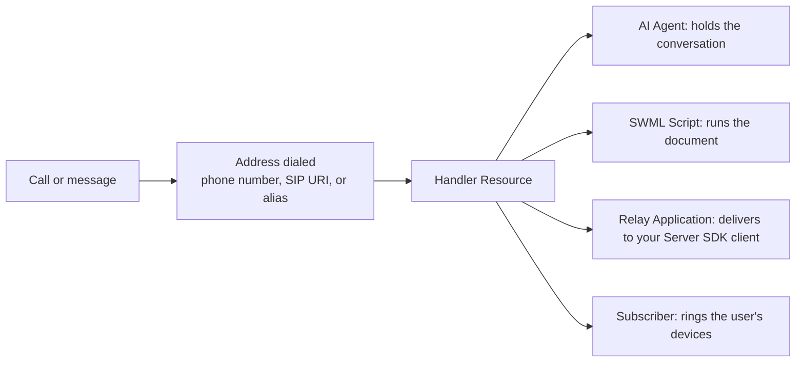

[resources]: /docs/platform/resources
[subscribers]: /docs/platform/subscribers
[phone-numbers]: /docs/platform/phone-numbers
[inbound-calling]: /docs/platform/voice/make-and-receive-calls
[sip-credentials]: /docs/platform/voice/sip/sip-credentials
[sip-gateways]: /docs/platform/voice/sip#sip-gateways
[byoc]: /docs/platform/voice/sip/bring-your-own-carrier
[swml-connect]: /docs/swml/reference/calling/connect
[browser-address-book]: /docs/browser-sdk/v4/guides/address-book
[rest-update-number]: /docs/apis/rest/phone-numbers/update-phone-number
[rest-phone-route]: /docs/apis/rest/phone-routes/assign-resource-phone-route
[rest-whatsapp-route]: /docs/apis/rest/whatsapp-routes/assign-resource-whatsapp-number
[rest-list-number-addresses]: /docs/apis/rest/phone-number-addresses/list-phone-number-addresses
[rest-link-number]: /docs/apis/rest/phone-number-addresses/create-phone-number-address
[rest-repoint-number]: /docs/apis/rest/phone-number-addresses/update-phone-number-address
[rest-unlink-number]: /docs/apis/rest/phone-number-addresses/delete-phone-number-address
[rest-list-aliases]: /docs/apis/rest/alias-addresses/list-alias-addresses
[rest-create-alias]: /docs/apis/rest/alias-addresses/create-alias-address
[rest-update-alias]: /docs/apis/rest/alias-addresses/update-alias-address
[rest-delete-alias]: /docs/apis/rest/alias-addresses/delete-alias-address
[rest-list-sip]: /docs/apis/rest/sip-addresses/list-sip-addresses
[rest-create-sip]: /docs/apis/rest/sip-addresses/create-sip-address
[rest-update-sip]: /docs/apis/rest/sip-addresses/update-sip-address
[rest-delete-sip]: /docs/apis/rest/sip-addresses/delete-sip-address
[rest-list-addresses]: /docs/apis/rest/addresses/list-resource-addresses
[rest-list-addresses-client]: /docs/apis/rest/addresses/list-resource-addresses-client
[subscriber-token]: /docs/apis/rest/subscribers/tokens/create-subscriber-token
[whatsapp-onboarding]: /docs/platform/messaging/whatsapp/onboarding

An Address is how people and code reach a [Resource][resources] on SignalWire. A caller dials a
phone number, a PBX sends a call to a SIP URI, or a browser dials a name such as
`/public/support`, and SignalWire hands the call to the Resource assigned to that Address. That
Resource is the Address's **handler**.

Your own code uses the same Addresses to name a destination: the `to` of a REST dial, the
destination of [`connect`][swml-connect] in SWML, or the argument to `dial()` in the Browser SDK.

An Address and its Resource are separate objects. A Resource can carry any number of Addresses, and
every Address hands its calls to one Resource. Because callers only ever see the Address, you can
put a different Resource behind a phone number or SIP URI without changing anything on their side.



## Address types

| Type | Looks like | Who dials it |
|---|---|---|
| [Phone number](#phone-numbers) | `+12025550123` | Anyone on the phone network |
| [SIP Address](#sip-addresses) | `sip:*@bayview-public.dapp.signalwire.com` | SIP devices, PBXs, and carriers outside SignalWire |
| [Alias](#aliases) | `/public/dispatch`, `/private/ada` | Browser SDK clients, your scripts, REST dials, and other Resources |
| [WhatsApp number](#whatsapp-numbers) | A WhatsApp business number connected to your Space | WhatsApp users |

### Phone numbers

A [phone number you've bought or ported][phone-numbers] gives you two Addresses, assigned
independently: a calling Address whose handler takes inbound calls, and a messaging Address whose
handler takes inbound messages. A number rings nobody until you assign a calling handler.

Any Resource that can take a call can be a calling handler, such as an AI Agent, a SWML Script, a
Call Flow, a Relay Application, a Subscriber, or a SIP Credential. A messaging handler is a
Resource that runs messaging logic, such as a SWML Script or a Relay Application.

### SIP Addresses

A SIP Address gives a Resource its own SIP URI so devices and systems outside SignalWire, such as a
PBX or your own carrier, can send it calls. SignalWire builds the host from your Space name and the
domain you pick:

```text
sip:<user>@<YOUR_SPACE>-<domain>.dapp.signalwire.com
```

The user defaults to `*`, which accepts any username, so `sip:anything@bayview-public.dapp.signalwire.com`
reaches the same Resource. The domain is one of your project's [contexts](#contexts), `public` by
default. Each user and domain pair is unique across your SignalWire account.

A SIP Address also carries its own call settings:

- **Password**, which callers supply to authenticate their calls. It's optional.
- **IP Whitelisting**, which accepts calls only from the IP addresses or CIDR ranges you list.
  Turning it on requires at least one entry, and the list holds up to 256.
- **Encryption**, set to required, optional, or forbidden. The default is optional.
- **Supported Codecs** and **Supported Ciphers**, which limit what calls to the address can
  negotiate. Codecs default to `PCMU` and `PCMA`, ciphers default to every supported cipher, and
  each list needs at least one entry.

A SIP Address carries calls only. It routes inbound SIP to its Resource, which makes it different
from a [SIP Credential][sip-credentials], a Resource your own SIP devices register to and place
calls from, and from a [SIP Gateway][sip-gateways], a Resource that connects your Space to an
external SIP network. To bring calls in from your own carrier, give the handling Resource a SIP
Address and point the carrier at it, as the [bring your own carrier][byoc] guide shows.

### Aliases

An alias is a name in the form `/<context>/<name>`. SignalWire creates one from the Resource's name
when you create the Resource, so an AI Agent named `Ada` is reachable at `/private/ada` and a
Subscriber named `john.doe` at `/private/john-doe`. Names use lowercase letters, numbers,
underscores, and dashes, run up to 256 characters, and are unique within their context.

The context of that first alias depends on the Resource type:

| First alias context | Resource types |
|---|---|
| `private` | AI Agents, SWML Scripts stored in your Space, Call Flows, Relay Applications, Subscribers |
| `public` | SWML Scripts served from your own URL, Video Rooms, SIP Credentials, SIP Gateways, FreeSWITCH Connectors |

A new AI Agent is therefore unreachable from a public call button on your website until you add a
`public` alias for it.

Add more aliases to expose the same Resource under other names or to shape how it's reached. Each
alias has these properties:

- **Name** is the URL-safe part of the Address. **Display Name** is the label client applications
  show, and it defaults to the name.
- **Context** is where the alias lives, such as `public` or `private`. See [Contexts](#contexts).
- **Channels** limit an alias to `audio`, `video`, `messaging`, or any combination. A
  messaging-only public alias gives a chat entry point to an agent that also takes voice calls
  through a private one.
- **Codecs** restrict the audio and video codecs offered on calls to the alias. Leave them empty to
  use the platform defaults.
- **Display As** controls how the alias appears to client applications that browse the directory:
  as an app, a room, a call, or a subscriber. The REST API returns it as `display_type`.

You can rename an alias, move it to another context, or change its channels and codecs at any
time. Its Resource stays fixed. To put a different Resource behind a name, delete the alias and
create one with the same name and context on the new Resource.

### WhatsApp numbers

A WhatsApp business number connected to your Space can be assigned to a Resource so it handles
inbound WhatsApp calls or messages. The number holds one Address at a time, for either calls or
messages, except on a Relay Application, which takes both. [WhatsApp onboarding][whatsapp-onboarding]
covers connecting the number to your Space.

## Contexts

Every alias lives in a context, and the context's access type decides who can reach it. Every
project has two built-in contexts, `public` and `private`, which can't be changed:

- **`public`** Addresses are reachable by anyone, including unauthenticated callers. Use them for
  entry points such as a support agent behind a call button on your website.
- **`private`** Addresses are reachable only by authenticated users, which makes them the home of
  [Subscribers][subscribers] and anything only your own users should dial.

You can add your own contexts from **Addresses** > **Contexts** in the Dashboard. A new context
takes a **Domain**, made of letters, numbers, and dashes, and inherits its access type from either
`public` or `private`. The domain becomes part of the host of every SIP Address you create in the
context. Deleting a context deletes every Address in it.

Phone numbers don't belong to a context you choose. The **Addresses** page lists them in the
`External` context.

When you dial an alias from a REST call, SWML [`connect`][swml-connect], or a client, write the
full `/<context>/<name>`.

## How SignalWire resolves an Address

When a call or message arrives, SignalWire works through these steps:

1. It looks up the Address the call or message was sent to.
2. It finds that Address's handler. For a phone number, a call goes to the handler of its calling
   Address and a message to the handler of its messaging Address. A client dialing an alias can
   use only the channels the alias allows.
3. It hands the call or message to the handler, and the Resource's type decides what happens
   next.

Because the Resource is what handles the call, the same logic runs whether the caller dialed the
phone number, the SIP Address, or an alias. See [inbound calling][inbound-calling] for the handler
code itself.

## One Resource, many Addresses

Give one Resource every Address its callers need rather than duplicating the Resource per channel.
Bayview Taxi's dispatcher, Ada, is one AI Agent Resource with four Addresses:

| Address | Who uses it |
|---|---|
| `+12025550123` | Riders calling from the phone network |
| `sip:*@bayview-public.dapp.signalwire.com` | Bayview's office PBX forwarding calls over SIP |
| `/public/dispatch` | The call button on Bayview's website |
| `/private/ada` | Drivers dialing from Bayview's own app as signed-in Subscribers |

To move every caller to a new version of Ada, Bayview assigns the phone number and the SIP Address
to the new Resource, then re-creates the two aliases on it. The number, the SIP URI, and
`/public/dispatch` all stay the same, so nothing that dials them changes.

## Create and manage Addresses

In the Dashboard, open a Resource and select its **Addresses & Phone Numbers** tab, then select
<kbd>+ Add</kbd> to **Assign a Phone Number**, **Assign a SIP Address**, or **Add an Alias**. The
**Addresses** page in the left sidebar lists every Address in your project with its context, type,
and handlers, and creates aliases and SIP Addresses for any Resource you pick. Every alias and SIP
Address needs a Resource when you create it.

Moving an Address depends on its type:

- **Phone number:** assign a different Resource as its call or message handler from the number's
  settings or with [Update phone number][rest-update-number].
- **SIP Address:** open it in the Dashboard, select **Change Resource**, and pick the new Resource.
  The SIP Address keeps its URI.
- **Alias:** delete it and create one with the same name and context on the new Resource.

Removing an Address removes only that way in. The Resource stays, and a phone number stays in your
project, unassigned, until you assign another Resource. Select **Delete Address** next to an
Address on its Resource's **Addresses & Phone Numbers** tab, or use [Delete SIP address][rest-delete-sip]
to delete a SIP Address together with its settings.

With the REST API, every create call takes the ID of the Resource that handles the Address:

| Task | Endpoints |
|---|---|
| Manage aliases | [List][rest-list-aliases], [create][rest-create-alias], [update][rest-update-alias], [delete][rest-delete-alias] |
| Manage SIP Addresses | [List][rest-list-sip], [create][rest-create-sip], [update][rest-update-sip], [delete][rest-delete-sip] |
| Manage a phone number's calling and messaging Addresses (beta) | [List][rest-list-number-addresses], [link][rest-link-number], [re-point][rest-repoint-number], [remove][rest-unlink-number] |
| Assign a number or WhatsApp number from the Resource's side | [Assign Resource to phone route][rest-phone-route], [Assign Resource to WhatsApp number][rest-whatsapp-route] |
| List the Addresses assigned to one Resource | [List Resource Addresses][rest-list-addresses] |
| List Addresses from a client authenticated with a [Subscriber token][subscriber-token] | [List Resource Addresses from a Client][rest-list-addresses-client] |

In the Browser SDK, a client signed in as a Subscriber lists Addresses through `client.directory$`
and dials the URI each entry returns. The [address book guide][browser-address-book] shows how.

## Next steps

<CardGroup cols={2}>
  <Card title="Resources" icon="regular cubes" href="/docs/platform/resources">
    The Resource types an Address can point at, and how to create and manage them.
  </Card>
  <Card title="Inbound calling" icon="regular phone-arrow-down-left" href="/docs/platform/voice/make-and-receive-calls">
    Assign a number and write the code that answers when it rings.
  </Card>
  <Card title="Subscribers" icon="regular users" href="/docs/platform/subscribers">
    Users with private Addresses that ring their browser, mobile, or SIP devices.
  </Card>
  <Card title="Phone numbers" icon="regular hashtag" href="/docs/platform/phone-numbers">
    Buy, port, verify, and manage the numbers you assign to Resources.
  </Card>
</CardGroup>
