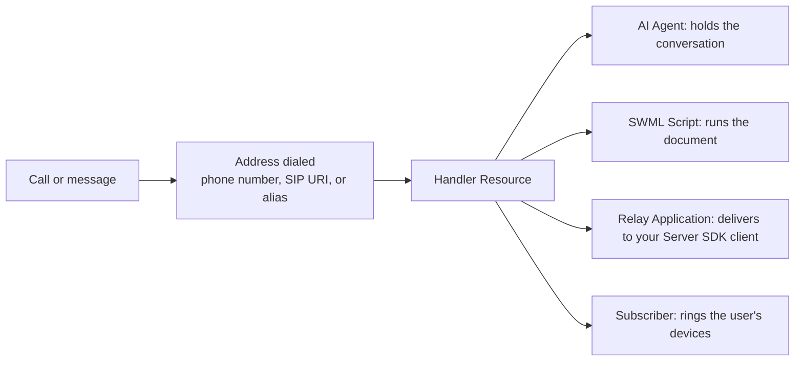

[resources]: /docs/platform/resources
[call-path]: /docs/platform/resources#how-a-call-reaches-a-resource
[subscribers]: /docs/platform/subscribers
[phone-numbers]: /docs/platform/phone-numbers
[inbound-calling]: /docs/platform/voice/make-and-receive-calls
[sip-credentials]: /docs/platform/voice/sip/sip-credentials
[sip-gateways]: /docs/platform/voice/sip#sip-gateways
[byoc]: /docs/platform/voice/sip/bring-your-own-carrier
[swml-connect]: /docs/swml/reference/calling/connect
[browser-sdk]: /docs/browser-sdk
[browser-address-book]: /docs/browser-sdk/v4/guides/address-book
[rest-calls]: /docs/apis/rest/calls/call-commands
[rest-phone-route]: /docs/apis/rest/phone-routes/assign-resource-phone-route
[rest-whatsapp-route]: /docs/apis/rest/whatsapp-routes/assign-resource-whatsapp-number
[rest-list-number-addresses]: /docs/apis/rest/phone-number-addresses/list-phone-number-addresses
[rest-link-number]: /docs/apis/rest/phone-number-addresses/create-phone-number-address
[rest-repoint-number]: /docs/apis/rest/phone-number-addresses/update-phone-number-address
[rest-unlink-number]: /docs/apis/rest/phone-number-addresses/delete-phone-number-address
[rest-list-aliases]: /docs/apis/rest/alias-addresses/list-alias-addresses
[rest-create-alias]: /docs/apis/rest/alias-addresses/create-alias-address
[rest-update-alias]: /docs/apis/rest/alias-addresses/update-alias-address
[rest-delete-alias]: /docs/apis/rest/alias-addresses/delete-alias-address
[rest-list-sip]: /docs/apis/rest/sip-addresses/list-sip-addresses
[rest-create-sip]: /docs/apis/rest/sip-addresses/create-sip-address
[rest-update-sip]: /docs/apis/rest/sip-addresses/update-sip-address
[rest-delete-sip]: /docs/apis/rest/sip-addresses/delete-sip-address
[rest-list-addresses]: /docs/apis/rest/addresses/list-resource-addresses
[rest-list-addresses-client]: /docs/apis/rest/addresses/list-resource-addresses-client
[subscriber-token]: /docs/apis/rest/subscribers/tokens/create-subscriber-token
[whatsapp-onboarding]: /docs/platform/messaging/whatsapp/onboarding

An Address is how people and code reach a [Resource][resources] on SignalWire. A caller dials a
phone number, a private branch exchange (PBX) sends a call to a SIP URI, or a browser dials a name
such as `/public/support`, and SignalWire hands the call to the Resource assigned to that Address.
That Resource is the Address's **handler**.

Your own code uses the same Addresses to name a destination: the `to` of a call you create with
the [REST API][rest-calls], the destination of [`connect`][swml-connect] in SWML, or the argument
to `dial()` in the [Browser SDK][browser-sdk].

Every Address has exactly one handler, and callers only ever see the Address.
[How a call reaches a Resource][call-path] walks through the full path from the dialed Address to
the Resource that answers.



## Address types

| Type | Looks like | Who dials it |
|---|---|---|
| [Phone number](#phone-numbers) | `+12025550123` | Anyone on the phone network |
| [SIP Address](#sip-addresses) | `sip:*@bayview-public.dapp.signalwire.com` | SIP devices, PBXs, and carriers outside SignalWire |
| [Alias](#aliases) | `/public/ada`, `/private/dispatch` | Browser SDK clients, your scripts, REST API calls, and other Resources |
| [WhatsApp number](#whatsapp-numbers) | A WhatsApp business number connected to your Space | WhatsApp users |

### Phone numbers

A [phone number you've bought or ported][phone-numbers] gives you two Addresses, assigned
independently: a calling Address whose handler takes inbound calls, and a messaging Address whose
handler takes inbound messages. Assign a calling handler to start taking calls on the number.

Any Resource that can take a call can be a calling handler, such as an AI Agent, a SWML Script, a
Call Flow, a Relay Application, a Subscriber, or a SIP Credential. A messaging handler is a
Resource that runs messaging logic, such as a SWML Script created for messaging or a Relay
Application.

### SIP Addresses

A SIP Address gives a Resource its own SIP URI so devices and systems outside SignalWire, such as a
PBX or your own carrier, can send it calls. SignalWire builds the host from your Space name and the
domain you pick:

```text
sip:<user>@<YOUR_SPACE>-<domain>.dapp.signalwire.com
```

The user defaults to `*`, which accepts any username, so `sip:anything@bayview-public.dapp.signalwire.com`
reaches the same Resource. The domain is one of your project's [contexts](#contexts), `public` by
default. Each user and domain pair is unique across your Space.

A SIP Address also carries its own settings:

| Setting | Behavior |
|---|---|
| Name | Required. Up to 50 lowercase letters, numbers, hyphens, and underscores. No other Address in the project can have the same name |
| Password | Optional. Callers supply it to authenticate their calls |
| IP allowlist | Labeled **IP Whitelisting** in the Dashboard. Accepts calls only from the IP addresses or Classless Inter-Domain Routing (CIDR) ranges you list. Turning it on requires at least one entry, and the list holds up to 256 |
| Encryption | Required, optional, or forbidden. The default is optional |
| Supported Codecs | Limits the codecs calls to the address can negotiate. Defaults to `PCMU` and `PCMA`, and needs at least one entry |
| Supported Ciphers | Limits the ciphers calls to the address can negotiate. Defaults to every supported cipher, and needs at least one entry |

A SIP Address carries calls only. It routes inbound SIP to its Resource, which makes it different
from a [SIP Credential][sip-credentials], a Resource your own SIP devices register to and place
calls from, and from a [SIP Gateway][sip-gateways], a Resource that connects your Space to an
external SIP network. To bring calls in from your own carrier, give the handling Resource a SIP
Address and point the carrier at it, as the [bring your own carrier][byoc] guide shows.

### Aliases

An alias is a name in the form `/<context>/<name>`. SignalWire creates one from the Resource's name
when you create the Resource, so an AI Agent named `Ada` that you add in the Dashboard is reachable
at `/public/ada`. A Subscriber's alias comes from its display name, or from the part of its email
before the `@` when it has none, so a Subscriber with the email `john.doe@example.com` is reachable
at `/private/john-doe`. Names use lowercase letters, numbers, underscores, and dashes, run up to
256 characters, and are unique within their context.

The context of that first alias depends on the Resource type. For the most common types:

| First alias context | Resource types |
|---|---|
| `private` | AI Agents created with the REST API, SWML Scripts stored in your Space, Call Flows, Relay Applications, Subscribers |
| `public` | AI Agents added in the Dashboard, Dialogflow agents, SWML Scripts served from your own URL, Video Rooms, SIP Credentials, SIP Gateways, FreeSWITCH Connectors |

The first alias of an AI Agent added in the Dashboard takes audio calls only. To reach an AI Agent
created with the REST API from a public call button on your website, add a `public` alias for it.

Add more aliases to expose the same Resource under other names or to shape how it's reached. Each
alias has these properties:

| Property | Behavior |
|---|---|
| Name | The URL-safe part of the Address |
| Display Name | The label client applications show. Defaults to the name |
| Context | Where the alias lives, such as `public` or `private`. See [Contexts](#contexts) |
| Channels | Limit the alias to `audio`, `video`, `messaging`, or any combination. A messaging-only public alias gives a chat entry point to an agent that also takes voice calls through a private one |
| Codecs | Restrict the audio and video codecs offered on calls to the alias. Leave them empty to use the platform defaults |
| Display As | How the alias appears to client applications that browse the directory: as an app, a room, a call, or a subscriber. The REST API returns it as `display_type` |

You can rename an alias, move it to another context, or change its channels and codecs at any
time. Its Resource stays fixed. To put a different Resource behind a name, delete the alias and
create one with the same name and context on the new Resource.

### WhatsApp numbers

A WhatsApp business number connected to your Space can be assigned to a Resource so it handles
inbound WhatsApp calls or messages. The number holds one Address at a time, for either calls or
messages. The exception is a Relay Application assigned in the Dashboard, which takes both. Through
the REST API, every assignment sets a single handler and removes the other, including for a Relay
Application. [WhatsApp onboarding][whatsapp-onboarding] covers connecting the number to your Space.

## Contexts

Every alias lives in a context, and the context's access type decides who can reach it. Every
project has two built-in contexts, `public` and `private`, which can't be changed:

| Context | Who can reach its Addresses | Use it for |
|---|---|---|
| `public` | Anyone, including unauthenticated callers | Entry points such as a support agent behind a call button on your website |
| `private` | Only authenticated users | [Subscribers][subscribers] and anything only your own users should dial |

If your Dashboard shows **Addresses** in the left sidebar, you can add your own contexts from
**Addresses** > **Contexts**. A new context
takes a **Domain**, made of letters, numbers, and dashes, and inherits its access type from either
`public` or `private`. The domain becomes part of the host of every SIP Address you create in the
context. Deleting a context deletes every Address in it.

Phone numbers don't belong to a context you choose. SignalWire places them in the `external`
context.

When you dial an alias from a REST API call, SWML [`connect`][swml-connect], or a client, write the
full `/<context>/<name>`.

## How SignalWire resolves an Address

SignalWire hands each call or message to the handler of the Address it was sent to, following the
[path from Address to Resource][call-path]. Two rules depend on the Address type:

- For a phone number, a call goes to the handler of its calling Address and a message to the
  handler of its messaging Address.
- A client dialing an alias can use only the channels the alias allows.

Because the Resource is what handles the call, the same logic runs whether the caller dialed the
phone number, the SIP Address, or an alias. See [inbound calling][inbound-calling] for the handler
code itself.

## One Resource, many Addresses

Give one Resource every Address its callers need rather than duplicating the Resource per channel.
Bayview Taxi's dispatcher, Ada, is one AI Agent Resource with four Addresses:

| Address | Who uses it |
|---|---|
| `+12025550123` | Riders calling from the phone network |
| `sip:*@bayview-public.dapp.signalwire.com` | Bayview's office PBX forwarding calls over SIP |
| `/public/ada` | The call button on Bayview's website. SignalWire created this alias with the Resource |
| `/private/dispatch` | Drivers dialing from Bayview's own app as signed-in Subscribers |

To move every caller to a new version of Ada, Bayview assigns the phone number and the SIP Address
to the new Resource. It then deletes the two aliases from the old Resource and re-creates them on
the new one, which frees `/public/ada` so the new alias doesn't get a random suffix. The number,
the SIP URI, and both aliases stay the same, so nothing that dials them changes.

## Create and manage Addresses

Every alias and SIP Address needs a Resource when you create it.

<llms-ignore>

In the Dashboard, open a Resource and select its **Addresses & Phone Numbers** tab, then select
<kbd>+ Add</kbd> to **Assign a Phone Number**, **Assign a SIP Address**, or **Add an Alias**.

</llms-ignore>

Moving an Address depends on its type:

- **Phone number:** assign a different Resource as its call or message handler from the number's
  settings, with [Assign Resource to phone route][rest-phone-route], or with
  [Update phone number address][rest-repoint-number].
- **SIP Address:** open it in the Dashboard, select **Change Resource**, and pick the new Resource.
  The SIP Address keeps its URI.
- **Alias:** delete it and create one with the same name and context on the new Resource.

Removing an Address removes only that way in. The Resource stays, and a phone number stays in your
project, unassigned, until you assign another Resource. Select **Delete Address** next to an
Address on its Resource's **Addresses & Phone Numbers** tab, or use [Delete SIP address][rest-delete-sip]
to delete a SIP Address together with its settings.

With the REST API, every create call takes the ID of the Resource that handles the Address:

| Task | Endpoints |
|---|---|
| Manage aliases | [List][rest-list-aliases], [create][rest-create-alias], [update][rest-update-alias], [delete][rest-delete-alias] |
| Manage SIP Addresses | [List][rest-list-sip], [create][rest-create-sip], [update][rest-update-sip], [delete][rest-delete-sip] |
| Manage a phone number's calling and messaging Addresses (beta) | [List][rest-list-number-addresses], [link][rest-link-number], [re-point][rest-repoint-number], [remove][rest-unlink-number] |
| Assign a number or WhatsApp number from the Resource's side | [Assign Resource to phone route][rest-phone-route], [Assign Resource to WhatsApp number][rest-whatsapp-route] |
| List the Addresses assigned to one Resource | [List Resource Addresses][rest-list-addresses] |
| List Addresses from a client authenticated with a [Subscriber token][subscriber-token] | [List Resource Addresses from a Client][rest-list-addresses-client] |

In the Browser SDK, a client signed in as a Subscriber lists Addresses through `client.directory$`
and dials the URI each entry returns. The [address book guide][browser-address-book] shows how.

## Next steps

<CardGroup cols={2}>
  <Card title="Resources" icon="regular cubes" href="/docs/platform/resources">
    The Resource types an Address can point at, and how to create and manage them.
  </Card>
  <Card title="Inbound calling" icon="regular phone-arrow-down-left" href="/docs/platform/voice/make-and-receive-calls">
    Assign a number and write the code that answers when it rings.
  </Card>
  <Card title="Subscribers" icon="regular users" href="/docs/platform/subscribers">
    Users with private Addresses that ring their browser, mobile, or SIP devices.
  </Card>
  <Card title="Phone numbers" icon="regular hashtag" href="/docs/platform/phone-numbers">
    Buy, port, verify, and manage the numbers you assign to Resources.
  </Card>
</CardGroup>
