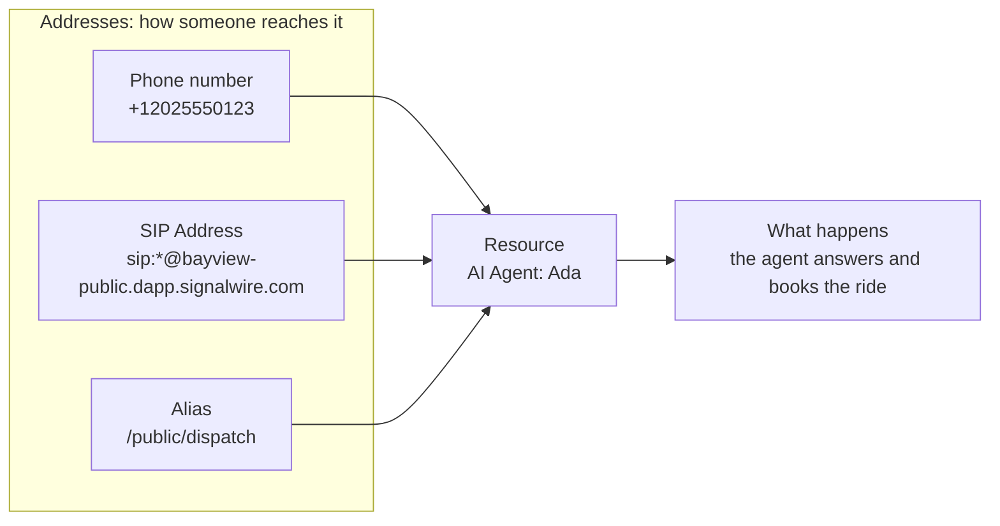

[addresses]: /docs/platform/addresses
[aliases]: /docs/platform/addresses#aliases
[contexts]: /docs/platform/addresses#contexts
[manage-addresses]: /docs/platform/addresses#create-and-manage-addresses
[ai]: /docs/platform/ai
[cfb]: /docs/call-flow-builder
[relay-client]: /docs/server-sdks/guides/relay-client
[swml]: /docs/swml
[sip-credentials]: /docs/platform/voice/sip/sip-credentials
[sip-gateways]: /docs/platform/voice/sip#sip-gateways
[subscribers]: /docs/platform/subscribers
[video]: /docs/platform/video
[rest-list-resources]: /docs/apis/rest/resources/list-resources
[rest-get-resource]: /docs/apis/rest/resources/get-resource
[rest-delete-resource]: /docs/apis/rest/resources/delete-resource
[rest-list-addresses]: /docs/apis/rest/addresses/list-resource-addresses
[rest-create-swml-script]: /docs/apis/rest/swml-scripts/create-swml-script

A Resource is the part of your SignalWire Space that handles a call or message. An AI Agent that
holds a conversation is a Resource. So is a SWML Script that runs call logic, a Subscriber whose
devices ring, and a Video Room that several people join.

Nobody dials a Resource directly. People and code reach it through an [Address][addresses]: a
phone number, a SIP URI, or a name such as `/public/support`. The Resource decides what happens,
and the Address decides how someone gets there.

Keeping the two apart lets you change either side without touching the other. You can point a
phone number at a new Resource and callers keep dialing the same number, or give one Resource a
phone number, a SIP URI, and a web entry point that all run the same logic.

## How a call reaches a Resource

Every inbound call or message follows the same path:

1. Someone dials an Address. A caller on the phone network dials a phone number, a PBX or carrier
   sends a SIP call to a SIP Address, and a browser, script, or another Resource dials an alias.
2. SignalWire looks up the Address and finds its **handler**, the one Resource assigned to it. A
   phone number gives you two Addresses, one for calls and one for messages, so each can go to a
   different Resource.
3. The handler runs. What it does depends on its type: an AI Agent holds the conversation, a SWML
   Script runs its document, a Relay Application delivers the call to your server, and a Subscriber
   rings that user's devices.

Consider Bayview Taxi. Its dispatcher, Ada, is an AI Agent Resource. Riders reach Ada by calling
the company's phone number or by pressing a call button on its website, which dials the alias
`/public/dispatch`. Both Addresses have Ada as their handler, so every rider gets the same
conversation however they got there. When Bayview builds a new version of Ada, it assigns the phone
number to the new Resource, and riders never notice the change.

## What each part controls

| Part | What it controls |
|---|---|
| Address | Who can reach the Resource and how: the phone number, SIP URI, or alias someone dials |
| [Context][contexts] | Whether an alias is open to anyone (`public`) or only to your authenticated users (`private`) |
| Resource | What happens when the call or message arrives, set by the Resource's type and configuration |

## Resource types

Every Resource has a type, and the type decides what the Resource does with a call or message.

| Type | What it does | Choose it when |
|---|---|---|
| [AI Agent][ai] | Holds automated conversations with your callers, using a prompt, voice, and functions you configure in the Dashboard | A conversation should be handled by AI |
| [SWML Script][swml] | Controls calls and messages with a SWML document in JSON or YAML, stored in your Space or served from your own URL | You want to describe call or message logic as a document |
| [Call Flow][cfb] | Routes calls with logic you build in the visual Call Flow Builder | You'd rather draw the logic than write it |
| [Relay Application][relay-client] | Hands calls and messages to your own server over a real-time WebSocket connection from the Server SDKs | Your own code should control each call as it happens |
| [Subscriber][subscribers] | Represents a user of your application, with sign-in credentials and devices that ring when the user is called | A person should receive the call on their browser, app, or SIP phone |
| [Video Room][video] | Gives participants a shared room to join by video, audio, or both | Several people should meet in one place |
| [SIP Credential][sip-credentials] | Gives your SIP phones and softphones a username and password to register with and place calls from | You have SIP devices that should connect to your Space |
| [SIP Gateway][sip-gateways] | Connects your Space to an external SIP network | Calls should reach SIP infrastructure outside SignalWire |
| FreeSWITCH Connector | Sends traffic from SignalWire to your own FreeSWITCH infrastructure | You run FreeSWITCH and want SignalWire to send calls to it |

Most types can take calls. Messages go only to Resources that run messaging logic: SWML Scripts
and Relay Applications.

## Resources and Addresses

A Resource can carry any number of Addresses, and each Address hands its calls to one Resource.
Deleting an Address never deletes the Resource behind it.

SignalWire gives every new Resource one [alias][aliases] so it's reachable right away. The alias
name is a URL-safe form of the Resource name, so an AI Agent named `Support Agent` is reachable at
`/private/support-agent`. If that name is already taken in the alias's context, SignalWire adds a
short random suffix. Renaming the Resource later keeps the alias it already has.

To take calls from the phone network or from SIP systems outside SignalWire, give the Resource a
phone number or a SIP Address. Both can move to a different Resource later, so the number or SIP
URI that callers use stays the same when you change the logic behind it. The
[Addresses page][addresses] covers each Address type and how contexts decide who can dial them.

## Create and manage Resources

In the [SignalWire Dashboard](https://my.signalwire.com/resources), select **My Resources** in the
left sidebar to list every Resource in your project, then select <kbd>+ Add</kbd> to create one.
**Script** asks you to choose **SWML Script**, **AI Agent** offers a custom agent or a Google
Dialogflow agent, and **SIP** asks you to choose **SIP Credential** or **SIP Gateway**. Open any
Resource to find its settings on the **Configuration** tab and its Addresses on the
**Addresses & Phone Numbers** tab, where you can also [add more][manage-addresses].

<Info title="No My Resources page?">
If the left sidebar doesn't show **My Resources**, your Space is on the Legacy Dashboard.
[Contact Support](https://support.signalwire.com/) to move your Space to the current Dashboard.
</Info>

With the REST API, create or update a Resource through the endpoints for its type, such as
[Create SWML Script][rest-create-swml-script]. The generic Resources endpoints work with every
type: [list Resources][rest-list-resources], with an optional `type` filter such as `swml_script`
or `subscriber`; [retrieve][rest-get-resource] or [delete][rest-delete-resource] one by ID; and
[list a Resource's Addresses][rest-list-addresses].

Deleting a Resource also deletes its aliases. A Resource that is still assigned as a handler can't
be deleted: the call or message handler of a phone number or WhatsApp number, the handler of a SIP
Address, or the Resource a SIP Credential sends its calls to. The Dashboard reports that a resource
currently assigned as a call or message handler can't be deleted. Assign those Addresses to
another Resource first, then delete it.

## Next steps

<CardGroup cols={2}>
  <Card title="Addresses" icon="regular at" href="/docs/platform/addresses">
    Phone numbers, SIP Addresses, aliases, and the contexts that decide who can dial them.
  </Card>
  <Card title="Subscribers" icon="regular users" href="/docs/platform/subscribers">
    The Resource type for the people who use your application.
  </Card>
  <Card title="System-directed AI" icon="regular robot" href="/docs/platform/ai">
    How an AI Agent Resource holds a conversation while your code supplies data and rules.
  </Card>
  <Card title="Resources REST API" icon="regular code" href="/docs/apis/rest/resources/list-resources">
    List, retrieve, and delete Resources programmatically.
  </Card>
</CardGroup>
