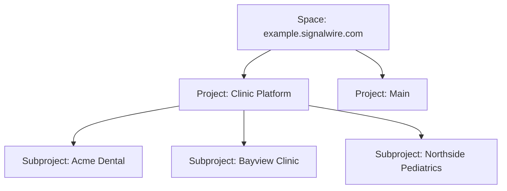

[projects]: /docs/platform/projects
[create-subproject]: /docs/platform/projects#create-a-subproject
[api-credentials]: /docs/platform/your-signalwire-api-space
[campaign-registry]: /docs/platform/messaging/campaign-registry
[create-subproject-api]: /docs/apis/rest/projects/create-subproject
[create-token]: /docs/apis/rest/project-tokens/create-token
[member-projects]: /docs/apis/rest/space/members/list-member-projects
[enable-member-project]: /docs/apis/rest/space/members/enable-member-project
[list-projects]: /docs/apis/rest/projects/list-projects
[update-number-compat]: /docs/compatibility-api/rest/incoming-phone-numbers/update-incoming-phone-number
[server-sdks]: /docs/server-sdks
[get-statement]: /docs/apis/rest/space/billing/get-billing-statement
[get-usage]: /docs/apis/rest/space/billing/get-usage
[pat]: /docs/apis/authorization#personal-access-tokens
[e911]: /docs/platform/e911

Your SignalWire Space can hold everything your business builds, including a separate,
isolated workspace for each of your customers.
You don't need a new Space per customer, per app, or per environment.
One Space with Projects and Subprojects keeps your billing, your team, and your Dashboard in one
place, while each customer still gets its own phone numbers, credentials, and logs.

## How the levels fit together

A **Space** is your SignalWire account's home, reached at its own subdomain such as
`example.signalwire.com`.
Inside it, **Projects** group what you build, and each Project can hold **Subprojects**, one level
deep.



A Subproject is a complete Project in its own right, with its own Project ID, API tokens, phone
numbers, and Resources.
The only thing it can't do is hold Subprojects of its own.

### What each level owns

The Space owns everything that is about your business as a whole.
Every Project and Subproject in it shares these:

- The Space URL, such as `example.signalwire.com`, that the Dashboard and every API request go through
- The balance, payment methods, billing profile, and monthly statements
- The members of your team and their access levels
- [Trial mode](/docs/platform/trial-mode), and Space settings such as geographic permissions

Projects and Subprojects own everything that is about one workload.
Each one keeps its own copy, isolated from the others:

| Belongs to each Project and Subproject | Where to find it in the Dashboard |
|---|---|
| Project ID, API tokens, and webhook signing key | **API Credentials** |
| Phone numbers | **Phone Numbers** |
| Resources, such as AI Agents, SIP endpoints, and Subscribers | **My Resources** |
| 10DLC brands and campaigns | **Messaging Campaigns** |
| Call, message, and other logs | **Logs** |
| SIP URI, in the form `example-<name>.sip.signalwire.com` | **Configuration** > **SIP Settings** |
| [Media URL protection](/docs/platform/media-protection) settings | **Configuration** > **Project** |

A Subproject's API token reaches only that Subproject, so credentials you give to one customer's
integration can't touch another customer's numbers or logs.

The Space menu, opened from the Space name at the top of the sidebar, holds the Space-level
settings: **Space Settings**, **Members**, **Usage & Billing**, your balance, and **Switch Space**.

## Choose a structure

The hierarchy has no fixed meaning.
A Project is whatever you need to keep separate, so pick the structure that matches who you serve.

### Your customers' customers

If you build a product that other businesses use, give that product a root Project, and give each
of your customers a Subproject beneath it.

Take a company that sells appointment-reminder software to medical practices.
It creates a root Project called **Clinic Platform**, and each practice that signs up gets its own
Subproject: **Acme Dental**, **Bayview Clinic**, **Northside Pediatrics**.
That structure gives each practice:

- Its own phone numbers, Resources, and logs, listed only inside its Subproject
- Its own 10DLC brand and campaigns, registered under the practice's own business name through the
  [Campaign Registry][campaign-registry]
- Its own API token, which can't read or change another practice's Subproject
- Its own row on your monthly statement, so you can bill each practice for what it used

Usage from every Subproject draws on the Space's one balance, so you fund one account and still see
each customer's share. See [Bill customers by Project](#bill-customers-by-project).

Your application doesn't have to wait for someone to click through the Dashboard: it can create
each customer's Subproject the moment they sign up.
See [Create a Subproject when a customer signs up](#create-a-subproject-when-a-customer-signs-up).

### Environments

Keep test traffic away from live customers by giving each environment its own root Project, such as
**Production** and **Staging**.
Numbers, Resources, and credentials stay apart, so a test script with a Staging token can't reach a
Production number, and both environments draw on the same balance.

### Teams and products

When different teams or product lines share a Space, give each one a root Project and grant each
member only the Projects they work on.
Every team keeps its own numbers and logs, and your billing and member list stay in one place.

### When to create another Space

Create a separate Space only when you need something that the Space itself owns to be separate:

- A different balance, payment method, or billing profile, such as a business unit that pays its own bills
- A completely different set of members
- A different Space URL

A new customer, a new app, or a new environment doesn't need a new Space; a Project or Subproject
covers it.
Every Space is set up, verified, and funded on its own, so splitting work across several Spaces
multiplies that setup and spreads your usage and team across several Dashboards.

## Set up Projects and Subprojects in the Dashboard

Creating a root Project takes the owner or administrator access level.
Any member who can open a root Project can create Subprojects beneath it.

<Steps>

<Step title="Create a root Project">

Open the Project menu by clicking the Project name at the top of the Dashboard, select
**Create New Project**, enter a name, and select **Save**.
The Dashboard switches to the new Project.

</Step>

<Step title="Add Subprojects">

With the root Project selected, open **Configuration** > **Subprojects** in the sidebar.
The page lists the Project's Subprojects, and **New** opens the **Create a New Subproject** form.
Enter the Subproject's name and select **Save**.

**Configuration** > **Subprojects** appears only while a root Project is selected, since a
Subproject can't hold Subprojects of its own.

After you save, the Dashboard switches to the new Subproject.
To add another, select the root Project again first.

</Step>

<Step title="Switch between Projects">

Open the Project menu and select **Switch Project**.
Subprojects are listed under their root Project, and the header shows both names while a Subproject
is selected, for example **Clinic Platform / Northside Pediatrics**.
Over the API, [List projects][list-projects] returns the same tree, and each entry reports whether
it's a Subproject and which Project it belongs to.

<llms-ignore>

<Frame caption="Switch Project lists each Subproject beneath its root Project">
  
</Frame>

</llms-ignore>

</Step>

<Step title="Give your team access">

Open the Space menu, select **Members**, then **Invite**.
Choose an **Access Level** of **User** or **Administrator**, and under **Project Access** turn on
each root Project the person should reach.

Access to a root Project includes all of its Subprojects, so **Project Access** lists root Projects
only.
A member sees only the Projects they've been granted, along with their Subprojects.

To change an existing member's access over the API, use
[Enable a member for a project][enable-member-project] and
[List a member's projects][member-projects] with a [Personal access token][pat].

</Step>

</Steps>

To confirm the setup, open **Switch Project**: each Subproject should appear indented under its root
Project.
If **Configuration** > **Subprojects** is missing from the sidebar, a Subproject is selected; switch
to its root Project and look again.

## Create a Subproject when a customer signs up

When your application onboards a new customer, it can create the customer's Subproject and its
first API token in two calls, authenticated with the root Project's credentials.
The [Server SDKs][server-sdks] wrap both calls:

| Value | Replace with |
|---|---|
| `<YOUR_SPACE>` | Your Space name, such as `example` for `example.signalwire.com` |
| `<YOUR_PROJECT_ID>` | The root Project's Project ID, from **API Credentials** |
| `<YOUR_API_TOKEN>` | An API token for the root Project with the **Management** permission |
| `<YOUR_SUBPROJECT_ID>` | The `id` returned when you create the Subproject (cURL only) |

<CodeBlocks>

```python title="Python — REST client"
# Install: python -m pip install signalwire-sdk
# Save as onboard_customer.py and run: python onboard_customer.py
from signalwire.rest import RestClient

client = RestClient(
    project="<YOUR_PROJECT_ID>",
    token="<YOUR_API_TOKEN>",
    host="<YOUR_SPACE>.signalwire.com",
)

subproject = client.projects.create(name="Acme Dental")
token = client.project.tokens.create(
    name="Acme Dental integration",
    permissions=["calling", "messaging", "numbers"],
    subproject_id=subproject["id"],
)

print("Subproject ID:", subproject["id"])
print("API token:", token["token"])
```

```typescript title="TypeScript — REST client"
// Install: npm install @signalwire/sdk
// This sample also runs as JavaScript: save as onboard-customer.mjs,
// then run: node onboard-customer.mjs
import { RestClient } from "@signalwire/sdk";

const client = new RestClient({
  project: "<YOUR_PROJECT_ID>",
  token: "<YOUR_API_TOKEN>",
  host: "<YOUR_SPACE>.signalwire.com",
});

const subproject = await client.projects.create({ name: "Acme Dental" });
const token = await client.project.tokens.create(
  "Acme Dental integration",
  ["calling", "messaging", "numbers"],
  { subproject_id: subproject.id },
);

console.log("Subproject ID:", subproject.id);
console.log("API token:", token.token);
```

```bash title="cURL — REST API"
# Create the Subproject
curl -X POST "https://<YOUR_SPACE>.signalwire.com/api/projects" \
  -u "<YOUR_PROJECT_ID>:<YOUR_API_TOKEN>" \
  -H "Content-Type: application/json" \
  -d '{"name": "Acme Dental"}'

# Issue it an API token, using the id from the response above
curl -X POST "https://<YOUR_SPACE>.signalwire.com/api/project/tokens" \
  -u "<YOUR_PROJECT_ID>:<YOUR_API_TOKEN>" \
  -H "Content-Type: application/json" \
  -d '{"name": "Acme Dental integration", "permissions": ["calling", "messaging", "numbers"], "subproject_id": "<YOUR_SUBPROJECT_ID>"}'
```

</CodeBlocks>

The calls are [Create a project][create-subproject-api] and [Create API token][create-token].
Store the new Subproject's ID and token in your own records for that customer: your integration
authenticates as the customer's Subproject with that ID as the username and that token as the
password.
The create response also carries the Subproject's `signing_key`, returned only this once; the
[Projects][create-subproject] page covers it, along with the error you get when a Subproject tries to
create one of its own.

## Move a phone number to another Project

If you bought numbers before setting up Subprojects, you can move them where they belong.
Open the number from **Phone Numbers**, select **Transfer Number**, re-enter the number to confirm,
and pick the destination under **Transfer to**.

A number can move to any Project or Subproject in the same Space that you have access to.
The transfer is blocked while the number has an [E911 address][e911] assigned or while a port-in for
it is in progress.

To move a number over the API, set `AccountSid` to the destination Project's ID with
[Update an incoming phone number][update-number-compat] in the Compatibility API.

## Bill customers by Project

Each monthly statement includes a **Per Project Totals** section, which you can filter by Project or
search by Project name, and every Subproject appears as its own row.
Open it from the Space menu under **Usage & Billing** > **Statements**; statements are visible to
owners and administrators.

To pull the same breakdown into your own billing system, use
[Retrieve a statement][get-statement], which accepts a `project` filter, or
[Retrieve usage][get-usage].
Both authenticate with a [Personal access token][pat].

## Next steps

<CardGroup cols={2}>
  <Card title="Projects" icon="regular cubes" href="/docs/platform/projects">
    Create, update, and delete Projects and Subprojects through the API.
  </Card>
  <Card title="API credentials" icon="regular key" href="/docs/platform/your-signalwire-api-space">
    Find a Project's Project ID and Space URL, and issue API tokens.
  </Card>
</CardGroup>
