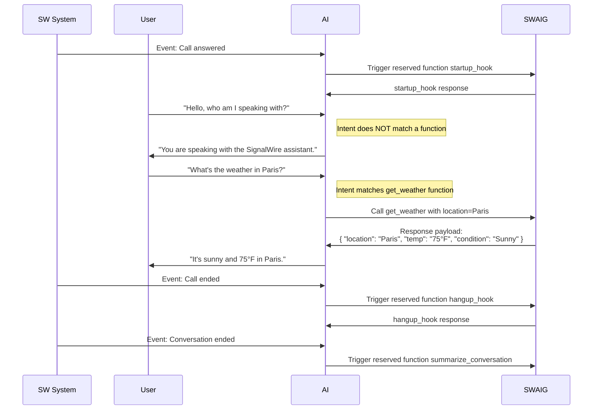

[reserved-functions]: #reserved-functions
[gates]: /docs/swml/reference/calling/ai/swaig/functions/gates
[post-prompt]: /docs/swml/reference/calling/ai#post_prompt

An array of JSON objects to define functions that can be executed during the interaction with the AI.

Each function needs somewhere to run: a `web_hook_url`, set on the function or inherited from
[`SWAIG.defaults.web_hook_url`](/docs/swml/reference/calling/ai/swaig#defaultsweb_hook_url), or a `data_map`.
A function with none of these is not added to the agent.

## **Properties**

<ParamField path="SWAIG.functions" type="object[]" toc={true}>
  An array of JSON objects that accept the following properties.
</ParamField>

<Indent>

<ParamField path="functions[].description" type="string" required={true} toc={true}>
  A description of the context and purpose of the function, to explain to the agent when to use it.
</ParamField>


<ParamField path="functions[].function" type="string" required={true} toc={true}>
  A unique name for the function. This can be any user-defined string or can reference a reserved function. Reserved functions are SignalWire functions that will be executed at certain points in the conversation. To learn more about reserved functions, see [Reserved Functions][reserved-functions].
</ParamField>


<ParamField path="functions[].active" type="boolean" default="true" toc={true}>
  Whether the function is active.
</ParamField>


<ParamField path="functions[].data_map" type="object" toc={true}>
  An object that processes function inputs and executes operations through expressions, webhooks, or direct output. Properties are evaluated in strict priority order: (1) expressions, (2) webhooks, (3) output. Evaluation stops at the first property that returns a valid output result, similar to a return statement in a function.

  See [`data_map`](/docs/swml/reference/calling/ai/swaig/functions/data-map) for additional details.
</ParamField>


<ParamField path="functions[].parameters" type="object" toc={true}>
  A JSON object that defines the expected user input parameters and their validation rules for the function.

  See [`parameters`](/docs/swml/reference/calling/ai/swaig/functions/parameters) for additional details.
</ParamField>


<ParamField path="functions[].fillers" type="object" toc={true}>
  An object containing language-specific arrays of filler phrases that are played when calling a SWAIG function. These fillers help break silence between responses and are played asynchronously during the function call. Each key is a [language code](/docs/swml/reference/calling/ai/swaig#filler-language-codes) and each value is an array of filler phrases selected from randomly.
</ParamField>


<ParamField path="functions[].skip_fillers" type="boolean" default="false" toc={true}>
  Skips the top-level fillers specified in [`ai.languages`](/docs/swml/reference/calling/ai/languages) (which includes `speech_fillers` and `function_fillers`). When set to `true`, only function-specific fillers defined directly on [`SWAIG.functions.fillers`](/docs/swml/reference/calling/ai/swaig/functions) will play.
</ParamField>


<ParamField path="functions[].meta_data" type="object" toc={true}>
  A powerful and flexible environmental variable which can accept arbitrary data that is set initially in the SWML script or from the SWML [`set_meta_data` action](/docs/swml/reference/calling/ai/swaig/functions/data-map#actions). This data can be referenced **locally** to the function. All contained information can be accessed and expanded within the prompt - for example, by using a template string.
</ParamField>


<ParamField path="functions[].meta_data_token" type="string" default="Set by SignalWire" toc={true}>
  Scoping token for `meta_data`. If not supplied, metadata will be scoped to function's `web_hook_url`.
</ParamField>


<ParamField path="functions[].wait_file" type="string" toc={true}>
  A file to play while the function is running. `wait_file_loops` can specify the amount of times that files should continously play.
</ParamField>


<ParamField path="functions[].wait_file_loops" type="string | integer" toc={true}>
  The amount of times that `wait_file` should continuously play/loop.
</ParamField>


<ParamField path="functions[].wait_for_fillers" type="boolean" default="false" toc={true}>
  Whether to wait for fillers to finish playing before continuing with the function.
</ParamField>


<ParamField path="functions[].web_hook_url" type="string" toc={true}>
  Function-specific URL to send status callbacks and reports to. Takes precedence over a default setting. Authentication can also be set in the url in the format of `username:password@url`. Credentials embedded in the URL take precedence over `web_hook_auth_user` and `web_hook_auth_password`.
</ParamField>


<ParamField path="functions[].web_hook_auth_user" type="string" toc={true}>
  Username for basic auth on this function's webhook. Falls back to `defaults.web_hook_auth_user`.
</ParamField>


<ParamField path="functions[].web_hook_auth_password" type="string" toc={true}>
  Password for basic auth on this function's webhook. Falls back to `defaults.web_hook_auth_password`.
</ParamField>


<ParamField path="functions[].gates" type="object[]" toc={true}>
  [Semantic gates][gates]: 1 to 8 yes/no questions about the call that must all pass before the function runs. When any gate fails, the function doesn't run, and the AI gets the first failing gate's `on_fail` response instead. A gated function needs a `description` and a `web_hook_url` (its own or from `SWAIG.defaults`) or a `data_map`. If any gate is invalid, the function isn't added to the agent at all.

  See [`gates`][gates] for additional details.
</ParamField>


<ParamField path="functions[].gate_fillers" type="object" toc={true}>
  What the agent says while the function's gates are checked, shaped like [`fillers`](#functionsfillers). Ignored on a function without `gates`.
</ParamField>


<ParamField path="functions[].fillers_at_gates" type="boolean" toc={true}>
  For a gated function without `gate_fillers`, whether its `fillers` play as soon as the AI calls it, during the gate check (`true`), or only after the gates pass (`false`). Set it to `false` when the function's fillers announce the action ("OK, cancelling your account now"), so the caller doesn't hear them before a gate blocks it. When unset, the function inherits [`SWAIG.defaults.fillers_at_gates`](/docs/swml/reference/calling/ai/swaig#defaultsfillers_at_gates), which is `true` unless you change it.
</ParamField>


<ParamField path="functions[].visual_input" type="boolean | integer" toc={true}>
  How many of the caller's newest video frames your `web_hook_url` receives with the function call, as `visual_input` in the request body: `true` is `1`, a whole number from `0` to `5`, and `false` or `0` is none. On a gated function, the frames are taken when its gates are checked, never later, and a blocked call sends none. Ignored on a `data_map` function.
</ParamField>


<ParamField path="functions[].purpose" type="string" deprecated={true} toc={true}>
  Deprecated. Use `description` instead.
</ParamField>


<ParamField path="functions[].argument" type="object" deprecated={true} toc={true}>
  Deprecated. Use `parameters` instead.
</ParamField>


<ParamField path="functions[].web_hook_auth_pass" type="string" deprecated={true} toc={true}>
  Password for basic auth on this function's webhook. Deprecated — use `web_hook_auth_password` instead.
  The alias is used only when `web_hook_auth_password` is not set. The same fallback applies on `SWAIG.defaults`.
</ParamField>


</Indent>

## Tool webhook

When the agent calls one of your SWAIG functions, the platform sends an HTTP `POST` to that function's
`web_hook_url` (or the SWAIG `defaults.web_hook_url`). Your endpoint runs the function and returns a JSON
object with a `response` string (the result the AI reads next) and, optionally, an `action` — a single
object or an array — telling the agent what to do.

### Request

<Schema type="Webhooks.AI.AiSwaigToolWebhookPayload" api="signalwire-rest" showDescription />

<llms-ignore>

<WebhookPayloadSnippet webhook="aiSwaigToolWebhook" />

</llms-ignore>

See the [AI SWAIG tool webhook](/docs/apis/rest/webhooks/ai-swaig-tool-webhook) webhook page for the full field reference.

### Reply

Return a JSON object with a `response` key and an optional `action` key. The `response` is the text
the AI reads next, and `action` carries SWML-compatible objects that change what the call does next.

<Markdown src="/snippets/swml/_swaig-response-fields.mdx" />

<Indent>

<Markdown src="/snippets/swml/_actions.mdx" />

</Indent>

```json
{
  "response": "Oh wow, it's 82.0°F in Tulsa. Bet you didn't see that coming! Humidity at 38%. Your hair is going to love this! Wind speed is 2.2 mph. Hold onto your hats, or don't, I'm not your mother! Looks like Sunny. Guess you'll survive another day.",
  "action": [
    {
      "set_meta_data": {
        "temperature": 82.0,
        "humidity": 38,
        "wind_speed": 2.2,
        "weather": "Sunny"
      }
    },
    {
      "SWML": {
        "version": "1.0.0",
        "sections": {
          "main": [
            {
              "play": {
                "url": "https://example.com/twister.mp3"
              }
            }
          ]
        }
      }
    }
  ]
}
```

## **Variables**

SWAIG functions don't set SWML variables of their own. The `ai` method sets
[`ai_result`](/docs/swml/reference/calling/ai#variables) when the agent ends.

## **Reserved Functions**

Reserved functions are special SignalWire functions that are automatically triggered at specific points during a conversation.
You define them just like any other SWAIG function, but their names correspond to built-in logic on the SignalWire platform,
allowing them to perform specific actions at the appropriate time.

<Warning title="Function name conflicts">
Do not use reserved function names for your own SWAIG functions unless you want to use the reserved function's built-in behavior.
Otherwise, your function may not work as expected.
</Warning>

### List of Reserved Functions

<ParamField path="startup_hook" type="function" toc={true}>
  Triggered when the call is answered. Sends the set properties of the function to the defined `web_hook_url`.
</ParamField>


<ParamField path="hangup_hook" type="function" toc={true}>
  Triggered when the call is ended. Sends the set properties of the function to the defined `web_hook_url`.
</ParamField>


<ParamField path="summarize_conversation" type="function" toc={true}>
  Triggered when the call is ended. The [`post_prompt`][post-prompt] must be defined for this function to be triggered. Provides a summary of the conversation and any set properties to the defined `web_hook_url`.
</ParamField>


<Warning title="Where are my function properties?">
If the AI is not returning the properties you set in your SWAIG function, it may be because a reserved function was triggered before
those properties were available. To ensure your function receives all necessary information, make sure the AI has access to the
required property values before the reserved function is called. Any property missing at the time the reserved function runs will
not be included in the data sent back.
</Warning>

## Diagram examples



## SWML **Examples**

### Using SWAIG Functions

<CodeBlocks>
<CodeBlock title="YAML">
```yaml
version: 1.0.0
sections:
  main:
    - ai:
        post_prompt_url: "https://example.com/my-api"
        prompt:
          text: |
            You are a helpful assistant that can provide information to users about a destination.
            At the start of the conversation, always ask the user for their name.
            You can use the appropriate function to get the phone number, address,
            or weather information.
        post_prompt:
          text: "Summarize the conversation."
        SWAIG:
          includes:
            - functions:
                - get_phone_number
                - get_address
              url: https://example.com/functions
              auth_user: me
              auth_password: secret
          defaults:
            web_hook_url: https://example.com/my-webhook
            web_hook_auth_user: me
            web_hook_auth_password: secret
          functions:
            - function: get_weather
              description: To determine what the current weather is in a provided location.
              parameters:
                properties:
                  location:
                    type: string
                    description: The name of the city to find the weather from.
                type: object
            - function: summarize_conversation
              description: Summarize the conversation.
              parameters:
                type: object
                properties:
                  name:
                    type: string
                    description: The name of the user.
```
</CodeBlock>
<CodeBlock title="JSON">
```json
{
  "version": "1.0.0",
  "sections": {
    "main": [
      {
        "ai": {
          "post_prompt_url": "https://example.com/my-api",
          "prompt": {
            "text": "You are a helpful assistant that can provide information to users about a destination.\nAt the start of the conversation, always ask the user for their name.\nYou can use the appropriate function to get the phone number, address,\nor weather information.\n"
          },
          "post_prompt": {
            "text": "Summarize the conversation."
          },
          "SWAIG": {
            "includes": [
              {
                "functions": [
                  "get_phone_number",
                  "get_address"
                ],
                "url": "https://example.com/functions",
                "auth_user": "me",
                "auth_password": "secret"
              }
            ],
            "defaults": {
              "web_hook_url": "https://example.com/my-webhook",
              "web_hook_auth_user": "me",
              "web_hook_auth_password": "secret"
            },
            "functions": [
              {
                "function": "get_weather",
                "description": "To determine what the current weather is in a provided location.",
                "parameters": {
                  "properties": {
                    "location": {
                      "type": "string",
                      "description": "The name of the city to find the weather from."
                    }
                  },
                  "type": "object"
                }
              },
              {
                "function": "summarize_conversation",
                "description": "Summarize the conversation.",
                "parameters": {
                  "type": "object",
                  "properties": {
                    "name": {
                      "type": "string",
                      "description": "The name of the user."
                    }
                  }
                }
              }
            ]
          }
        }
      }
    ]
  }
}
```
</CodeBlock>
</CodeBlocks>
