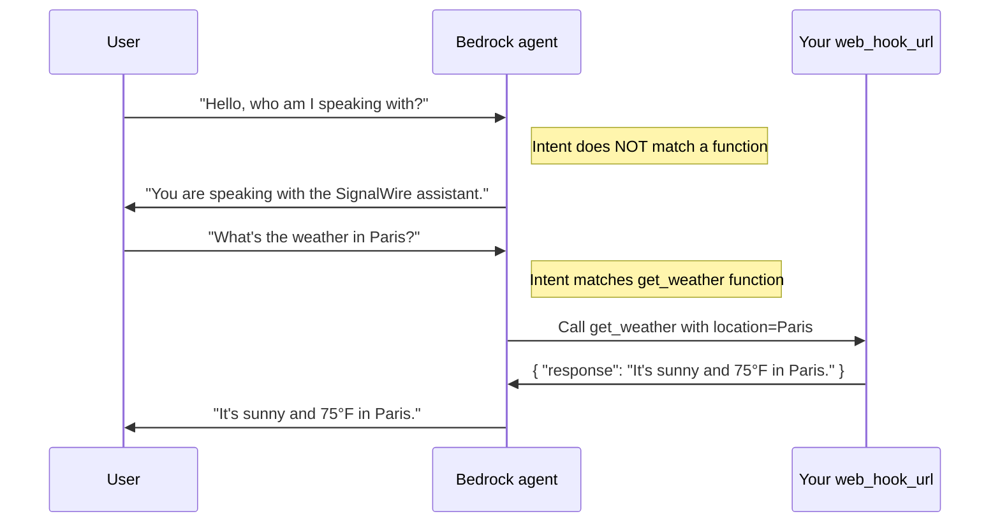

[reserved-functions]: #reserved-function-names
[post-prompt]: /docs/swml/reference/calling/amazon-bedrock#post_prompt
[post-prompt-url]: /docs/swml/reference/calling/amazon-bedrock#post_prompt_url-callback

An array of JSON objects to define functions that can be executed during the interaction with the Amazon Bedrock agent.

## **Properties**

<ParamField path="SWAIG.functions" type="object[]" toc={true}>
  An array of JSON objects that accept the following properties.
</ParamField>

<Indent>

<ParamField path="functions[].description" type="string" required={true} toc={true}>
  A description of the context and purpose of the function, to explain to the agent when to use it.
</ParamField>


<ParamField path="functions[].function" type="string" required={true} toc={true}>
  A unique name for the function. The agent calls the function by this name. The name `summarize_conversation` is
  reserved for the end-of-call summary; see [Reserved function names][reserved-functions].
</ParamField>


<ParamField path="functions[].data_map" type="object" toc={true}>
  An object containing properties to process or validate the input, perform actions based on the input, or connect to external APIs or services in a serverless fashion.

  See [`data_map`](/docs/swml/reference/calling/amazon-bedrock/swaig/functions/data-map) for additional details.
</ParamField>


<ParamField path="functions[].parameters" type="object" toc={true}>
  A JSON object that defines the expected user input parameters and their validation rules for the function.

  See [`parameters`](/docs/swml/reference/calling/amazon-bedrock/swaig/functions/parameters) for additional details.
</ParamField>


<ParamField path="functions[].meta_data" type="object" toc={true}>
  Data for this function. It is sent with each call to the function's `web_hook_url` and is available to its
  [`data_map`](/docs/swml/reference/calling/amazon-bedrock/swaig/functions/data-map) templates under
  `session_data.meta_data`. Functions that share a `meta_data_token` share one set of metadata.
</ParamField>


<ParamField path="functions[].meta_data_token" type="string" toc={true}>
  Scoping token for `meta_data`. Functions that set the same token share their metadata. When omitted, the metadata is
  scoped to this function's name, so it is not shared with other functions.
</ParamField>


<ParamField path="functions[].web_hook_url" type="string" toc={true}>
  Function-specific URL that receives calls to this function. Takes precedence over `defaults.web_hook_url`. Authentication can also be set in the url in the format of `username:password@url`.
</ParamField>


</Indent>

## Tool webhook

When the agent calls one of your SWAIG functions, the platform sends an HTTP `POST` to that function's
`web_hook_url` (or the SWAIG `defaults.web_hook_url`). Your endpoint runs the function and returns a JSON
object with a `response` string (the result the agent reads next) and, optionally, an `action` — a single
object or an array — telling the agent what to do once it has spoken its reply.

### Request

<Schema type="Webhooks.AI.BedrockSwaigToolWebhookPayload" api="signalwire-rest" showDescription />

<Note>
This payload differs from the one an [`ai`](/docs/swml/reference/calling/ai) agent sends. `content_type`
is `text/json` rather than `text/swaig`, `argument` carries no `substituted` value, and there is no
`version`, `description`, or `argument_desc`. The caller's number arrives as `caller_id` (and as
`caller_id_number` when the call has a caller profile) rather than `caller_id_num`.
Write your handler against this list, not the `ai` one.
</Note>

<llms-ignore>

<WebhookPayloadSnippet webhook="bedrockSwaigToolWebhook" />

</llms-ignore>

See the [Amazon Bedrock SWAIG tool webhook](/docs/apis/rest/webhooks/bedrock-swaig-tool-webhook)
webhook page for the full field reference.

### Reply

Return a JSON object with an optional `response` key and an optional `action` key. The `response` is the
text the agent reads next, and `action` carries SWML-compatible objects that change what the call does next.

<ParamField path="response" type="string" toc={true}>
  The result the agent reads next. When it is absent or not a string, the agent reads `Function completed.` and
  carries on.
</ParamField>

<ParamField path="action" type="object | object[]" toc={true}>
  An action, or a list of actions, for the agent to run once it has spoken its reply.
</ParamField>

<Indent>

<Markdown src="/snippets/swml/_bedrock-swaig-actions.mdx" />

</Indent>

<Note>
Bedrock agents accept a smaller set of actions than [`ai`](/docs/swml/reference/calling/ai) agents.
The six above are the whole list: there is no `say`, `stop`, `hangup`, `hold`, `toggle_functions`,
`context_switch`, `change_context`, `change_step`, `user_input`, `playback_bg`, or `stop_playback_bg`.
An unrecognized key in `action` is ignored rather than reported as an error, so a payload written for
an `ai` agent fails quietly here.
</Note>

```json
{
  "response": "It's 82°F and sunny in Tulsa, with 38% humidity and a 2.2 mph wind.",
  "action": [
    {
      "set_meta_data": {
        "temperature": 82.0,
        "humidity": 38,
        "wind_speed": 2.2,
        "weather": "Sunny"
      }
    }
  ]
}
```

## Reserved function names

A Bedrock agent runs none of your functions automatically: every function you define is offered to the agent, which
calls it when the conversation needs it. The one reserved name is `summarize_conversation`.

<ParamField path="summarize_conversation" type="string" toc={true}>
  Reserved for the summary written when the conversation ends. A function with this name is not offered to the agent
  during the call. The summary is written only when [`post_prompt_url`][post-prompt-url] is set, and is sent to that
  URL. [`post_prompt`][post-prompt] supplies the summary instructions; when it is omitted, a default instruction is
  used.
</ParamField>

## Diagram example



## SWML **Examples**

### Using SWAIG Functions

<CodeBlocks>
<CodeBlock title="YAML">
```yaml
version: 1.0.0
sections:
  main:
    - amazon_bedrock:
        post_prompt_url: "https://example.com/my-api"
        prompt:
          text: |
            You are a helpful assistant that can provide information to users about a destination.
            At the start of the conversation, always ask the user for their name.
            You can use the appropriate function to get weather information.
        post_prompt:
          text: "Summarize the conversation."
        SWAIG:
          defaults:
            web_hook_url: https://example.com/my-webhook
          functions:
            - function: get_weather
              description: To determine what the current weather is in a provided location.
              parameters:
                properties:
                  location:
                    type: string
                    description: The name of the city to find the weather from.
                type: object
            - function: summarize_conversation
              description: Summarize the conversation.
              parameters:
                type: object
                properties:
                  name:
                    type: string
                    description: The name of the user.
```
</CodeBlock>
<CodeBlock title="JSON">
```json
{
  "version": "1.0.0",
  "sections": {
    "main": [
      {
        "amazon_bedrock": {
          "post_prompt_url": "https://example.com/my-api",
          "prompt": {
            "text": "You are a helpful assistant that can provide information to users about a destination.\nAt the start of the conversation, always ask the user for their name.\nYou can use the appropriate function to get weather information.\n"
          },
          "post_prompt": {
            "text": "Summarize the conversation."
          },
          "SWAIG": {
            "defaults": {
              "web_hook_url": "https://example.com/my-webhook"
            },
            "functions": [
              {
                "function": "get_weather",
                "description": "To determine what the current weather is in a provided location.",
                "parameters": {
                  "properties": {
                    "location": {
                      "type": "string",
                      "description": "The name of the city to find the weather from."
                    }
                  },
                  "type": "object"
                }
              },
              {
                "function": "summarize_conversation",
                "description": "Summarize the conversation.",
                "parameters": {
                  "type": "object",
                  "properties": {
                    "name": {
                      "type": "string",
                      "description": "The name of the user."
                    }
                  }
                }
              }
            ]
          }
        }
      }
    ]
  }
}
```
</CodeBlock>
</CodeBlocks>
